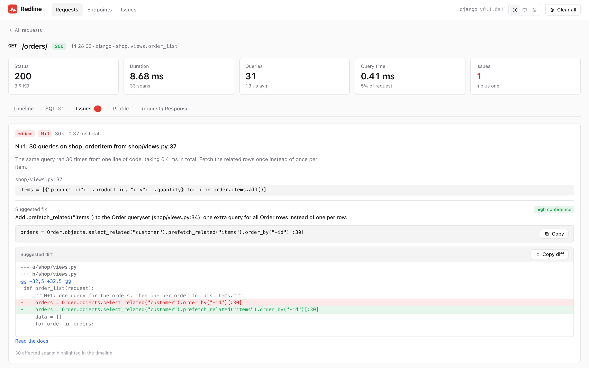

<div align="center">

<a href="https://pythondeveloper6.github.io/redline/">
  <picture>
    <source media="(prefers-color-scheme: dark)" srcset="docs/assets/logo-dark.svg">
    
  </picture>
</a>

**A request profiler, backend analyzer and load tester for Django, FastAPI, Flask and Litestar.**<br>
See inside every request: N+1 queries with a fix diff, one-click EXPLAIN, flamegraphs, and a
load test that shows which query broke.

[](https://github.com/Pythondeveloper6/redline)
[](https://github.com/Pythondeveloper6/redline/tree/main/packages/django-redline)
[](https://github.com/Pythondeveloper6/redline/tree/main/packages/fastapi-redline)
[](https://github.com/Pythondeveloper6/redline/tree/main/packages/flask-redline)
[](https://github.com/Pythondeveloper6/redline/tree/main/packages/litestar-redline)
[](https://github.com/Pythondeveloper6/redline/actions/workflows/ci.yml)
[](https://github.com/Pythondeveloper6/redline/blob/main/LICENSE)

[**Documentation**](https://pythondeveloper6.github.io/redline/) ·
[Getting started](https://pythondeveloper6.github.io/redline/getting-started/) ·
[Changelog](CHANGELOG.md) ·
[FAQ](https://pythondeveloper6.github.io/redline/faq/)

</div>

<picture>
  <source media="(prefers-color-scheme: dark)" srcset="docs/assets/screenshots/django-n-plus-one-dark.png">
  
</picture>

> **Development release: `0.5.0a2` (alpha).** This branch includes the next release's
> features; published packages can be an earlier version. Start with development or
> staging. Production use requires validation of your actual framework, database driver,
> traffic and process model: see the [deployment gate](docs/production.md).

Redline keeps request and job recordings on your own disk, connects slow or failing work
to your source, and lets you inspect it in a bundled browser UI. Use it to investigate a
single incident, find repeated database work, check a refactor, or compare releases.
The core has no required runtime dependencies; integrations and active tools are optional.

## Install

Choose your framework's published prerelease (the adapter installs its matching core):

```bash
pip install --pre django-redline
# Or: pip install --pre fastapi-redline
# Or: pip install --pre flask-redline
# Or: pip install --pre litestar-redline
```

Packages: [Django](https://pypi.org/project/django-redline/),
[FastAPI](https://pypi.org/project/fastapi-redline/),
[Flask](https://pypi.org/project/flask-redline/),
[Litestar](https://pypi.org/project/litestar-redline/),
[core](https://pypi.org/project/redline-core/). Each adapter pins the exact core version
it was tested with. Keep that pair aligned when adding core extras such as
`redline-core[profile,load]`.

To try **this branch's 0.4 features** before publication, use the local workspace:

```bash
git clone https://github.com/Pythondeveloper6/redline
cd redline
# Check out the development/release branch you intend to test.
uv sync --all-packages
```

Python 3.10+ for core/FastAPI/Flask/Litestar; Python 3.12+ for Django.
Framework requirements: Django 5.2–6.1, FastAPI 0.110+, Flask 3.0+, Litestar 2.12+;
the latter three use SQLAlchemy 2.x. Install the application's chosen database driver
separately. See [installation and optional integrations](docs/getting-started.md).

## Connect your app

These examples are for local development. Make a request to your application, then open
the Redline mount. An explicit `access="local"` permits loopback access only; it is not
a configuration for a public reverse proxy.

### Django

```python
# settings.py
INSTALLED_APPS = [..., "django_redline"]
MIDDLEWARE = [
    "django.middleware.security.SecurityMiddleware",
    "django_redline.middleware.RedlineMiddleware",
    ...,
]

# urls.py
from django.urls import include, path
urlpatterns = [..., path("redline/", include("django_redline.urls"))]
```

Open `/redline/` as an active superuser. Run `python manage.py check` to check setup.
Django Ninja and DRF use the same integration. [Django guide](docs/django.md).

### FastAPI

```python
from fastapi import FastAPI
from sqlalchemy import create_engine
from fastapi_redline import install

app = FastAPI()
engine = create_engine("sqlite:///app.db")
redline = install(app, engine=engine, settings={"access": "local"})
```

Open `/_redline/`. Sync and async SQLAlchemy engines are accepted; pass your application's
existing engine. [FastAPI guide](docs/fastapi.md).

### Flask

```python
from flask import Flask
from sqlalchemy import create_engine
from flask_redline import Redline

app = Flask(__name__)
engine = create_engine("sqlite:///app.db")
redline = Redline(app, engine=engine, settings={"access": "local"})
```

Open `/_redline/`. Flask-SQLAlchemy engines can be discovered automatically.
A Flask app mounted under FastAPI can explicitly share the outer recorder in nested mode.
[Flask guide](docs/flask.md) · [nested applications](docs/real-world-workflows.md#storage-and-mixed-frameworks).

### Litestar

```python
from litestar import Litestar
from sqlalchemy import create_engine
from litestar_redline import RedlinePlugin

engine = create_engine("sqlite:///app.db")
app = Litestar(
    route_handlers=[...],
    plugins=[RedlinePlugin(engine=engine, settings={"access": "local"})],
)
```

Open `/_redline/`. [Litestar guide](docs/litestar.md).
With no explicit access policy, the FastAPI/Flask/Litestar mount answers 404 outside debug
mode. Django uses its framework permission gate.

## Feature catalog

### Requests, source and performance

| Capability | What you can inspect or do |
|---|---|
| Request recordings | Method, route/view, status, duration, query counts, issue badges, filters, search and live mode |
| Timeline and source | Nested middleware/view/SQL/cache/template/serializer/transaction/outbound/custom spans, SQL fingerprints, project callsites and editor links |
| Request detail | Captured headers/bodies, logs, exception traceback/locals when enabled; compare recordings, copy cURL/HTTPie, replay allowed requests and download snapshots |
| N+1 and fix advice | Group repeated relation loads; Django `select_related`/`prefetch_related` and SQLAlchemy `joinedload`/`selectinload` suggestions, source diffs where the pattern can be located |
| Query correctness and cost | Duplicate/slow/over-budget queries, large and unbounded results, inefficient count/existence checks, repeated writes/scans, deep OFFSET and costly round trips |
| Application bottlenecks | Event-loop blocking, slow serializers, long transactions, HTTP calls inside transactions, large responses, many ORM instances, pool checkout waits, JSON/cache decoding hotspots |
| External calls and caches | Slow/duplicate outbound calls and retry storms; cache hit/miss patterns, stampedes and large entries, where instrumentation supplies evidence |
| GraphQL | Strawberry/Graphene integrations and resolver context for captured repeated queries |
| Custom instrumentation | Context-manager/decorator/async spans and application tags; optional client/database integrations |
| Profiling | Opt-in request flamegraphs and speedscope download; requires the `profile` extra |

Read [the UI guide](docs/the-ui.md), [detector reference](docs/detectors.md),
[performance workflows](docs/performance-workflows.md), [integrations](docs/integrations.md)
and [flamegraphs](docs/flamegraphs.md). Suggestions are reviewable advice; they do not
apply code changes or database indexes automatically.

### Plans, experiments and regression checks

| Capability | What it adds |
|---|---|
| EXPLAIN | Eligible captured read queries, plan findings and index suggestions; executable/actual plans require a separate opt-in |
| Database/workload view | Cross-recording SQL search, workload index advice, catalog evidence and unused-index observations where the database supports them |
| Load testing | CLI scenarios and an opt-in UI builder, stepped offered load, latency/error charts, saturation/knee detection and query/endpoint bottlenecks per step |
| Refactor checks | Record a read-only baseline, replay against a changed app, compare response structure, latency/query/N+1 behavior, emit a verdict and CI reports |
| Test and CI gates | Pytest query/issue/outbound budgets, SQL-error/session-leak/round-trip assertions; refactor-check JUnit and Markdown results |
| Static N+1 scan | Template/DRF serializer checks that complement runtime evidence |
| History and releases | Hourly retained-trace rollups, per-route percentiles and release comparisons with new/resolved issue groups |

[EXPLAIN](docs/explain.md) · [Database](docs/database.md) · [Load testing](docs/load-testing.md)
· [Refactor checks](docs/refactor-check.md) · [Static scan](docs/static-scan.md)
· [History](docs/history.md) · [CLI](docs/cli.md).

Active experiments belong in an owned development/staging environment. A read-only UI
setting alone does not make every form of database inspection or application replay safe.

### New in the 0.4 development release

| Capability | Evidence and boundaries |
|---|---|
| Caught SQL failures | SQL error spans and issues even when a handler returns HTTP 200; normalized vendors, SQLSTATE/native codes and categories when available; failure counts survive missing span evidence |
| Application failures | Group unhandled request/job exceptions by type and source; message/traceback/local capture can be disabled |
| Connection and session observations | Explicit/all-engine SQLAlchemy capture modes; connection age, creation/disconnect correlation, raw rowcounts, batch kinds, comment placeholders and observed session switches |
| SQL Server tooling | SQLAlchemy estimated/actual plan paths, Showplan analysis, statistics/catalog evidence, bracketed/batch SQL handling; capability and live-validation limits below |
| SQL checks | Import-free raw-SQL extraction/linting, baselines, JSON/JUnit output; explicit isolated online compilation and bounded schema snapshots for drift checks |
| Jobs | `job`, `stage`, `row_outcome`, TASK recordings and a Jobs UI; explicit Celery signal integration for execution/retry/failure and parent/request correlation |
| Correlation | Configurable request-ID headers, explicit user-ID resolver, job IDs and parent trace IDs; searchable labels, not credentials |
| Privacy controls | Shared-dev preset, SQL value capture policy, key/table profiles, route rules, logger filters, redaction preview and store audit |
| Multiple applications/workers | Explicit recorder ownership, separate templated stores, read-only secondary-store browsing and provenance; nested Flask/FastAPI recording |
| Capture limits | Bounded SQL/span/tag/trace capture, traversal/cycle handling, visible incomplete-evidence markers, queue drops and retained failure counters |
| Developer operations | Import checks, pytest completeness checks and explicit OTLP summary preview/export; no automatic exporter |

Detailed APIs, support boundaries and UI paths are in [Real-world workflows](docs/real-world-workflows.md).

### New in the 0.5 development release

| Capability | Evidence and boundaries |
|---|---|
| Safer setup | `redline init` writes a starter `redline.toml` and ignores the store; `install_if_dev(...)` in every adapter refuses to attach when the environment looks like production |
| CI gates | A composite GitHub Action runs `redline check` and keeps one sticky PR comment; `redline check ratchet` and pytest `--redline-ratchet` store per-endpoint query/latency baselines that only tighten |
| Shared store | `storage_url = "postgresql://..."` stores recordings for several workers or hosts in one PostgreSQL database; `redline doctor` flags a single SQLite file shared by workers or on a network filesystem |
| Runtime engines | `engines="auto"` captures SQLAlchemy engines created per user or per request; stored procedures (`EXEC`, `CALL`) are their own query kind, and session housekeeping (`sp_set_session_context`, `SET ...`) is ignored by default (`ignore_sql`) |
| Grouping | Flask requests carry their blueprint; `api/endpoints?group_by=blueprint` and `flask redline endpoints --group-by blueprint` aggregate per blueprint |
| Jobs | RQ, Dramatiq and FastAPI/Starlette background tasks are recorded as jobs linked to the request that queued them |
| Coverage | `auto_instrument` (`off`/`warn`/`on`) warns about, or instruments, installed httpx/requests/Redis/boto3 |
| Static analysis | More dynamic SQL resolved, unresolved inputs reported by reason, and a precision harness to measure the false-positive rate on your own code |
| Sharing and alerts | `redline export ID --html` writes one redacted, self-contained page; `redline digest` posts new issues to a webhook; `api/metrics` exposes recorder health for Prometheus; `redline_trace_id` links logs, Sentry events and OTLP spans to a recording |
| Release checks | Live MySQL qualification (pymysql, aiomysql, asyncmy) in CI; fresh-venv install and old-store upgrade checks against published releases |

Stability promises for these and older APIs are in [API stability](docs/api-stability.md).

## Real-life investigations

| Situation | How Redline helps | What the evidence does not prove |
|---|---|---|
| A list endpoint gets slower with more orders | Group repeated SQL at its callsite, inspect an N+1 loading suggestion, then compare a refactor | A suggested diff is not verified business logic |
| An API returns 200 but silently skips failed writes | Inspect caught SQL errors, structured codes and preserved failure counts | HTTP success does not certify database success; missing spans are incomplete evidence |
| A SQL Server import reports an unknown affected-row count | Inspect `rowcount_raw=-1`, batch kinds, captured errors and observed session switches | Unknown rowcount does not prove NOCOUNT is ON, a write failed or a 404 has that cause |
| An import commits rows, then fails in its summary stage | Inspect TASK stages, bounded row-outcome counts and observed commit-before-failure evidence | A commit observed before failure does not mean the entire job completed |
| A migration breaks raw SQL | Run offline SQL checks, then explicit compilation/schema snapshots against an isolated development database | Static extraction skips dynamic SQL; compilation cannot certify every runtime schema/permission path |
| A release increases p95 or creates an N+1 | Compare retained endpoint history, refactor-check results and recorded issue groups | Sampled/always-keep-slow recordings are not an unbiased production SLO |
| Shared-development recordings contain customer data | Disable SQL/body/log/error text capture, add application redaction rules, preview invented samples and audit the store | Key-pattern redaction and size limits cannot recognize every secret |
| Several codebases or web/worker processes use Redline | Give each app/environment private stores, credentials and explicit recorders; browse allowed worker stores read-only | Storage roles and request IDs do not create authorization or distributed tracing |

For a small worker/service without an HTTP request:

```python
from redline_core import Recorder, Settings, job, stage, row_outcome
from redline_core.storage import SQLiteStore

settings = Settings(storage_path="/tmp/redline-worker-demo.db", capture_locals=False)
store = SQLiteStore.from_settings(settings)
recorder = Recorder(settings, store)
try:
    with job("daily-import", recorder=recorder, task_id="run-123"):
        with stage("write"):
            row_outcome("succeeded")
        with stage("summary"):
            pass
finally:
    store.flush()
    store.close()
```

Instrument the worker's actual database engine separately. This is a local demonstration;
production jobs need the production capture/access/storage policy and lifecycle validation.

## Framework and database capabilities

| Integration | Recording | Plans/catalogs and qualification |
|---|---|---|
| Django + SQLite/PostgreSQL/MySQL | Native execute-wrapper SQL capture, handled errors, fetched-row evidence where supported | Existing Django plan paths; each deployed backend/driver/process combination still needs qualification |
| Django + SQL Server backend | Native wrapper evidence with normalized vendor naming; depends on the selected third-party backend | **Django SQL Server EXPLAIN is unsupported**; live backend/driver validation pending |
| FastAPI/Flask/Litestar + SQLAlchemy + SQLite/PostgreSQL/MySQL | Registered sync/async engine capture and optional engine discovery (`engines="auto"`) | Existing SQLAlchemy plan paths; live MySQL EXPLAIN, index advice and reconnect tests run in CI with pymysql, aiomysql and asyncmy; actual driver support differs by capability |
| FastAPI/Flask/Litestar + SQLAlchemy + SQL Server | SQL failure/session/connection evidence and SQL Server parsing support | **Experimental** plan/catalog support; actual-plan mode requires a supported sync multi-result driver; per-request engine capture is tested in the Compose suite; live Azure SQL and deployment qualification remain pending |
| Celery | Explicit worker recorder and signal integration; eager-mode coverage | Live broker, retries, prefork/restart and actual database driver behavior require deployment tests |

An explicit engine registry is the default. Opting into `instrument_engines="all"`
observes engines used by the active opted-in recorder; it does not establish that every
worker or raw driver cursor was captured. SQL values disabled, failed/incomplete SQL,
secondary-store recordings and unsupported executors cannot be used for EXPLAIN.
SQLite/fake-driver/parser tests do not establish live database behavior.

## Production recording and inspection

The intended production use is **recording and inspection of stored traffic**. Start with
an isolated canary, unique storage/credentials per codebase and an operator-only UI.
A local SQLite store is not a distributed monitoring service.

```toml
# redline.toml: provide REDLINE_TOKEN and REDLINE_SECRET_KEY via deployment secrets.
preset = "production"
access = "token"
storage_path = "/var/lib/redline/myapp-production/{role}.db"
storage_role = "web"
sample_rate = 0.01
capture_request_body = false
capture_response_body = false
capture_sql_params = false
capture_locals = false
capture_error_details = false
capture_logs = false
read_only = true
profile = "off"
load_from_ui = false
checks_from_ui = false
analysis_from_ui = false
explain_analyze = false

[features]
replay = false
replay_writes = false
load = false
checks = false
explain = false
profile = false
```

Review the effective config with `redline config` and run `redline doctor`. Explicit
settings override presets. Validate latency/memory, storage contention/full disk, capture
loss, privacy canaries, worker isolation and graceful shutdown with your actual drivers.
The production/shared-dev defaults disable bodies, SQL values, logs and exception details;
redaction is rule-based and storage is not encrypted. Keep files out of Git and the UI
behind authenticated access/TLS. [Production guide](docs/production.md) ·
[Security](docs/security.md) · [Access](docs/access-control.md) · [Storage](docs/storage.md).

## Commands for everyday work

```bash
redline config
redline doctor

# No application imports or database connection in offline mode:
redline check-sql app/ --dialect mssql --junit sql-results.xml
redline check-sql app/ --dialect mssql --write-baseline sql-baseline.json

# Explicit development target: executes module import code.
redline check-imports myapp.main:app

# Preview only; transmission needs --endpoint and --send.
redline export --store /path/to/redline.db
```

Load/refactor examples (install the matching core `load` extra and run against your own
staging app):

```bash
redline load init --from-traces -o scenario.toml
redline load scenario.toml --steps 10:100:10 --step-duration 20s
redline check init --from-traces -o checks/orders.toml
redline check record checks/orders.toml --label before
# Refactor and restart the application, then:
redline check compare checks/orders.toml --markdown report.md --junit report.xml
```

Set the correct `--store` and target base URL for the application you are testing.
Online SQL compilation and schema snapshots are explicit development-database operations;
see [the workflow guide](docs/real-world-workflows.md#explicit-online-compilation-and-schema-drift).
OTLP export currently sends selected recording summaries, not a complete distributed
span/log stream. [CLI reference](docs/cli.md) · [HTTP API](docs/http-api.md).

## Try the demos and help test

The [Flask](examples/flask/README.md), [FastAPI](examples/fastapi/README.md),
[Django](examples/django/README.md) and [Litestar](examples/litestar/README.md) demos include
seeded data and deliberately problematic endpoints. The Flask playground adds caught SQL
errors, job stages, mixed apps, privacy controls and guarded optional driver probes.

```bash
# From a checkout with uv sync --all-packages completed:
.venv/bin/python scripts/check_real_world_workflows.py

# Interactive Flask demo (its README lists all endpoints):
cd examples/flask
uv run --project ../.. python seed.py
uv run --project ../.. flask --app shop.main run --port 8012
# Open http://127.0.0.1:8012/_redline/
```

The [workflow harness](scripts/check_real_world_workflows.py) uses disposable local data
and in-process clients. It is a repeatable feature demonstration, not a substitute for
live SQL Server/MySQL, broker or deployment load testing. External-driver probes require
explicit disposable-database opt-in; follow the demo instructions.

Please try Redline on a real project in development or staging and tell us what happens.
[Open an issue for a bug or feature request](https://github.com/Pythondeveloper6/redline/issues/new)
with your framework, database and driver versions, the expected/actual behavior, and a
small **sanitized reproduction**. Never include tokens, credentials, private data or
unsanitized recordings. Report security vulnerabilities privately via [SECURITY.md](SECURITY.md).

For full integration testing, the [shared Docker stack](examples/testing/README.md)
provides PostgreSQL, MySQL, SQL Server, Redis, a Celery prefork worker and Chromium,
with complete package suites, live driver checks and browser flows in one command.
It also serves all four example UIs on loopback ports 8011–8014.

## Documentation and development

[Documentation site](https://pythondeveloper6.github.io/redline/) ·
[Configuration](docs/configuration.md) · [All settings](docs/settings.md) ·
[Real-world workflows](docs/real-world-workflows.md) · [Contributing](CONTRIBUTING.md) ·
[Changelog](CHANGELOG.md) · [Roadmap](docs/roadmap.md).

The repository contains five lockstep distributions in `packages/`, the React/TypeScript
UI source in `frontend/`, detailed guides in `docs/` and four runnable apps in `examples/`.
The built UI ships with the core wheel; build it from source when making UI changes.

```bash
uv sync --all-packages
uv run --with mkdocs-material mkdocs serve
uv run --with mkdocs-material mkdocs build --strict
```

Routine CI and documentation deployment run after pushes/merges to main. Publishing
follows successful main CI with an exact-version repository opt-in and the configured
release approvals. A local merge does not publish packages. See [RELEASING.md](RELEASING.md).

Redline remains alpha. API/settings/schema changes are possible; production readiness is
specific to a tested deployment. It has no distributed tracing, alerting or fleet-wide
store. WebSockets are not recorded; RQ/Dramatiq integrations are not implemented. Index
and source suggestions need review, and sampled history needs careful interpretation.

## Licence

Redline is available under the [MIT licence](LICENSE). Copyright &copy; 2026 Mahmoud Ahmed.
