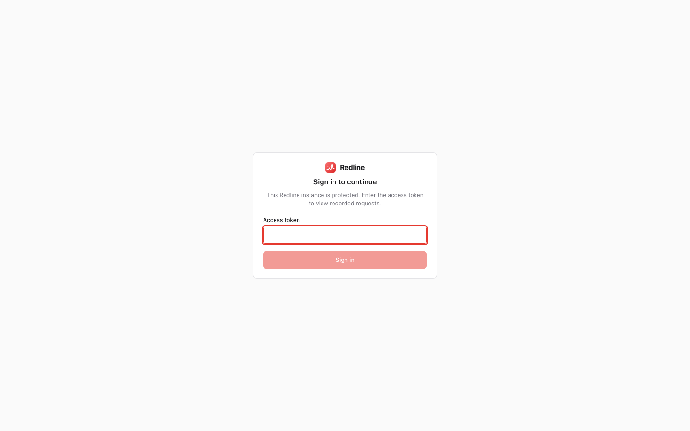
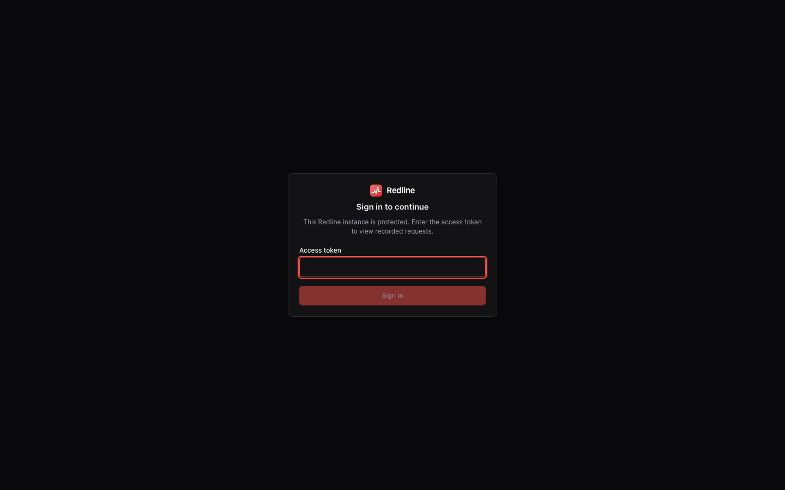

# Access control

[← Index](index.md)

The Redline UI shows SQL, request and response bodies, headers, source lines and exception
locals. Treat it like a database console. Who may open it is decided by **one policy**,
the same for every framework: `redline_core.access.check(request_info)` returns a decision,
and each adapter just asks it.

Two things always apply, whatever policy you pick: the **CSRF check** on every request
that is not a `GET`, `HEAD` or `OPTIONS` (login and logout included) and
**`X-Frame-Options: DENY`** on Redline's own responses. The CSRF check refuses
`Sec-Fetch-Site: cross-site` **and `same-site`**, and any `Origin` (the literal `null`
too) whose host and port differ from the host the request was addressed to; a request with
no `Origin` is not a browser and is allowed. It runs after the policy, so outsiders get the
policy's refusal first.

The order of the checks is: `ui_enabled` (off: `404`), the effective client address
(`trusted_proxies`), the network rules, the policy, feature switches and `read_only`, then
CSRF.

## Policies

Set `access` to one of:

| `access` | Who gets in | Typical use |
|---|---|---|
| `local` (default, see below) | loopback clients using a loopback `Host`, plus anything in `allowed_ips` | your laptop |
| `token` | a request with `Authorization: Bearer <token>`, or a browser that logged in with the token | staging, production, a shared server |
| `basic` | a user from `basic_users` (`Authorization: Basic`, or the login form) | a small team, behind a proxy that cannot do SSO |
| `framework` | the framework's own check: Django superusers or `PERMISSION`, FastAPI `dependencies`, Flask `permission`, Litestar `guards` | you already have an admin login |
| `custom` | whatever your `access_check(request_info) -> bool` returns | anything else |
| `open` | everyone | **refused** unless `REDLINE_ALLOW_OPEN=1` is also set |

The default is `local` for FastAPI, Flask and Litestar. In Django the default is
`framework`, meaning active **superusers** (staff in 0.1; see
[Django: access control](django.md#access-control)). Passing a native hook (a non-empty
FastAPI `dependencies=` or Litestar `guards=` list, a Flask `permission=` callable) switches
the default to `framework` for you, unless you set `access` yourself in the file, the
environment or the framework settings (a preset does not count). An empty list is the same
as no hook.

!!! warning "Set `access` explicitly (FastAPI, Flask, Litestar)"

    While `access` is not set anywhere (code, `redline.toml`, `REDLINE_ACCESS`), Redline
    serves the `local` default **only when the framework is in debug mode** (`app.debug`,
    for example `FastAPI(debug=True)`, `flask --debug run` or `Litestar(debug=True)`).
    Otherwise every Redline URL answers `404` and an error is logged at startup. The
    reason: a reverse proxy on the same host that adds no `X-Forwarded-For`
    (`proxy_pass http://127.0.0.1:8000;` with no `proxy_set_header`) makes every visitor a
    loopback client addressing a loopback `Host`, so `local` would let the whole internet
    in. Choose: `access = "token"` or `"basic"` on any server, or `access = "local"` on a
    development machine where you accept that risk.


### Local

Only loopback clients (`127.0.0.0/8`, `::1`) that address the server by a
loopback name (`localhost`, `*.localhost`, `127.0.0.1`, `[::1]`, any port) are served. The
`Host` check defeats DNS rebinding: a malicious page cannot make your browser talk to
`evil.example`, resolve it to `127.0.0.1`, and read your traces. `allowed_ips` adds client
networks, and `allowed_hosts` adds accepted `Host` values (ports are ignored).

If a loopback peer sends `X-Forwarded-For`, `X-Real-IP` or `Forwarded` and is **not** in
`trusted_proxies`, the request is refused with `403 forbidden`, and `api/config` carries a
warning. A reverse proxy running on the same host would otherwise make every visitor look
local. Set `trusted_proxies` (see [Network restrictions](#network-restrictions)) or use
`token`.

A **unix-socket** peer (the app listens on a socket, so there is no client address) is not
local: a proxy on the same machine is the usual reason for one. Set
`trust_unix_socket = true` if only you can reach that socket.

### Token

```bash
REDLINE_ACCESS=token
REDLINE_TOKEN=$(openssl rand -hex 32)       # or token_file=/run/secrets/redline_token
```

Clients send `Authorization: Bearer <token>`. In a browser, the UI shows a **login screen**
when the API answers `401 login_required`; you paste the token once, and Redline sets an
HttpOnly, SameSite=Strict cookie (`Secure` when the effective scheme is https, see
`cookie_secure`) scoped to
its own mount path, valid for `session_ttl_s` (12 hours by default). The token is compared
as SHA-256 digests in constant time and is never logged or shown, not even on the Settings
page. The page shell and its assets (and `badge.js`) are public because they hold no data;
**every `api/` call needs credentials**.

Outside the `dev` preset the token must be at least 24 characters, or Redline refuses to
start and prints a command to generate one. A `token_file` is read once at startup; keep its
permissions to the owner only (`redline doctor` warns otherwise).

```bash
curl -H "Authorization: Bearer $REDLINE_TOKEN" https://staging.example.com/_redline/api/meta
```

A failed credential (login body, Bearer or Basic) counts against the client address.
After `max_login_attempts` (10) within 300 seconds, further credential attempts from that
address answer `429 too_many_requests` with `Retry-After`; a success resets it, and
requests carrying a valid session cookie are never limited. The counters are in memory and
per process. Behind a proxy without `trusted_proxies` all clients share one bucket
(`redline doctor` warns).

!!! warning "Several worker processes need `secret_key`"

    Login cookies are signed with `secret_key`. When it is unset each process generates a
    random key, so a login only works on the worker that issued it and every restart logs
    everyone out. Set `secret_key` (16 characters or more, for example
    `REDLINE_SECRET_KEY`) for any multi-worker deployment. Rotating the key, the token or
    a password revokes all sessions. Logout clears the cookie **and revokes that session**
    in the process that answered: the cookie is refused there until it would have expired.
    The revocation list lives in memory, so with several worker processes another worker
    still accepts a copy of the cookie until it expires (or until you rotate
    `secret_key`).

`cookie_secure` decides the cookie's `Secure` attribute: `"auto"` (default) sets it when
the request is https, which includes `X-Forwarded-Proto: https` from a peer in
`trusted_proxies`; `true` always sets it (use it when TLS ends at a proxy you have not
listed); `false` never does.

A refused API call answers `401 login_required` (no credentials) or `401
invalid_credentials` (wrong ones). Both carry a `WWW-Authenticate` header, unless the
request has `X-Redline-UI: 1` (the UI and `badge.js` send it) so browsers do not pop up
their own dialog.

### Basic

```bash
redline hash-password            # prompts, prints a PBKDF2-SHA256 hash
```

```toml
# redline.toml
access = "basic"

[basic_users]
alice = "pbkdf2_sha256$..."      # the output of redline hash-password
```

Passwords are stored only as hashes: `pbkdf2_sha256$<iterations>$<salt>$<hash>`, 600 000
iterations by default (`redline hash-password --iterations N`; 1 000 is the minimum
accepted, and `redline doctor` warns below 100 000). A plain password in `basic_users` is
rejected at startup. Unknown users still cost a hash computation, so response time does
not reveal which users exist. The browser UI shows a username and password form; scripts
may send `Authorization: Basic`. Use it behind HTTPS only: basic credentials are sent on
every request, and sessions need `secret_key` with several workers, as for tokens.

### Framework

Use your application's existing authentication and let Redline defer to it. With no hook
configured the request is refused (`403 forbidden`). Each framework exposes its native hook,
and passing it implies `access = "framework"`:

=== "Django"

    ```python
    REDLINE = {"ACCESS": "framework", "PERMISSION": "myproject.redline.can_view"}
    ```

    Default: `user.is_active and user.is_superuser` (staff before 0.2). See [Django: access control](django.md#access-control).

=== "FastAPI"

    ```python
    install(app, engine=engine, dependencies=[Depends(require_admin)])
    ```

    See [FastAPI: access control](fastapi.md#access-control).

=== "Flask"

    ```python
    Redline(app, permission=lambda request: current_user.is_admin)
    ```

=== "Litestar"

    ```python
    RedlinePlugin(guards=[require_admin])
    ```

### Custom

```python
def can_view(request_info) -> bool:
    return request_info.headers.get("x-internal-user") in ALLOWED

REDLINE = {"ACCESS": "custom", "ACCESS_CHECK": can_view}   # or "myproject.redline:can_view"
```

`request_info` has `method`, `path` (relative to the mount), `client_ip` (after
`trusted_proxies`), lower-cased `headers`, `cookies`, `host`, `scheme` and `mount`. If
your function raises, the error is logged and the request is refused.

### Open

`access = "open"` serves the UI to everyone. Without `REDLINE_ALLOW_OPEN=1` in the
environment every request is answered `403 open_refused` and an error is logged at
startup. With it, Redline serves the UI and logs a warning at startup and then at most
once a minute. It exists for
sealed environments (a throwaway container, a network you control completely). Do not use
it on anything reachable from the internet.

## Network restrictions

These apply **in addition to** the policy:

| Setting | Effect |
|---|---|
| `allowed_ips` | IPs and CIDRs (v4 or v6). With `local` it **widens** access: loopback plus these (for example a VPN range `10.8.0.0/16`). With `token`, `basic`, `framework`, `custom` and `open` it **restricts**: when non-empty the client must also be in it, and loopback is not implicit |
| `allowed_hosts` | extra `Host` values accepted by `local`'s DNS-rebinding check |
| `trusted_proxies` | IPs and CIDRs of reverse proxies. **Only** requests whose TCP peer is in this list have `X-Forwarded-For`, `X-Forwarded-Proto` and `X-Forwarded-Host` believed |

`trusted_proxies` matters. If you do not set it, the forwarding headers are ignored, so a
client cannot claim to be `127.0.0.1` by sending one. If you do set it, list only the
proxies you operate: `X-Forwarded-For` is read from the right, skipping trusted hops, and
the first untrusted address is the client. `Forwarded` (RFC 7239) is not parsed.

## Read-only mode

`read_only = True` refuses every state-changing `api/` call (anything but `GET`, `HEAD` and
`OPTIONS`) with `403 read_only`: deleting traces and runs, `POST api/runs`, stopping a run.
Login, logout and `POST api/explain` still work, but an `EXPLAIN` with `analyze: true` is
refused with `403 read_only`. Reads, plain EXPLAIN, search and exports still work. The
`production` [preset](configuration.md#presets) turns it on. `GET api/meta` reports
`access.read_only`, and the UI hides Clear all, ANALYZE and the run controls.

## Feature switches

`features` turns individual capabilities off. All default to on. A disabled feature's
routes answer `404 feature_disabled`, and the UI hides the matching controls (from
`GET api/meta`). Unknown names are an error.

| Switch | Turns off |
|---|---|
| `explain` | `POST api/explain` and the EXPLAIN drawer |
| `profile` | `api/traces/{id}/profile`, and the profile is left out of snapshots |
| `replay` | the Replay button (replay has no server route; it is a UI feature) |
| `snapshot` | `GET api/traces/{id}/snapshot` and the download button |
| `load` | the Load page and everything under `api/runs` |
| `logs` | log capture (the trace's `logs` is `[]`) and the Logs tab |
| `locals` | exception local variables (not captured, dropped from responses) |
| `sse` | `api/stream`; Live mode is hidden |

```toml
[features]
explain = false
replay = false
```

## Other access settings

| Setting | Default | Meaning |
|---|---|---|
| `ui_enabled` | `True` | If false, every Redline URL answers `404`; Redline **captures but does not serve** the UI or API |
| `mount_path` | `None` (then `/_redline`) | Where FastAPI, Flask and Litestar serve the UI when `prefix` / `url_prefix` / `path` is not passed. Django ignores it |
| `session_ttl_s` | `43200` | Login cookie lifetime |
| `max_login_attempts` | `10` | Failed credential attempts per client IP per 300 seconds |
| `secret_key` | `None` | Signs login cookies (see above) |
| `base_url` | `None` | Where load runs started from the UI go; see [Load testing](load-testing.md#starting-a-run-from-the-ui) |

## Login and API

{ .rl-shot .rl-only-light }
{ .rl-shot .rl-only-dark }

| Endpoint | Behaviour |
|---|---|
| `POST api/login` | body `{"token": "..."}` or `{"username": "...", "password": "..."}` (4 KiB at most); answers `200 {"ok": true, "expires_at": <epoch>}` and sets the cookie. Never redirects. `400 invalid_json` / `invalid_body`, `401 invalid_credentials`, `429 too_many_requests`; `404` under other policies |
| `POST api/logout` | answers `200 {"ok": true}` and clears the cookie, under any policy |
| `GET api/config` | `{preset, file, settings, sources, groups, warnings}`: the effective configuration with secrets as `***`, where each value came from, and risky-combination warnings |

An unauthenticated request to a `token` or `basic` instance gets `401 login_required`. The
UI reacts by showing its login screen. See [HTTP API](http-api.md#authentication-and-csrf).

## Recipes

### Local development

Run the app in debug mode and the default `local` policy serves
`http://localhost:8000/_redline/` to you and nobody else. Without debug mode (for example a
plain `uvicorn main:app`), set it yourself:

```python
install(app, engine=engine, settings={"access": "local"})   # or REDLINE_ACCESS=local
```

### Behind a VPN

You run a shared dev or staging box that only VPN users can reach. Add the VPN range:

```toml
access = "local"
allowed_ips = ["10.8.0.0/16"]
allowed_hosts = ["devbox.internal"]
```

Anyone on the VPN can open the UI with no login. If the VPN is wider than the people who
should see request bodies, use a token as well.

### Token in staging

```bash
REDLINE_PRESET=staging          # token access, 25% sampling, no locals
REDLINE_TOKEN=...               # from your secret store
```

Share the token with the team through your password manager. Rotate it by changing the
variable and restarting.

### Production, read-only

```bash
REDLINE_PRESET=production
REDLINE_TOKEN=...
```

Read-only, token-protected, 5% sampling plus slow requests and errors, no bodies, no
locals, no badge. Reach it through your VPN or an SSH tunnel as well; a token is a second
lock, not the only one. See [Production](production.md).

### Behind a reverse proxy

The proxy terminates TLS and forwards to the app. Without help, every request appears to
come from the proxy. Tell Redline which proxy to believe:

```toml
access = "token"
trusted_proxies = ["10.0.0.0/8"]       # your load balancer's network, not "0.0.0.0/0"
```

The proxy must set `X-Forwarded-For` and overwrite any value the client sent. Also set
`X-Forwarded-Proto` and `X-Forwarded-Host` (or pass the original `Host`) so the CSRF
`Origin` comparison sees the public host name and the login cookie gets `Secure` (or set
`cookie_secure = true`). Set
`secret_key` when you run several workers. Optionally, restrict `/_redline/` at the proxy to your office or VPN range, so the
app's check is the second line of defence:

```nginx
location /_redline/ {
    allow 10.8.0.0/16;
    deny  all;
    proxy_pass http://app;
}
```

### Kubernetes

Do not expose Redline through a public Ingress. Options, safest first:

1. **`kubectl port-forward`**. Reach it from your machine only, with `access = "local"`
   (set explicitly):

   ```bash
   kubectl port-forward deploy/shop 8000:8000
   # http://localhost:8000/_redline/
   ```

   `port-forward` makes the connection arrive from the pod's own loopback side, so the
   `local` policy lets you in as long as the app is not behind a proxy that adds
   forwarding headers. If the client address is not loopback, add it to `allowed_ips`.

2. **An internal Ingress or Service** reachable only from the cluster or VPN, with
   `access = "token"` and `trusted_proxies` set to the ingress controller's pod CIDR.

Keep the token in a `Secret`, mounted as `token_file`:

```yaml
env:
  - name: REDLINE_PRESET
    value: production
  - name: REDLINE_TOKEN_FILE
    value: /run/secrets/redline/token
volumeMounts:
  - { name: redline-token, mountPath: /run/secrets/redline, readOnly: true }
```

Remember that the store is a SQLite file **per pod**: use a volume if you want it to
survive restarts, and note that each replica has its own data
([Production](production.md#process-models)).

## What to read next

[Security](security.md) covers what is stored and the full threat model;
[Configuration](configuration.md) covers how these settings are supplied.
