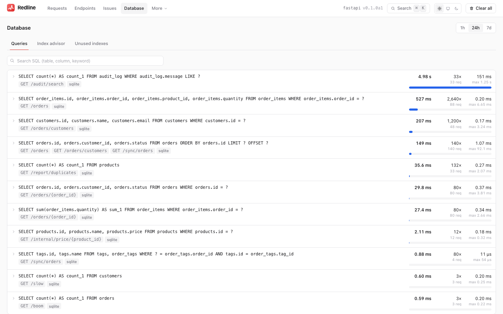
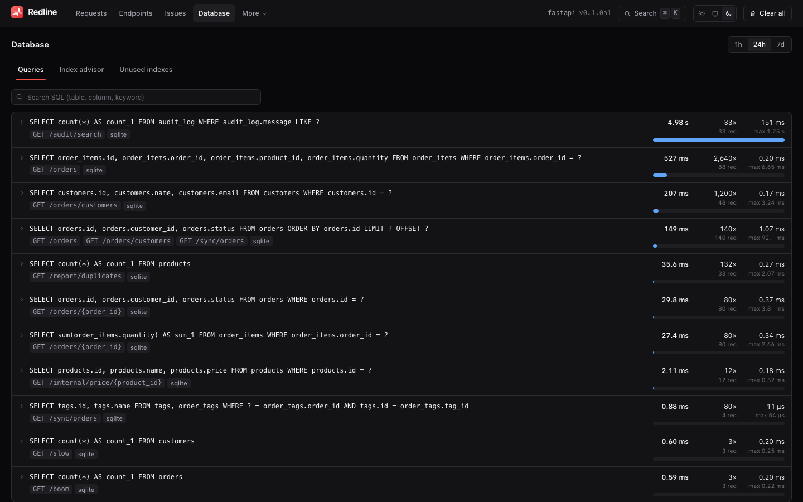

# Database

[← Index](index.md)

{ .rl-shot .rl-only-light }
{ .rl-shot .rl-only-dark }

The request detail page tells you what *one* request did to the database. The **Database**
page answers the questions that only make sense across all of them:

- Which SQL costs the most in total, even though no single execution is slow?
- Where is a given table or column used?
- Which index would help the *workload*, rather than a single query?
- Which indexes does nobody use?

It has three tabs: **Queries**, **Index advisor** and **Unused indexes**, with a window
picker (1 h, 24 h, 7 d) applying to all of them.

## Queries: SQL search

Every kept trace is summarised by SQL fingerprint at write time (the `trace_sql` table:
one row per trace and fingerprint with its count, total and maximum time, and rows). The
Queries tab aggregates those rows.

Each row is one **fingerprint**, the normalised statement with literals replaced by `?`:

| Column | Meaning |
|---|---|
| SQL | the normalised statement. Click to open a sample request on its SQL tab |
| Executions | how many times it ran in the window |
| Requests | how many traces ran it |
| Total | summed time, the default sort. A cheap query run a million times beats a rare slow one |
| Mean, max | per execution |
| Mean rows | rows per execution, where the driver reports them |
| Routes | which endpoints run it |

The search box matches the **normalised SQL** as a case-insensitive substring, so you can
type a table (`shop_order`), a column (`customer_id`) or a keyword (`LEFT JOIN`). It is the
fastest way to answer "where do we query this table?" and "does anything still use that
column before I drop it?".

The request list has the same filter: `GET api/traces?sql=shop_order` returns only
requests that ran a matching statement.

!!! note "Normalised, not raw"

    Search runs over the normalised statement, so you cannot search for a literal value
    (`WHERE id = 42`). That is deliberate: it is what lets thousands of executions
    collapse into one row, and it keeps parameter values out of the aggregate table.

## Index advisor

The EXPLAIN drawer already suggests an index for a single query. The **advisor** looks at
the whole recorded workload instead, and proposes the indexes that would help the most
queries at once.

How it works, in order:

1. It takes the 100 SELECT fingerprints that cost the most time in the window and works out,
   per table, which columns they filter and sort on: equality columns first (`=`, `IN`,
   `IS NULL`), then one range column (`<`, `BETWEEN`, a prefix `LIKE 'abc%'`) or, without a
   range, the `ORDER BY` columns. A leading-wildcard `LIKE` or an `ILIKE` becomes a
   text-search suggestion (`pg_trgm`, FTS5 or `FULLTEXT`) instead of a B-tree.
2. It reads the database's catalog, through the same always-rolled-back connection EXPLAIN
   uses, and drops every requirement an existing index already serves.
3. It runs a plain `EXPLAIN` (never `ANALYZE`) for the 20 heaviest remaining queries to see
   which tables are read by a sequential or full scan. Catalog and EXPLAIN share a
   three-second budget; what does not fit is left unverified.
4. It picks the smallest set of indexes, up to 10, that covers the most query time.

Nothing here ever runs DDL. For each candidate you see:

| Field | Meaning |
|---|---|
| Table, columns | the proposed index, with its columns in order |
| `CREATE INDEX` statement | ready to copy, for your database's dialect |
| Covers | the query fingerprints it would speed up |
| Executions | how often those queries ran in the window |
| Total time | what those queries cost in the window |
| Estimated saving | a heuristic: 80% of the covered time when EXPLAIN showed a scan of that table, 40% otherwise |
| Confidence | `high` when a scan was seen, `medium` for an unverified B-tree, `low` for text-search alternatives (not drop-in) and for queries that already avoid a full scan |

How to use it: take the top candidate, create the index on a **staging copy**, re-run the
[EXPLAIN](explain.md) for one of the covered queries, and compare. The advisor reads recorded
SQL, not table statistics, so it can suggest an index that the planner would not use
because the table is small or the column has few distinct values. Treat it as a ranked list
of things to check.

!!! warning "An index is not free"

    Every index slows down writes and takes disk. Do not create every suggestion.
    Prefer the ones that cover many queries, and look at the unused-index list before you
    add the tenth index to the same table.

If the store cannot compute the workload (a custom store without `sql_workload`), the tab
says the advisor is not available and the API answers `501 not_supported`.

## Unused indexes

On **PostgreSQL**, Redline lists indexes that have **never been scanned** since the
statistics were last reset (primary keys, unique indexes and indexes backing a constraint
are excluded):

| Column | Meaning |
|---|---|
| Table, index | what it is |
| Scans | how many times the planner has used it (0) |
| Size | disk it occupies |
| Copy DROP | the `DROP INDEX` statement |

Support is **PostgreSQL only** (it reads `pg_stat_user_indexes`). For SQLite and MySQL the
page says the detection is not supported (`unused_supported: false` in the API). If the
database connection for the alias is missing or the statistics query fails on PostgreSQL,
`unused_error` carries the reason.

The advisor result is cached for 30 seconds per window and database, because it runs
catalog reads and EXPLAINs. Add `refresh=1` to recompute at once; the response says
`"cached": true` when it was served from the cache.

Before dropping anything:

- Statistics **reset** on restart, failover or `pg_stat_reset()`. A freshly restarted
  database makes every index look unused.
- Check a **replica** and a **full business cycle**: month-end reports use indexes that
  nothing else touches.
- Unique and primary-key indexes enforce constraints even when they are never scanned. Do
  not drop them.

Redline only reads statistics. It never runs `DROP INDEX` for you.

## From the API

```text
GET api/sql?q=shop_order&window=24h&limit=100
GET api/indexes?window=24h
```

See [HTTP API](http-api.md#get-apisql) and [HTTP API: indexes](http-api.md#get-apiindexes).
