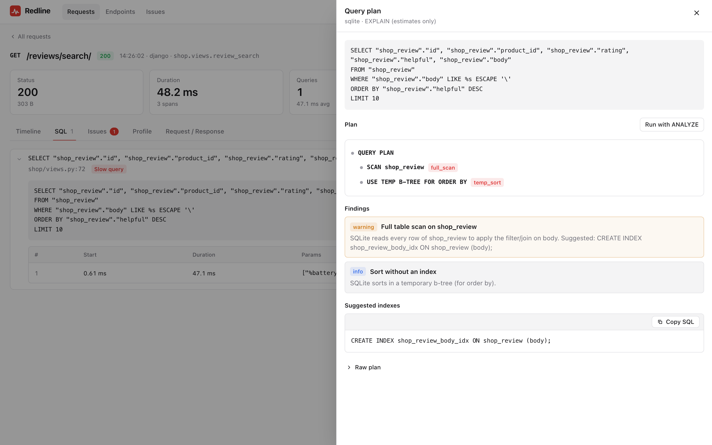
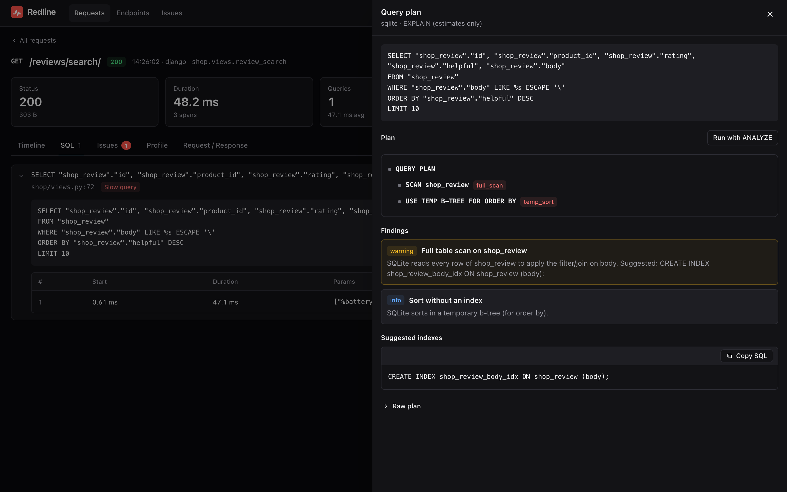

# EXPLAIN

[← Index](index.md)

Any captured `SELECT` can be explained from the UI with one click. Redline runs the
database's `EXPLAIN` on the query as it was recorded, turns the plan into a tree,
flags the expensive parts, and suggests an index when one is likely to help.

{ .rl-shot .rl-only-light }
{ .rl-shot .rl-only-dark }

## Where to click

- **SQL tab**: every execution of a statement has an **Explain** button.
- **Span drawer**: click any `sql` span in the timeline, then **Explain**.
- **API**: `POST api/explain` with `{"trace_id", "span_id", "analyze": false}`. See
  [The HTTP API](http-api.md#post-apiexplain).

The button is disabled when the query is not explainable (see below).

## Supported databases

| Vendor | Statement Redline runs | Notes |
|---|---|---|
| PostgreSQL | `EXPLAIN (FORMAT JSON) <sql>` | `ANALYZE` adds `EXPLAIN (ANALYZE, BUFFERS, FORMAT JSON)` |
| MySQL, MariaDB | `EXPLAIN FORMAT=JSON <sql>` | `ANALYZE` is **not supported** (`analyze_unsupported`, 400) |
| SQLite | `EXPLAIN QUERY PLAN <sql>` | no `ANALYZE` form; the flag is ignored |
| anything else | none | `unsupported_vendor` (400) |

Vendor names come from the adapter: Django's `connection.vendor`, SQLAlchemy's
`dialect.name` (with `mariadb` mapped to `mysql`).

## What can be explained

Only statements `redline_core.sql.is_explainable` accepts: **a single read-only
`SELECT`** (or `WITH ... SELECT`, `VALUES`, `TABLE`). Redline refuses:

- any write or DDL keyword, in any letter case (`INSERT`, `UPDATE`, `DELETE`, `MERGE`,
  `CREATE`, `DROP`, `ALTER`, `TRUNCATE`, `GRANT`, `REVOKE`, `CALL`, `COPY`, `INTO`). This
  covers data-modifying CTEs (`WITH x AS (DELETE ... RETURNING *) SELECT ...`) and
  `SELECT ... INTO`;
- every **row-locking clause**: `FOR UPDATE`, `FOR NO KEY UPDATE`, `FOR SHARE`,
  `FOR KEY SHARE` (PostgreSQL) and `LOCK IN SHARE MODE` (MySQL). Under `ANALYZE` they
  would take row locks until the rollback;
- **more than one statement** (a `;` outside a literal; one trailing `;` is fine);
- `executemany` spans (`many=True`), whose parameters are a list of rows.

The check reads the statement **twice** and both readings must pass:

1. **Literal-aware**: over the normalised statement with literals and comments stripped,
   so `WHERE note = 'DELETE me'` or a column named `"update"` does not trip it.
2. **Dialect-pessimistic**: over the raw text, removing only what every database agrees
   is inert. Databases disagree about quoting: a backslash ends a standard PostgreSQL
   string but escapes the quote in MySQL; MySQL has no `$$` dollar quoting, executes
   `/*! ... */` "comments", and needs a space after `--`. A statement that hides a `;` or
   a write keyword under one of those readings (`SELECT 'a\' ; DELETE FROM t; --'`,
   `SELECT 1 /*! INTO OUTFILE '/tmp/x' */`) is refused.

The check errs on the side of refusing: an unusual but harmless statement may be refused,
a harmful one is not let through.

!!! note "Functions with side effects are out of scope"

    `SELECT nextval('seq')`, `SELECT pg_advisory_lock(1)` or a user function that writes
    all *look* like reads, and Redline does not try to know which functions have side
    effects. A plain `EXPLAIN` (the default) only plans the statement and never calls
    them. `EXPLAIN ANALYZE` does run them, which is one more reason it is off by default;
    it still runs inside a transaction that is always rolled back (and `READ ONLY` on
    PostgreSQL, which refuses most writes). Effects outside the transaction (a sequence
    advancing, an advisory lock held until the rollback, a sleep) can happen.

The same check runs in the API **and** again in the explain runner, whatever the adapter
passes: it is not left to the UI.

## Safety

Explaining a query you did not write the text of is the riskiest thing Redline does, so
the rules are strict and layered.

| Rule | Where enforced |
|---|---|
| Only recorded queries, by id | The request names a `trace_id` and `span_id`. There is **no way to submit SQL**; Redline explains what it stored |
| Only a single read-only `SELECT` | `is_explainable`, checked when the span is recorded, in the API, and in the runner |
| Always rolled back | The adapter's executor runs the statement in a transaction it **always** rolls back |
| `READ ONLY` on PostgreSQL | `SET TRANSACTION READ ONLY` before the statement (Django: only when Redline owns the outermost transaction) |
| `ANALYZE` is opt-in | Refused with `403 analyze_disabled` unless `explain_analyze` is true |
| Not recorded | Django: queries run by EXPLAIN are suppressed and never become spans |
| CSRF-protected | `POST api/explain` needs the CSRF token (Django) or a same-origin `Origin` (FastAPI) |
| Access-controlled | Behind the same permission as the rest of the UI |

!!! warning "Rolled back is not the same as harmless"

    Plain `EXPLAIN` does not execute the query, only plans it. **`EXPLAIN ANALYZE`
    executes it.** That has three consequences.

    - It costs what the query costs, on your database, now. A 40-second report takes 40
      seconds.
    - Even inside a rolled-back transaction a `SELECT` can have side effects, for
      example a function that writes elsewhere (PostgreSQL's `READ ONLY` blocks writes
      but MySQL and SQLite have no equivalent here).
    - The recorded **parameters are used verbatim**, including values that were
      redacted *in storage*: Redline cannot rerun a query whose parameter it masked
      (it would run with the placeholder text instead of the secret). Queries filtered
      on secret columns explain with `[redacted]` values and may produce a different plan.

    That is why `explain_analyze` is **off by default**. Turn it on in development, not
    on a production database you care about.

## What you get back

```json
{
  "vendor": "sqlite",
  "analyzed": false,
  "plan": [[2, 0, 0, "SCAN shop_review"], [10, 0, 0, "USE TEMP B-TREE FOR ORDER BY"]],
  "text": "SCAN shop_review  [full_scan]\nUSE TEMP B-TREE FOR ORDER BY  [temp_sort]",
  "tree": { "label": "...", "detail": "...", "cost": null, "rows": null,
            "actual_ms": null, "children": [], "flags": ["full_scan"] },
  "findings": [{ "severity": "warning", "title": "...", "detail": "..." }],
  "suggested_indexes": ["CREATE INDEX shop_review_body_idx ON shop_review (body);"]
}
```

(Abbreviated: field values are illustrative, the shape is exact.)

| Field | Meaning |
|---|---|
| `plan` | The **raw** plan: JSON for PostgreSQL and MySQL, rows for SQLite |
| `text` | A rendered text tree with `[flag]` markers |
| `tree` | The plan as nodes: `label`, `detail`, `cost`, `rows`, `actual_ms` (ANALYZE only), `children`, `flags` |
| `findings` | Things worth your attention, each with a severity (`info`, `warning`, `critical`) |
| `suggested_indexes` | `CREATE INDEX` statements. **Redline never runs DDL** |

## Findings and flags

Each flag appears on the offending node and as a finding.

| Flag | Meaning | Detected on |
|---|---|---|
| `seq_scan` | A sequential scan of a large table: at least 1,000 estimated rows, or cost at least 1,000. A *warning* when it filters rows (an index would help), *info* otherwise | PostgreSQL |
| `full_scan` | A full table scan: MySQL `access_type: ALL` on at least 1,000 rows, or SQLite `SCAN <table>` where the table is filtered or joined in the query | MySQL, SQLite |
| `sort_spill` | A sort that went to disk (`external merge`, `Disk`) | PostgreSQL |
| `hash_spill` | A hash join that needed more than one batch | PostgreSQL |
| `nested_loop_high_rows` | A nested loop driving at least 10,000 rows, or whose inner side ran at least 1,000 times | PostgreSQL (ANALYZE sharpens it) |
| `temp_sort` | A sort using a temporary structure: SQLite `USE TEMP B-TREE`, MySQL `using_filesort` | SQLite, MySQL |
| `automatic_index` | SQLite built a throw-away index for this query. It is the engine telling you which index you are missing | SQLite |

The thresholds are module constants in `redline_core.plan_analysis` (`LARGE_TABLE_ROWS`,
`SEQ_SCAN_COST`, `NESTED_LOOP_ROWS`, `NESTED_LOOP_LOOPS`) and are not settings.

## Index suggestions, and their limits

When a scan is flagged, Redline derives a `CREATE INDEX` from the plan's `Filter` and
`Hash Cond` (PostgreSQL), `attached_condition` (MySQL) or the SQL's `WHERE` and `ON`
columns (SQLite). It emits the table name, up to three columns, and a safely quoted name
such as `shop_review_body_idx`.

It is deliberately **not naive**. It understands that a plain B-tree index cannot serve
several common predicates, and tells you instead of suggesting an index that would not be
used:

| Predicate | What Redline says |
|---|---|
| `LIKE '%term%'` (leading wildcard) | No B-tree index can serve it. Suggests, as an alternative, a `pg_trgm` GIN index on PostgreSQL. Not a drop-in: it needs the extension and adds write cost |
| `lower(col) = ?` or any function around the column | A plain index is ignored; only an expression index with exactly that expression matches |
| `ILIKE` | B-trees are case-sensitive; index `lower(col)` or use trigrams |
| `col IS NOT NULL` | Rarely helped; consider a partial index |
| `!=`, `NOT IN`, `NOT LIKE` | Match most rows; filter on the positive set instead |
| `LIKE 'abc%'` (prefix) | Needs `text_pattern_ops` on PostgreSQL, or `COLLATE NOCASE` on SQLite, with the statement |

Columns used in different `OR` branches get an index each, not one compound index.

!!! warning "A suggestion is a hypothesis"

    The analysis sees **one query**, with the estimates of one database at one moment. It
    cannot know:

    - how many other queries an extra index will slow down (every index costs writes and
      space);
    - whether an equivalent index already exists under another name or as a prefix of a
      compound one;
    - your data distribution tomorrow, or the planner's statistics being stale (run
      `ANALYZE` on the table first if estimates look wrong);
    - that a low-cardinality column (a boolean, a status) is rarely worth indexing alone.

    Test the index on a copy, re-run the explain, and measure the query. "What-if" index
    testing without creating anything (HypoPG) is on the [roadmap](roadmap.md), not here.

## Reading a plan

| You see | It usually means |
|---|---|
| A scan node with big `rows` and a `Filter` | The filter is evaluated row by row: an index on the filtered column may help |
| `actual_ms` much larger than the parent's estimate | The planner's estimate was wrong: refresh statistics |
| Nested loop with a high inner `loops` count | A join that should be a hash or merge join, or a missing index on the join column |
| A sort node flagged `sort_spill` | The sort exceeded `work_mem`; raise it for the session or add an index that provides the order |
| `Rows Removed by Filter` very high (PostgreSQL ANALYZE) | You read many rows to keep few: selectivity is the problem |

## Errors

| Code | Status | Cause |
|---|---|---|
| `not_explainable` | 400 | The span is not a single read-only `SELECT` |
| `analyze_disabled` | 403 | `analyze` was requested but `explain_analyze` is off |
| `analyze_unsupported` | 400 | `ANALYZE` on MySQL |
| `unsupported_vendor` | 400 | The database is not PostgreSQL, MySQL or SQLite |
| `trace_not_found`, `span_not_found` | 404 | The trace was pruned, or the id is wrong |
| `explain_unavailable` | 501 | No connection or engine for that `db_alias` (a router-only alias, or an engine that was not passed to `install()`) |
| `explain_failed` | 422 | The database rejected the statement. The message carries the driver's error, e.g. a table dropped since, or a type that cannot be bound from the recorded parameter |

!!! note "Why a plan can differ from production"

    The plan is produced on **the database your app is connected to now**, with the
    **parameters of the recorded request**. A different parameter value can pick a
    different plan, and a development database with 400 rows will happily seq-scan a table
    that is 40 million rows in production. Explain against production-shaped data.
