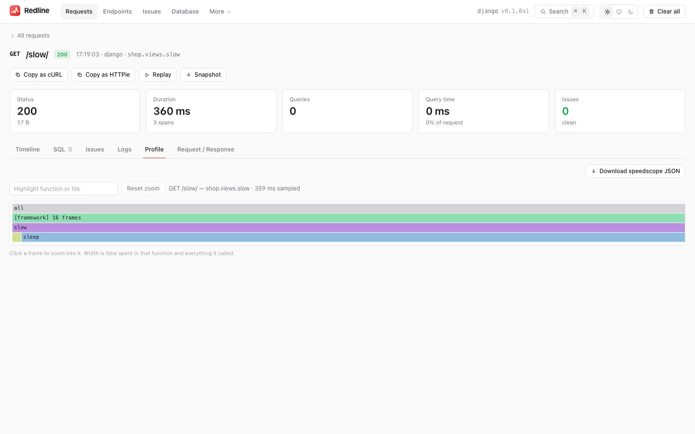
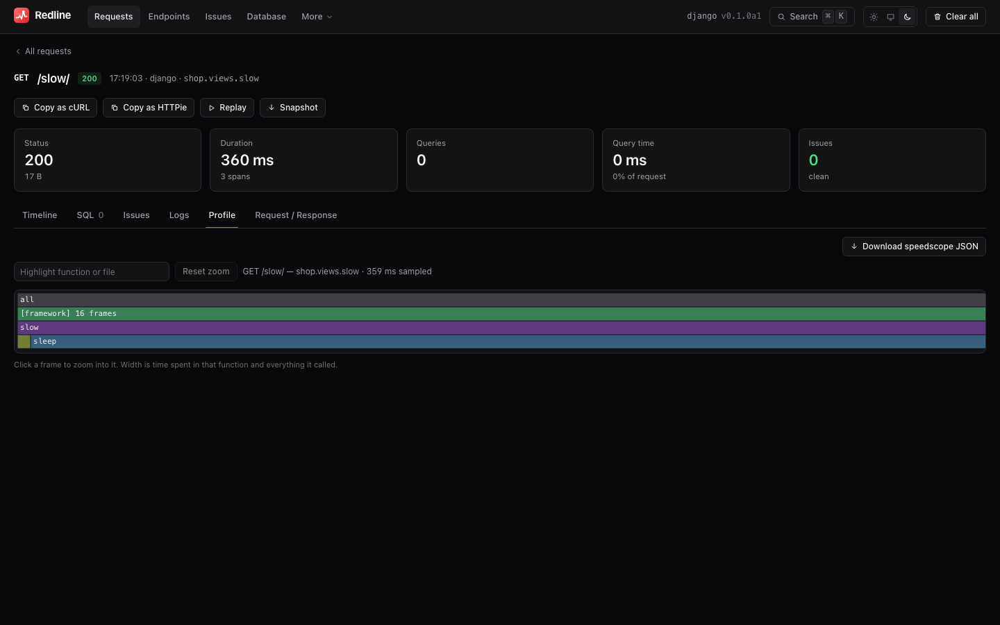

# Flamegraphs

[← Index](index.md)

A flamegraph shows where a request spent its time **in Python**, call by call. Redline
records them with [pyinstrument](https://pyinstrument.readthedocs.io), a statistical
sampling profiler, on request, and draws them in the UI.

{ .rl-shot .rl-only-light }
{ .rl-shot .rl-only-dark }

Flamegraphs are **opt-in** because they cost more than the rest of Redline. Spans tell
you *which query* or *which template* was slow; a flamegraph tells you what the Python
between them was doing: a CPU loop, a slow serializer, a lock.

## Install the extra

```bash
pip install "redline-core[profile] @ git+https://github.com/Pythondeveloper6/redline#subdirectory=packages/redline-core"
```

That adds `pyinstrument>=5.0,<6.0`. Without it, a profile request records no profile,
sets the trace tag `profile_error`, and the **Profile** tab explains how to enable it.
`GET api/meta` reports `profiler_available`.

## Ask for one

Add a query parameter or a header to **one request**:

```bash
curl "http://127.0.0.1:8000/slow/?_redline=profile"
curl -H "X-Redline-Profile: 1" http://127.0.0.1:8000/slow/
```

Then open the request in the UI and click **Profile**.

| Trigger | Django and FastAPI |
|---|---|
| `?_redline=profile`, `1`, `true`, `yes` or `on` | yes |
| `X-Redline-Profile: profile`, `1`, `true`, `yes` or `on` | yes |

The values are case-insensitive, and both adapters parse them with the same core function
(`redline_core.sampling.profile_requested`), so a URL that profiles on one framework
profiles on the other. Any other value (`?_redline=0`) is ignored.

A profiled request is **always stored**, even if it is fast and the sample rate would
have dropped it (`tags["sampled_by"]` is then `profile`).

!!! note "Who may ask"

    The trigger is honoured only when the framework is in debug mode or the request carries
    valid Redline credentials under the active `access` policy: a client `local` lets in,
    `Authorization: Bearer <token>` / Basic credentials (or the login cookie), or your
    `access_check`. Anyone else's trigger is ignored, so strangers cannot make you profile
    and store their requests. With `access = "framework"` only debug mode counts. On a
    server, send the token:

    ```bash
    curl -H "X-Redline-Profile: 1" -H "Authorization: Bearer $REDLINE_TOKEN" https://app.example/slow/
    ```

    The `production` preset sets `profile = "off"`.

## Modes

The `profile` setting chooses who gets profiled.

| `profile` | Who is profiled |
|---|---|
| `"off"` | Nobody. The trigger is ignored |
| `"opt_in"` (default) | Only requests carrying the trigger |
| `"sampled"` | Triggered requests, **plus** a random `profile_sample_rate` fraction (0 to 1) of the rest |
| `"all"` | Every request that is recorded |

```python
REDLINE = {"PROFILE": "sampled", "PROFILE_SAMPLE_RATE": 0.01}   # Django
```

```python
install(app, settings={"profile": "sampled", "profile_sample_rate": 0.01})   # FastAPI
```

`"all"` is for short local sessions. Every request pays the profiler's overhead. Do not
use it on shared or production servers. `"sampled"` is the way to get a representative
profile of real traffic at a bounded cost. A sampled profile is chosen at the
*start* of the request, before anyone knows it will be slow, so to catch a *specific*
slow request, reproduce it with the trigger.

## Async correctness

On ASGI many requests share one thread and one event loop. A naive profiler started in one
request would sample everyone's work. Redline runs pyinstrument with
`async_mode="enabled"`: a profiler started inside one request's task only attributes **that
task's** work. Time spent awaiting appears as an `[await]` frame instead of someone else's
code. Concurrent requests each get a clean profile.

Starlette's threadpool (your `def` endpoints) and Django's `sync_to_async` are covered by
the same mechanism that carries the trace ([`contextvars`](how-it-works.md#why-contextvars)).

!!! warning "One profiler at a time"

    A profiler such as pyinstrument hooks the interpreter's own profiling machinery, and
    two profilers generally cannot share it. If a profiler cannot be started (the extra is
    missing, or another profiler is running) the request is **still recorded without a
    profile**, with `tags["profile_error"]` set to the exception. Redline never fails a
    request because of its profiler. If you use another profiler in the same process
    (New Relic's, a Sentry profiler) expect conflicts.

## Reading the UI

The **Profile** tab draws an **icicle** (flamegraph turned upside down: the entry point on
top, callees below).

- The **width** of a box is the time spent in that function **and everything it called**.
- **Click** a box to zoom into it; **Reset zoom** returns to the root.
- **Hover** for the function, `file:line`, the **total** time with its share of the whole,
  and the **self** time (time in the function's own code, excluding callees).
- The **search box** highlights frames whose function name or file contains the text. Type
  your app's package name to find your code among the framework's.
- Grey boxes are the synthetic root and any frame without a known source location.

Small boxes (under half a pixel) are not drawn. Zoom in to see them.

## Export to speedscope

The profile is stored as [speedscope](https://github.com/jlfwong/speedscope) JSON.

- In the UI, **Download speedscope JSON** saves `redline-<trace id>.speedscope.json`.
  Drag it onto <https://www.speedscope.app> (or the local app) for time-order,
  left-heavy and sandwich views.
- Over HTTP: `GET api/traces/<id>/profile` returns the same document, or `404
  profile_not_found`.

## Storage

Profiles live in their own table, apart from the trace, so listing requests never loads
them. They can be large (a deep call tree is hundreds of kilobytes of JSON). They are
removed with their trace by retention, by `DELETE`, and by **Clear all**. Profiles of
many requests are the fastest way to grow `.redline/redline.db`: see
[Storage](storage.md#size).

## Limits

- A statistical profiler **misses anything shorter than its sampling interval** (1 ms
  here) and is noisy for short requests. Profile a request that takes tens of milliseconds
  or more, and repeat it.
- It profiles **Python**. Time inside a C extension or the database driver appears as one
  box (the call into it), not what the native code was doing. Use the SQL spans and
  [EXPLAIN](explain.md) for that.
- It cannot see other processes. A request that waits on a worker, a queue or another
  service shows as `[await]` or a blocking call.
- The profile is of the **request handler**, from where the adapter starts the profiler
  to where it ends. Work done after the response is sent (FastAPI background tasks) is
  outside it.
