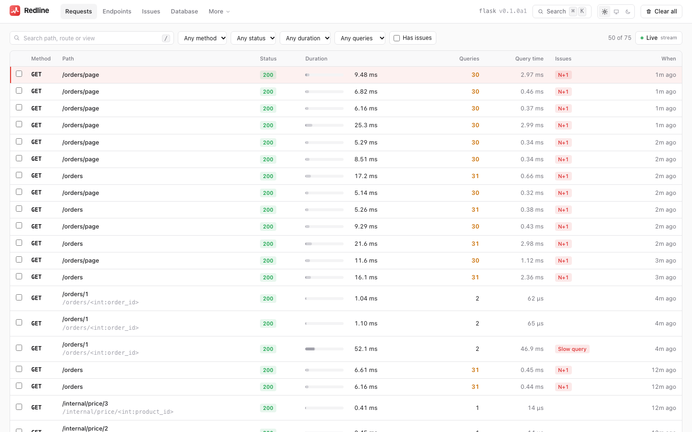
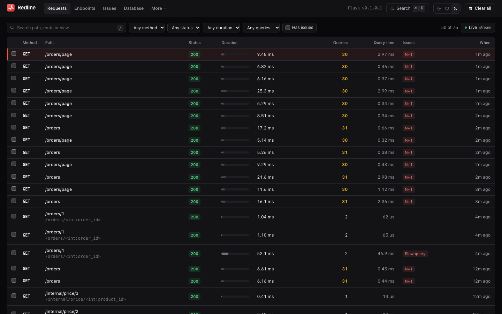

# Flask

[← Index](index.md)

`flask-redline` is the Flask and SQLAlchemy adapter. It wraps your WSGI app, hooks
Flask's own signals for the route template, view and templates, instruments your
SQLAlchemy engines and serves the Redline UI from a blueprint inside the same app.

It works with plain SQLAlchemy and with **Flask-SQLAlchemy**, with application
factories, with `async def` views (Flask's asgiref bridge) and with streaming responses.

## Install

```bash
pip install \
  "flask-redline @ git+https://github.com/Pythondeveloper6/redline#subdirectory=packages/flask-redline" \
  "redline-core @ git+https://github.com/Pythondeveloper6/redline#subdirectory=packages/redline-core"
```

Python 3.10 or newer, Flask 3.0 or newer (below 4), SQLAlchemy 2.x. Add the `profile`
extra to the core requirement for [flamegraphs](flamegraphs.md). See
[Getting started](getting-started.md#install) for why the core is named in the same
command.

## Mount it

```python
from flask import Flask
from sqlalchemy import create_engine
from flask_redline import Redline

app = Flask(__name__)
engine = create_engine("sqlite:///app.db")

# access="local": localhost only (unset, Redline answers 404 outside debug mode)
Redline(app, engine=engine, settings={"access": "local"})  # UI at http://localhost:5000/_redline/
```

With **Flask-SQLAlchemy** you do not even pass the engine. Its engines, including
`SQLALCHEMY_BINDS`, are found and instrumented on the first request, because they may not
exist yet when `Redline(app)` runs:

```python
db = SQLAlchemy(app)
Redline(app)
```

Traces go to their own SQLite file (`.redline/redline.db`), never to your database.

### Application factories

```python
redline = Redline(engine=engine)

def create_app():
    app = Flask(__name__)
    redline.init_app(app)
    return app
```

`redline.store`, `.settings`, `.recorder`, `.engines`, `.add_engine(engine, alias=None)`
and `.close()` act on the current app (inside an app context) or on the last app that was
initialised. The store is flushed and closed at interpreter exit.

## The `Redline` extension

```python
Redline(
    app=None,
    *,
    engine=None,          # Engine | [engines] | {"alias": engine}
    engines=None,         # "auto": instrument engines created at runtime
    settings=None,        # dict | redline_core.Settings
    url_prefix=None,      # default: the mount_path setting, else "/_redline"
    permission=None,      # callable(request) -> bool; implies access="framework"
    store=None,           # a custom Store; default is the SQLite file
)
```

| Argument | Meaning |
|---|---|
| `engine` | One engine, a list (the first is the `"default"` alias used by EXPLAIN) or a dict of aliases. Omit it with Flask-SQLAlchemy |
| `settings` | A dict of [settings](settings.md) (case-insensitive keys) or a `Settings`. `app.config["REDLINE"]` (a dict) is merged underneath a dict passed here |
| `url_prefix` | Where the UI and API live (default: the `mount_path` setting, else `/_redline`). Requests under it are never recorded |
| `permission` | Your own access check; implies `access = "framework"`. See [Access control](#access-control) |
| `store` | A custom [Store](extending.md#the-store-protocol) |

Settings can live in `app.config` too, which is handy with config classes:

```python
app.config["REDLINE"] = {"sample_rate": 0.1, "slow_query_ms": 50}
Redline(app, engine=engine)
```

The layered configuration (presets, `redline.toml`, `REDLINE_*` environment variables)
applies to Flask too; `app.config["REDLINE"]` and `settings=` are the top layer. See
[Configuration](configuration.md).

### Several engines

```python
Redline(app, engine=[main_engine, analytics_engine])
Redline(app, engine={"main": main_engine, "analytics": analytics_engine})
redline.add_engine(late_engine)            # an engine created later
```

The alias is stored on every query so that EXPLAIN runs on the right database.

### Engines created at runtime (per-user or per-request)

Apps that build engines on the fly (for example one per user, with token authentication
through `connect_args` or `creator=`) cannot register each one. Opt in to automatic
discovery:

```python
Redline(app, engines="auto")   # or settings={"instrument_engines": "all"}
```

This sets `instrument_engines="all"`: every SQLAlchemy `Engine` (sync, or the sync engine
inside an `AsyncEngine`) that runs a statement inside a recorded request is hooked on its
first use, once, under a unique alias (`auto_<id>`). Engines are held weakly, so a
disposed per-request engine is garbage collected as usual. Automatically found sync
engines can be EXPLAINed; async ones are recorded but not EXPLAINed. Engines you pass as
`engine=` keep their own alias. The default stays explicit registration.

## What is recorded

- **Request and response**: method, path, route template (`/orders/<int:order_id>`),
  view dotted name, status, headers, query string and body. Secrets are
  [redacted](security.md#redaction).
- **Bodies are never consumed or buffered without bound.** The request body is copied as
  the view reads it. Response bodies, including streams, are kept only up to
  `max_body_bytes`. A `stream_with_context` generator is not read ahead, and the trace ends
  when the last chunk is sent, so streaming work counts towards the latency. `send_file`
  and anything served through `wsgi.file_wrapper` is handed back untouched: only its size
  is recorded.
- **SQL** through SQLAlchemy's `before/after_cursor_execute`: statement, bound parameters
  (redacted), duration, row count, vendor, `db_alias` and the project line that issued
  the query.
- **Spans**: a `view` span around the view function, and a `template` span per
  `render_template` and `render_template_string`. Queries a template triggers (lazy
  loading) nest under it.
- **Transactions and pool waits**: `transaction` spans from the SQLAlchemy begin, commit
  and rollback events, and `pool_wait` spans when a connection checkout takes 1 ms or more.
  See [Transactions and locks](transactions.md).
- **Unhandled exceptions** are recorded (Flask's `got_request_exception`) and re-raised
  or turned into a 500 exactly as before, with
  [locals](logs-and-exceptions.md#exceptions-with-locals). `abort(404)` and other 4xx
  `HTTPException`s are client errors, not failures.
- **Log records** emitted during the request. See [Logs and exceptions](logs-and-exceptions.md).
- **`async def` views** keep the trace: queries and spans created inside the coroutine land
  in the request's trace. A bare `threading.Thread` is not attributed to any request.
- Your own spans: `with redline_core.span("pricing.compute"): ...`
  ([details](custom-spans.md)).
- `X-Redline-Run: <id>;step=<n>` becomes tags (used by the [load tester](load-testing.md)),
  for a run that is running in the store.

If you put `werkzeug.middleware.proxy_fix.ProxyFix` (or any other WSGI middleware) around
the app, wrap it **after** creating `Redline`, so the recorded client address is the real
one. Apps mounted under a `SCRIPT_NAME` (`DispatcherMiddleware`) record the full path and
route.

## Outbound HTTP and other integrations

Nothing is patched unless you ask:

```python
from flask_redline import instrument_httpx, instrument_requests

instrument_httpx()      # every httpx.Client / AsyncClient call becomes an http_out span
instrument_requests()   # the same for requests.Session.send
```

URLs are redacted (`?api_key=...` is masked). `uninstrument_httpx()` and
`uninstrument_requests()` undo it. For Redis, psycopg, asyncpg and Marshmallow see
[Integrations](integrations.md).

## Profiling

Flamegraphs are opt-in per request: add `?_redline=profile` or the header
`X-Redline-Profile: 1` (needs the `profile` extra). They are honoured with `app.debug` or
from a request with valid Redline credentials (a client `local` lets in, a token…); see
[Forcing capture](security.md#forcing-capture) and [Flamegraphs](flamegraphs.md).

## Fix suggestions

For an N+1, `SQLAlchemyFixSuggester` maps the repeated query to your models and writes a
real unified diff with `selectinload(Parent.children)` or `joinedload(Child.parent)`. It
works with Flask-SQLAlchemy's `db.session` and `db.Model`. Repeated `text()`/driver SQL
without ORM relationships gets a lower-confidence batching hint instead of a diff: use one
`IN` query (`bindparam(..., expanding=True)`) or join the child rows into the parent query.
See [N+1 detection](n-plus-one.md).

## Server-Timing, the badge and live mode

{ .rl-shot .rl-only-light }
{ .rl-shot .rl-only-dark }

Every recorded response carries a `Server-Timing` header when `server_timing` is on (`"auto"`
by default: on in debug mode, off otherwise), HTML pages get the floating badge when
`badge` is on (`"auto"`: debug mode), `api/stream` feeds [Live mode](the-ui.md#live-mode)
and the snapshot download is served as-is. All of them sit behind the same
[access control](access-control.md) and can be switched off with the `sse` and `snapshot`
feature switches. See [Server-Timing and the badge](server-timing-badge.md).

"Debug mode" is `app.debug`, read per request. `api/stream` holds a worker thread for as
long as it is open, so on WSGI servers it closes after about 25 seconds and the UI
reconnects with the last `seq`; use a threaded or async worker class if you want live mode
under gunicorn.

## Access control

The UI exposes your SQL, request bodies and EXPLAIN, so treat it like an admin tool.

**Default.** With no `permission`, the [`access` policy](access-control.md) decides, and
the default is `local`: only loopback clients (`127.0.0.0/8`, `::1`; a unix-socket peer
only with `trust_unix_socket`) that address the server by a loopback name
(`Host: localhost`, `127.0.0.1`, `[::1]`, any port; this blocks DNS rebinding) are served,
and a warning is logged at startup. **While `access` is not set** (code,
`app.config["REDLINE"]`, `redline.toml`, `REDLINE_ACCESS`), that default applies only when
`app.debug` is on (`flask --debug run`, `app.run(debug=True)`); otherwise every Redline URL
answers `404` and an error is logged at startup. Set `settings={"access": "local"}` on a
development machine or `"token"` on a server. Refusals are
JSON: `{"error": {"code": "forbidden", "message": "..."}}`.

**Your own check.** `permission` is any `callable(request) -> bool`, called with Flask's
`request`. Passing it implies `access = "framework"` (unless you set `access` yourself),
so it **replaces** the loopback default and the `Host` check becomes yours. The core
access check still runs first for `allowed_ips`, `trusted_proxies`, `read_only`, features
and CSRF. With an explicit policy such as `token`, `permission` is not used.

```python
from flask_login import current_user

Redline(app, engine=engine, permission=lambda request: current_user.is_admin)
```

Raise `werkzeug.exceptions.abort(401)` (or any `HTTPException`) inside it to answer with
that status. It is rendered as `{"error": {"code": "unauthorized", ...}}`, keeping a
`WWW-Authenticate` header.

The `allowed_hosts` setting adds accepted host names to the default check
(`loopback_guard(allowed_hosts=["devbox"])` is the older spelling).

For tokens, basic auth, IP allow-lists, trusted proxies and read-only mode, use the
`access` family of settings instead. They behave the same on every framework: see
[Access control](access-control.md).

**CSRF.** Every non-`GET` request (login and logout included) is refused with
`403 csrf_failed` when it carries `Sec-Fetch-Site: cross-site` or `same-site`, or an
`Origin` (including `null`) that does not match the request host. Non-browser clients send
no `Origin` and are subject only to the access policy. Redline's own responses carry `X-Frame-Options: DENY`.

## EXPLAIN

`POST /_redline/api/explain` runs `EXPLAIN` for a recorded SELECT on the engine it came
from, inside a transaction that is always rolled back (and `READ ONLY` on PostgreSQL).
`EXPLAIN ANALYZE` executes the query, so it is off unless `explain_analyze=True`. See
[EXPLAIN](explain.md).

## Command line

```bash
flask redline clear [--yes]                              # delete every recorded trace
flask redline prune [--max-age-days N] [--max-rows N]    # apply retention now
flask redline scan [--json] [--fail]                     # static N+1 scan of Jinja templates
flask redline scenario [-o FILE] [--base-url URL]        # write a load-test scenario
```

`scan` runs the Jinja dialect of the [static scan](static-scan.md); `scenario` generates a
file for [`redline load`](load-testing.md#generating-scenarios) from your `url_map`.

## Running with several workers

Each worker process gets its own writer thread and connection to the same SQLite file in
WAL mode. The store is fork-safe, so gunicorn `--preload` works. See
[Storage](storage.md#concurrency) and [Production](production.md#process-models).

## Under test

Disable recording in your test configuration so tests do not write a trace file:

```python
app.config["REDLINE"] = {"enabled": False}
```

With `enabled=False` no WSGI wrapper, hooks or SQLAlchemy listeners are installed.

## Troubleshooting

| Symptom | Cause and fix |
|---|---|
| No requests appear | The path starts with `url_prefix` (never recorded), matches `ignore_paths`, or `sample_rate` dropped it. Check `GET /_redline/api/meta` |
| No SQL appears | The engine was not passed and Flask-SQLAlchemy is not set up on the app. Pass `engine=` or call `redline.add_engine()` |
| Client address is always `127.0.0.1` behind a proxy | Wrap the app in `ProxyFix` **after** creating `Redline` |
| The UI answers 403 `forbidden` | You are not on a loopback address, or used a non-loopback `Host`. Pass `permission=` |
| `async def` views lose their queries | Install `flask[async]`. Work in a bare `threading.Thread` is never attributed |

A runnable demo with deliberately bad views is in
[`examples/flask`](https://github.com/Pythondeveloper6/redline/tree/main/examples/flask).
