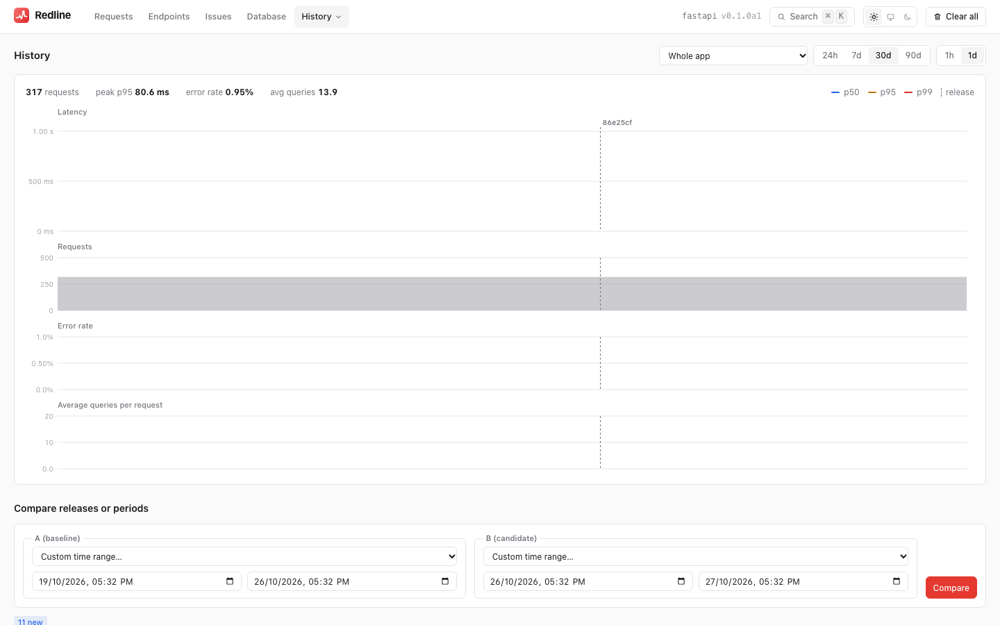
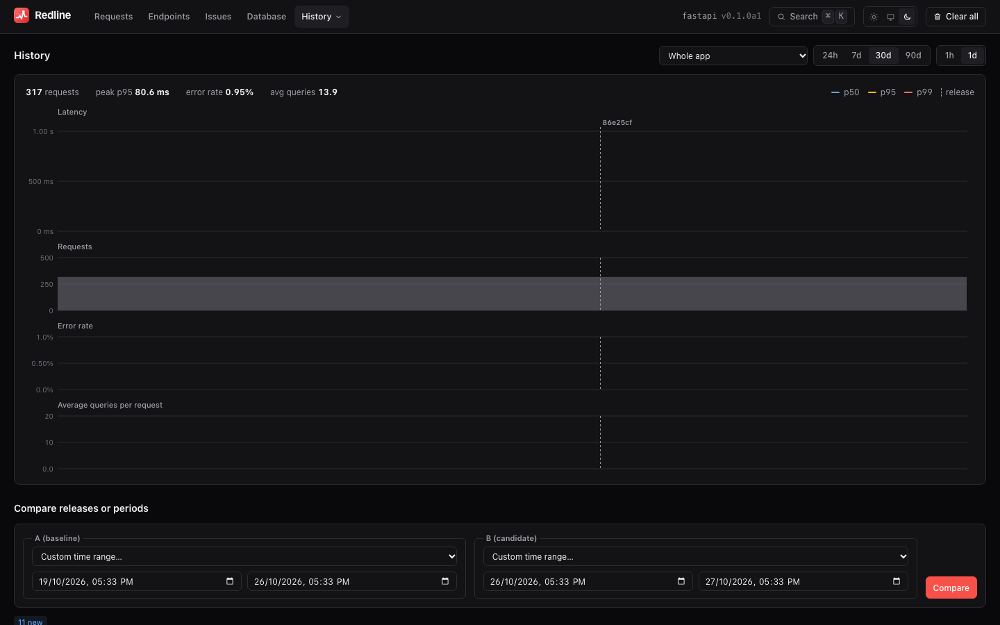

# History and releases

[← Index](index.md)

Redline keeps individual traces for a few days. That is the right window for debugging a
request, and the wrong one for the question you ask after every deploy: **did this release
make anything slower?**

The **History** page answers it. It keeps small, hourly summaries of every endpoint for 90
days, remembers which release was running, and compares any two releases or time ranges
side by side, with a verdict per endpoint and the issues that appeared or went away.

## How it works

Three things are stored, all written in the same transaction as the trace itself, and all
kept for `history_retention_days` (default 90) regardless of how soon the traces are
pruned:

| Table | What it holds |
|---|---|
| **rollups** | per hour, release, route and method: request count, errors, summed duration, a mergeable latency **histogram**, summed queries and query time, issue count |
| **releases** | each release name, when it was first and last seen, and how many requests it served |
| **issue index** | every issue ever seen: kind, severity, title, route, first and last seen, first and last release, occurrences. It **survives trace pruning** |

The latency histogram is log-linear (HDR-style, about 1% relative error from 1 microsecond
to an hour). Because histograms merge exactly, p50, p95 and p99 over a week are computed
from the hourly rows, not averaged from percentiles (which would be wrong).

History reflects **kept** traces. With `sample_rate = 0.1` it is built from a 10% sample
(plus every slow request and error), so counts are the sample's, and percentiles are
representative. Requests that are ignored or dropped are not included.

## Releases

A trace is stamped with a release when it is recorded. Redline resolves the name once, at
configure time, from the first of:

1. the `release` setting;
2. the environment variable `REDLINE_RELEASE`;
3. `GIT_SHA`, `SOURCE_VERSION`, `RENDER_GIT_COMMIT` or `HEROKU_SLUG_COMMIT`, which most
   platforms already set;
4. `git rev-parse --short HEAD` in `project_root`, run once with a one-second timeout;
5. nothing. History still works, grouped as one unnamed release.

```python
REDLINE = {"RELEASE": os.environ.get("APP_VERSION")}   # or set it in CI
```

Use something that changes on every deploy and is meaningful to you: a git SHA, a version,
a build number. The release markers on the timeline are placed where each name is first
seen.

## The History page

{ .rl-shot .rl-only-light }
{ .rl-shot .rl-only-dark }

Choose an endpoint (or the whole app) and a window. Four charts share one time axis, with
a vertical marker at each release:

- **Latency percentiles**: p50, p95 and p99.
- **Request count.**
- **Error rate.**
- **Average queries per request.**

Buckets are one hour for windows up to two days, otherwise one day. Only non-empty buckets
are drawn, and time is UTC-aligned. The same series is served by
`GET api/history` ([HTTP API](http-api.md#get-apihistory)).

## Before and after: comparing periods

A period is a **release** or a **time range**:

| Form | Example |
|---|---|
| a release | `release:3f9c2ab` |
| a range | `range:1761400000-1761486400` (start and end, epoch seconds) |

Pick a baseline (**A**) and the period under test (**B**) and Redline compares them
endpoint by endpoint. Each row carries both periods' request count, error rate, p50, p95,
p99, average duration and average queries, the p95 change, and a **verdict**:

| Verdict | Rule |
|---|---|
| `regressed` | p95 up **20% or more and 5 ms or more**, or average queries up by 1 or more |
| `improved` | the mirror image: p95 down 20% and 5 ms, or average queries down by 1 |
| `same` | none of the above |
| `new` | the endpoint exists in B only |
| `gone` | the endpoint exists in A only |

Rows are sorted regressed, new, improved, gone, same, so the problems are on top. The
double condition on latency (a relative *and* an absolute change) stops a 0.3 ms endpoint
doubling to 0.6 ms from being a headline. Compare two real releases that each served a
meaningful amount of traffic; an endpoint with a handful of requests is noise.

### Issues: new, resolved, persisting

Below the table, the same two periods' **issues** are diffed:

| Group | Meaning |
|---|---|
| **New** | present in B, not in A. Candidates for "this release introduced it" |
| **Resolved** | present in A, gone in B. Did the fix work? |
| **Persisting** | present in both, with B's occurrence count |

Each links to a sample request while its traces still exist. The issue index itself
outlives the traces, so you can still read "N+1 on `/orders/`, first seen in `3f9c2ab`,
last seen in `a81d0e4`" months later.

### A typical use

1. Deploy `release B`. Let it serve traffic for an hour or a day.
2. Open **History**, choose A = the previous release, B = the new one.
3. Read the regressed endpoints and the new issues. Open a sample trace for each.

For the same comparison on two single requests, use [Compare](the-ui.md#compare-two-requests).
For a comparison in your CI pipeline, see the [roadmap](roadmap.md) (v0.3).

## Retention

| Setting | Default | Covers |
|---|---|---|
| `history_retention_days` | `90` | rollups, issue index, releases, load runs |
| `max_age_days`, `max_rows` | `7`, `10000` | individual traces (and their `trace_sql`, `trace_ext`, `trace_cache` summaries) |

The two are independent: traces can be pruned after a week while the hourly rollups live
for 90 days. `0` or `None` for `history_retention_days` keeps history forever.

When pruning runs it deletes rollup hours that ended before the cutoff, releases and issue
index entries last seen before it, and load runs (with their steps) created before it, but
never a run that is still running. **Clear all** and `manage.py redline_clear` delete
traces but **keep history**; the API and store can wipe history too
(`clear(history=True)`). See [Storage](storage.md#history-tables).

## Upgrading an existing store

A store written by 0.1 is migrated in place the first time 0.2 opens it. The new tables are
created and **backfilled from the traces still in the file**, in one transaction, so history
starts from whatever was there (at most the retained week) rather than from zero. If several
workers start at once, the migration runs once. See [Storage](storage.md#the-schema).
