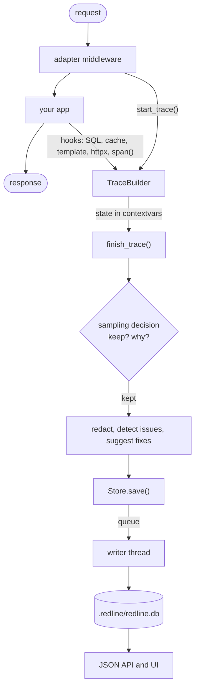

# How it works

[← Index](index.md)

Redline is a small pipeline. Understanding it explains every setting and every
limitation, so this page is worth reading once.



Five packages share this pipeline:

- **`redline-core`** owns everything in the middle: the data model, the recorder, SQL
  fingerprinting, callsite capture, redaction, sampling, the detectors, EXPLAIN analysis,
  the store, the JSON API and the UI bundle. It imports no web framework and has no
  runtime dependencies.
- **`django-redline`**, **`fastapi-redline`**, **`flask-redline`** and
  **`litestar-redline`** own the edges: how a request starts and ends, how SQL and cache
  calls are observed, how URLs and auth work, and which ORM the fix suggester understands.
  They all enforce the same [access policy](access-control.md).
- **`redline_core.contrib`** holds the optional hooks (SQLAlchemy, httpx, requests, redis,
  asyncpg, psycopg, Marshmallow, Strawberry, Graphene). Nothing there is imported unless you
  ask. See [Integrations](integrations.md).

## A trace and its spans

One request is one **trace**. A trace has request and response metadata and a flat list of
**spans** that form a tree through `parent_id`.

| Trace field | Meaning |
|---|---|
| `id` | 32-character hex id |
| `framework` | `django`, `fastapi` or `other` |
| `method`, `path` | the verb and the concrete path (`/orders/42/`) |
| `route` | the **template** (`/orders/<int:pk>/` or `/orders/{order_id}`), known once routing ran |
| `view` | dotted name of the view or endpoint (`shop.views.order_detail`) |
| `status`, `duration_ms` | response status and wall time |
| `query_count`, `query_ms` | SQL query count and their summed duration (exact even when the trace is truncated) |
| `request`, `response` | redacted headers, query, body, truncation flags, size |
| `issues` | what the [detectors](n-plus-one.md) found |
| `tags` | free-form; `run_id` and `step` (load-test correlation), `sampled_by`, `profile_error` |
| `error` | `{type, message, traceback}` for an unhandled exception; never set for a 4xx (Django's `Http404` is not an error) |
| `truncated` | `{dropped_spans, max_spans}` when the request hit `max_spans_per_trace`, else `null` |

Span kinds and the data each carries:

| Kind | Produced by | `data` keys |
|---|---|---|
| `sql` | the database hook | `sql`, `params`, `fingerprint`, `db_alias`, `vendor`, `rows`, `many`, `explainable` |
| `cache` | Django cache wrappers | `op`, `key`, `hit`, `backend` |
| `http_out` | `instrument_httpx()` | `method`, `url` (secrets redacted), `status` |
| `template` | Django template rendering | `template` |
| `middleware`, `view` | the adapters | adapter-specific (`async` for Django views) |
| `custom` | your `redline_core.span(...)` | whatever you pass |

SQL spans also carry a **callsite**: the project file, line, function and source text that
issued the query, plus up to 12 project frames of stack. That is what makes "30 queries
from `shop/views.py:37`" possible.

## Recording

When a request arrives the adapter calls `start_trace()`. That does four things:

1. Asks the sampler whether the path is **ignored** (`ignore_paths`, or Redline disabled).
   An ignored request gets an inert builder: nothing is recorded or stored.
2. Rolls the sample-rate dice once.
3. Reads the `X-Redline-Run` header into the `run_id` and `step` tags.
4. Starts a profiler if profiling was requested and is enabled.

From then on the hooks add spans as they finish. When the response is done the adapter
calls `finish_trace()`.

### What is recorded for every request, and what only for kept ones

This split is the heart of the overhead model.

| Work | When |
|---|---|
| Timing, span objects, SQL fingerprint, callsite capture, parameter redaction by column | **every non-ignored request**, as the query runs |
| Header, query and body redaction, log and exception-local redaction | only when the trace is **kept** |
| The detectors (N+1, duplicates, slow, too many, and the 0.2 detectors) and fix suggestions | only when the trace is **kept** |
| Serialising and writing to SQLite, including the derived summary rows | only when the trace is **kept**, on the writer thread |
| Log records, event-loop lag samples | while the request is in flight (a log record outside a request is one `ContextVar.get()`) |

So lowering `sample_rate` removes the analysis and the disk cost of the requests you
discard, but **not** the per-query recording cost. See
[Performance and overhead](performance.md).

## Why `contextvars`

Two context variables carry all state: the builder of the request being recorded, and
the id of the innermost open span. The consequences:

- Every `asyncio` task copies the context of the code that created it, so concurrent
  requests on one event loop never see each other's trace, and tasks spawned inside a
  request record into that request.
- `asgiref.sync_to_async`, `loop.run_in_executor` with `contextvars.copy_context()` and
  Starlette's threadpool (which runs your `def` endpoints) copy context into the worker
  thread, so their queries attribute correctly.
- A bare `threading.Thread` does **not** copy context. Work started that way is not
  attributed to any request. That is by design: it is not part of the request.
- When no trace is active, every hook is one `ContextVar.get()` and a `None` check.
- Once a trace is finished, late hooks (a background task that outlives the response)
  are ignored rather than attached to a closed trace.

!!! note "Where the trace ends"

    FastAPI: right after the last body chunk is sent, so `BackgroundTasks` do not inflate
    the request's latency. Django: when the response comes back up through the
    middleware stack, so middleware placed *above* `RedlineMiddleware` is not timed.

## Callsites

Walking the stack costs under a microsecond per frame; what makes naive implementations
slow is classifying filenames and reading source lines. Redline caches the verdict per
filename and reads source text only for the single innermost frame.

A frame is **project code** when its file is under `project_root` and is not the
standard library, anything under `site-packages` or `dist-packages`, Redline itself,
or a synthetic file (`<string>`, `<frozen ...>`).

`project_root` defaults to the working directory (FastAPI) or `BASE_DIR` (Django). If
your code lives elsewhere, set it, or callsites will be empty and the
[fix suggester](n-plus-one.md#how-the-fix-is-found) will have nothing to locate.

Queries issued from library code (a generic `ListView`, a DRF serializer, a lazily
rendered `TemplateResponse`) have no project frame. The Django adapter attributes them to
the project view that handled the request. See [Django: how it hooks in](django.md#how-it-hooks-in).

## SQL fingerprinting

A **fingerprint** is the query with every literal replaced by `?`, so the 24 queries of
an N+1 loop collapse into one group:

```sql
SELECT "id", "qty" FROM "shop_orderitem" WHERE "order_id" = 17
SELECT "id", "qty" FROM "shop_orderitem" WHERE "order_id" = %s
-- both become
SELECT "id", "qty" FROM "shop_orderitem" WHERE "order_id" = ?
```

| Normalisation | Rule |
|---|---|
| Comments, whitespace | removed, collapsed |
| Literals | strings (including `E'...'`, `N'...'`, `$tag$...$tag$`), numbers and hex blobs become `?` |
| Placeholders | `%s`, `%(name)s`, `?`, `:name`, `$1` become `?` |
| Lists | `IN (?, ?, ?)` becomes `IN (...)`; multi-row `VALUES` becomes `VALUES (...)` |
| Keywords | upper-cased; identifiers keep their spelling |

It is a tokenising pass, not a parser: fast (memoised) and good enough for grouping.
It never executes SQL.

## Sampling

Recording is cheap, storing is not, so the decision is split.

**At the start**: ignored paths are dropped, and the sample-rate dice are rolled once.

**At the end** the trace is **stored** if any of these is true, checked in this order:

| Reason (`tags["sampled_by"]`) | Condition |
|---|---|
| `all` | the dice said yes and `sample_rate >= 1.0` |
| `rate` | the dice said yes and `sample_rate < 1.0` |
| `error` | `always_keep_errors` is on and the request returned 5xx, or raised without becoming a 4xx (a raised `Http404` is a 404, not an error) |
| `slow` | `duration_ms >= always_keep_slower_than_ms` |
| `profile` | the request was profiled |

Otherwise it is dropped. The practical production recipe is therefore a low
`sample_rate` with the two safety nets left on: you keep a sample of normal traffic
**plus every slow request and every failure**. See [Production](production.md).

One sharp edge: `always_keep_slower_than_ms = 0` keeps every request, because every
duration is "at least" 0 ms.

## What the detectors read

Each kind of finding reads a kind of span. The v0.1 four read `sql` spans; the 0.2 ones read
the new kinds (`serializer`, `resolver`, `transaction`, `blocking`, `pool_wait`) and extra
facts on `sql` spans (`rows`, `has_limit`, `in_transaction`). The adapters and integrations
create them, and the detectors in `redline_core.detectors` read them when the trace is
finished. One detector failing is logged and skipped. See [Detectors overview](detectors.md).

## Storage

Kept traces are handed to `Store.save()`, which only puts them on a bounded queue. A
daemon writer thread drains the queue in batches, one SQLite transaction per batch, and
prunes by age and row count every 200 writes. In the same transaction it derives small
summary rows (per-trace SQL, outbound-call and cache summaries, hourly rollups with latency
histograms, the issue index) that power the [Database](database.md), [Cache](cache-efficiency.md),
[External](external-calls.md) and [History](history.md) pages. If the queue is full the trace is
**dropped and counted** (`store.dropped`, shown by `GET api/meta`) rather than slowing a
request. Details in [Storage](storage.md).

## Redaction

Header, query-string, body, SQL-parameter, log-message and exception-local redaction runs on
kept traces before they reach the store, on by default. Secrets never reach disk. See [Security](security.md#redaction).

## The overhead model

Cost has four sources:

| Source | Scales with | Controlled by |
|---|---|---|
| Per-request bookkeeping | requests | `ignore_paths`, `enabled` |
| Per-query recording (timing, fingerprint, callsite, param redaction) | queries | `enabled`; **not** reduced by `sample_rate` |
| Per-kept-trace analysis (redaction, detectors, serialising) | kept traces | `sample_rate`, always-keep rules |
| Profiling | profiled requests | `profile`, `profile_sample_rate` |

Measured on an Apple M2 Pro (Python 3.14, 2026-10-27, `benchmarks/RESULTS.md`), the
per-request bookkeeping is **0.04 to 0.09 ms**, and per-query recording **15 to 31 µs**
(including SQLAlchemy event dispatch on FastAPI, Flask and Litestar) when nothing is
kept, rising to **28 to 51 µs** when every trace is kept and analysed (v0.1 on Python
3.13: 12.5 to 44 µs). Disabled, Redline
costs a few µs per request. See [Performance and overhead](performance.md#measured-numbers)
for the full table and how to reproduce it.

Memory: a trace's spans are held until the request ends, about **1.5 KB per SQL span**.
At most `max_spans_per_trace` spans (default 2000) are kept per request; beyond that they
are counted, folded into per-(fingerprint, callsite) counters so the N+1 and slow-query
detectors still see every query, and the trace is marked `truncated`. Bodies are captured
only up to `max_body_bytes`.

## Design choices worth knowing

- **A separate SQLite file**, never your application database: no bloat, no migrations,
  and Redline's own writes can never be recorded as queries.
- **A pure ASGI middleware** on FastAPI and Litestar, not `BaseHTTPMiddleware`, which would break
  context propagation for sync endpoints and buffer streaming responses.
- **Recording never breaks a request.** Every adapter hook and `finish_trace` is wrapped:
  an error in Redline is logged on the `redline` logger and the request carries on.
- **Unhandled exceptions are recorded and re-raised untouched.**
