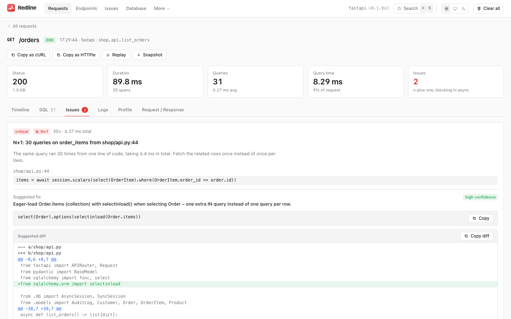
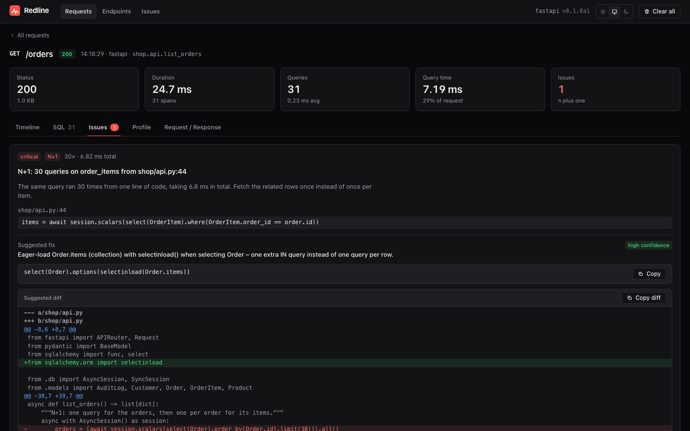

<div class="rl-hero" markdown>

{ .rl-hero-mark }

# See inside every request

<p class="rl-tagline">A self-hosted request profiler, backend analyzer and load tester for
Django, FastAPI, Flask and Litestar. Find the slow query, get the fix as a diff, then push
load at it and see what breaks first.</p>

[Get started](getting-started.md){ .md-button .md-button--primary }
[View on GitHub](https://github.com/Pythondeveloper6/redline){ .md-button }

</div>

{ .rl-shot .rl-only-light }
{ .rl-shot .rl-only-dark }

!!! warning "Alpha: `0.2.0a1`, install from GitHub"

    Redline is working and tested, but the API may still move and it is **not on PyPI
    yet**: install it from the GitHub repository (see
    [Getting started](getting-started.md#install)). See the
    [FAQ](faq.md#how-finished-is-this) for an honest account of what is and is not done.
    Use it in development and staging first, and read [Production](production.md) before
    pointing it at real traffic.

## Install in a minute

=== "Django"

    ```bash
    pip install \
      "django-redline @ git+https://github.com/Pythondeveloper6/redline#subdirectory=packages/django-redline" \
      "redline-core @ git+https://github.com/Pythondeveloper6/redline#subdirectory=packages/redline-core"
    ```

    ```python
    # settings.py
    INSTALLED_APPS = [..., "django_redline"]

    MIDDLEWARE = [
        "django.middleware.security.SecurityMiddleware",
        "django_redline.middleware.RedlineMiddleware",   # as high as possible
        ...,
    ]
    ```

    ```python
    # urls.py
    from django.urls import include, path

    urlpatterns = [
        ...,
        path("redline/", include("django_redline.urls")),
    ]
    ```

    Run your app, make a few requests, and open `/redline/` as a superuser.

=== "FastAPI"

    ```bash
    pip install \
      "fastapi-redline @ git+https://github.com/Pythondeveloper6/redline#subdirectory=packages/fastapi-redline" \
      "redline-core @ git+https://github.com/Pythondeveloper6/redline#subdirectory=packages/redline-core"
    ```

    ```python
    from fastapi import FastAPI
    from sqlalchemy.ext.asyncio import create_async_engine
    from fastapi_redline import install

    app = FastAPI()
    engine = create_async_engine("sqlite+aiosqlite:///app.db")

    # access="local": localhost only (unset, Redline answers 404 outside debug mode)
    install(app, engine=engine, settings={"access": "local"})  # UI at http://localhost:8000/_redline/
    ```

=== "Flask"

    ```bash
    pip install \
      "flask-redline @ git+https://github.com/Pythondeveloper6/redline#subdirectory=packages/flask-redline" \
      "redline-core @ git+https://github.com/Pythondeveloper6/redline#subdirectory=packages/redline-core"
    ```

    ```python
    from flask import Flask
    from sqlalchemy import create_engine
    from flask_redline import Redline

    app = Flask(__name__)
    engine = create_engine("sqlite:///app.db")

    # access="local": localhost only (unset, Redline answers 404 outside debug mode)
    Redline(app, engine=engine, settings={"access": "local"})  # UI at http://localhost:5000/_redline/
    ```

    With Flask-SQLAlchemy, omit the engine.

=== "Litestar"

    ```bash
    pip install \
      "litestar-redline @ git+https://github.com/Pythondeveloper6/redline#subdirectory=packages/litestar-redline" \
      "redline-core @ git+https://github.com/Pythondeveloper6/redline#subdirectory=packages/redline-core"
    ```

    ```python
    from litestar import Litestar
    from sqlalchemy.ext.asyncio import create_async_engine
    from litestar_redline import RedlinePlugin

    engine = create_async_engine("sqlite+aiosqlite:///app.db")

    app = Litestar(
        route_handlers=[...],
        # access="local": localhost only (unset, Redline answers 404 outside debug mode)
        plugins=[RedlinePlugin(engine=engine, settings={"access": "local"})],  # UI at http://localhost:8000/_redline/
    )
    ```

That is the whole setup. Traces go to their own SQLite file (`.redline/redline.db`), never to
your application database.

Both packages are named in each command because Redline is not on PyPI: the adapter pins
`redline-core`, and pip cannot fetch it from anywhere unless you name it too.
[Details](getting-started.md#install).

## What you get

<div class="grid cards" markdown>

-   :material-timeline-clock-outline:{ .lg .middle } **Profile every request**

    ---

    A waterfall of spans for middleware, view, SQL, cache, templates, serializers,
    transactions and outbound HTTP, with logs, exception locals and opt-in flamegraphs.

    [:octicons-arrow-right-24: How it works](how-it-works.md)

-   :material-database-search-outline:{ .lg .middle } **Analyze, with the fix attached**

    ---

    N+1 queries mapped back to your source line and written as a diff
    (`prefetch_related`, `selectinload`...). One-click EXPLAIN, an index advisor, event-loop
    blocking, long transactions, huge results, slow serializers and external calls.

    [:octicons-arrow-right-24: N+1](n-plus-one.md) · [Detectors](detectors.md)

-   :material-speedometer:{ .lg .middle } **Load test and find the knee**

    ---

    `redline load` drives your app at a real arrival rate, corrects for coordinated
    omission, finds the knee, and shows which query went from 3 ms to 410 ms at which step.

    [:octicons-arrow-right-24: Load testing](load-testing.md)

-   :material-check-decagram-outline:{ .lg .middle } **Prove a refactor is safe**

    ---

    `redline check` replays a set of read-only requests against the old code and the new,
    and reports what changed in the responses, which endpoints got faster or slower
    (with a significance test), and which queries appeared or went away. Exit code and
    PR comment included.

    [:octicons-arrow-right-24: Refactor check](refactor-check.md)

-   :material-chart-timeline-variant:{ .lg .middle } **Compare releases**

    ---

    Hourly rollups kept for 90 days, stamped with your release. Compare two releases and get
    a verdict per endpoint, plus the issues that are new or resolved.

    [:octicons-arrow-right-24: History](history.md)

-   :material-puzzle-outline:{ .lg .middle } **Five integrations**

    ---

    Django (with Ninja and DRF), FastAPI, Flask, Litestar and a framework-free core, plus
    `requests`, httpx, Redis, asyncpg, psycopg, Marshmallow, Strawberry and Graphene hooks.

    [:octicons-arrow-right-24: Integrations](integrations.md) · [Extending](extending.md)

-   :material-shield-lock-outline:{ .lg .middle } **Redacted and locked down**

    ---

    Secrets are masked before anything is stored. One access policy for every framework,
    read-only mode and a production preset. State lives in `contextvars`, so async is
    attributed correctly.

    [:octicons-arrow-right-24: Security](security.md) · [Access control](access-control.md)

</div>

## Five integrations, one tool

| Framework | Package | Read |
|---|---|---|
| Django (including Ninja and DRF) | `django-redline` | [Django](django.md), [Django Ninja](django-ninja.md) |
| FastAPI + SQLAlchemy | `fastapi-redline` | [FastAPI](fastapi.md) |
| Flask (and Flask-SQLAlchemy) | `flask-redline` | [Flask](flask.md) |
| Litestar + SQLAlchemy | `litestar-redline` | [Litestar](litestar.md) |
| Anything else | `redline-core` | [Extending](extending.md#using-the-core-directly) |

## A closer look

=== "Requests"

    { .rl-shot .rl-only-light }
    { .rl-shot .rl-only-dark }

=== "Timeline"

    { .rl-shot .rl-only-light }
    { .rl-shot .rl-only-dark }

=== "Issues"

    { .rl-shot .rl-only-light }
    { .rl-shot .rl-only-dark }

=== "EXPLAIN"

    { .rl-shot .rl-only-light }
    { .rl-shot .rl-only-dark }

=== "Flamegraph"

    { .rl-shot .rl-only-light }
    { .rl-shot .rl-only-dark }

=== "Endpoints"

    { .rl-shot .rl-only-light }
    { .rl-shot .rl-only-dark }

=== "Redaction"

    { .rl-shot .rl-only-light }
    { .rl-shot .rl-only-dark }

=== "FastAPI N+1"

    { .rl-shot .rl-only-light }
    { .rl-shot .rl-only-dark }

## Why another profiler

Request profilers split into two camps. In-page toolbars show one request, in development,
and forget it. Hosted APMs see production but not your source lines, and they are another
vendor. The self-hosted middle ground is thin: [django-silk](https://github.com/jazzband/django-silk)
is Django-only and has no async story, and nothing comparable exists for FastAPI, Flask or
Litestar.

Redline is built for that middle: a **persistent** record of recent requests, in your own
process and your own disk, that knows enough about your ORM to say *which line to change*,
and can push load at the same app to show where it bends. It is not trying to replace a
hosted APM for fleet-wide production monitoring (see the [comparison](#how-it-compares) and
the [FAQ](faq.md)).

## How it compares

| | **Redline** | django-silk | django-debug-toolbar | Kolo | Sentry / Logfire | Locust / k6 |
|---|---|---|---|---|---|---|
| Django | Yes | Yes | Yes | Yes | Yes | n/a (black box) |
| FastAPI, Flask, Litestar / SQLAlchemy | Yes | No | No | Not its focus | Yes | n/a |
| Async-correct recording | Yes (`contextvars`) | No async support | Partial (async views supported in recent versions) | n/a | Yes | n/a |
| Names the call that blocks the event loop | **Yes** | No | No | No | Partial | No |
| Persists traces across requests | Yes, own SQLite file | Yes, in your app DB | History panel only | Local trace store | Hosted | Results only |
| N+1 detection | Yes, grouped and deduplicated | Manual (count queries) | Query counts and "similar" markers | Shows repeated queries | Yes (performance issues) | No |
| Fix suggestion as a diff | **Yes** (Django and SQLAlchemy) | No | No | No | No (generic advice) | No |
| EXPLAIN | Yes, safe by default | No | Yes (per query, in page) | No | No | No |
| Plan analysis + index advice | Yes, per query and workload-wide | No | No | No | No | No |
| Flamegraphs | Opt-in, per request | cProfile call tree | Optional profiling panel | Call traces | Profiling products | No |
| Secrets redacted on write | Yes, by default | Stores bodies and headers as captured | n/a (not persisted) | Local only | Scrubbing is configurable | n/a |
| Before/after across releases | Yes (90 days of rollups) | No | No | No | Yes (releases) | Results only |
| Runs in production | Possible, with care ([preset](production.md#the-production-preset)) | Heavy; not advised | No | No | **Built for it** | Against staging |
| Distributed tracing across services | **No** | No | No | No | **Yes** | n/a |
| Load testing | **Yes**, open model, shows the culprit query per step | No | No | No | No | **Yes**, far more mature and flexible |
| Hosted, zero ops | No | No | No | Editor extension | Yes | Yes |

Read this table with its omissions in mind. If you need cross-service traces, alerting, or
fleet dashboards, use Sentry or Logfire (Redline can sit beside them). If you need a mature,
scriptable, distributed load generator, use Locust or k6: Redline's load tester is HTTP-only
and scenario-file driven, and its value is the correlation with what happened inside the
server. Where this table says "No" for another tool it means "not as a built-in feature", and
tools change: check theirs.

## Requirements

| | Python | Framework | Other |
|---|---|---|---|
| `redline-core` | 3.10+ | none | no runtime dependencies |
| `django-redline` | 3.12+ | Django 5.2, 6.0 or 6.1 | |
| `fastapi-redline` | 3.10+ | FastAPI 0.110+ | SQLAlchemy 2.x |
| `flask-redline` | 3.10+ | Flask 3.0+ | SQLAlchemy 2.x |
| `litestar-redline` | 3.10+ | Litestar 2.12+ | SQLAlchemy 2.x |

Flamegraphs need the `profile` extra (pyinstrument); the load tester needs the `load` extra
(httpx). There is no Node.js requirement: the web UI ships prebuilt inside `redline-core`.

## All pages

??? abstract "Every page, with what is in it"

    **Get started and guide**

    | Page | What is in it |
    |---|---|
    | [Getting started](getting-started.md) | Install, mount, first look, for all four frameworks |
    | [How it works](how-it-works.md) | Recording, `contextvars`, sampling, storage and the overhead model |
    | [The UI](the-ui.md) | A tour of every page, filter, shortcut and action |
    | [Server-Timing and the badge](server-timing-badge.md) | The header and the floating pill |
    | [N+1 detection](n-plus-one.md) | Detection rules, thresholds, fix suggestions with real diffs |
    | [EXPLAIN](explain.md) | Vendors, safety, findings, index suggestions |
    | [Flamegraphs](flamegraphs.md) | Opt-in profiling, modes, speedscope export |
    | [Custom spans](custom-spans.md) | Timing your own code with `redline_core.span` |
    | [Issues and endpoints](issues-and-endpoints.md) | Aggregates, percentiles, issue deduplication |

    **Analysis**

    | Page | What is in it |
    |---|---|
    | [Detectors overview](detectors.md) | Every issue kind, threshold and span kind |
    | [Blocking in async](async-blocking.md) | The event-loop lag monitor |
    | [Transactions and locks](transactions.md) | Long transactions, HTTP in a transaction, pool waits |
    | [Large and unbounded results](result-size.md) | Rows, missing `LIMIT`, `len(qs)` vs `.exists()` |
    | [Slow serializers](serializers.md) | DRF, Pydantic and Marshmallow |
    | [External calls](external-calls.md) | Slow, duplicated and retried outbound HTTP |
    | [Cache efficiency](cache-efficiency.md) | Hit rate, unread writes, stampedes |
    | [Logs and exceptions](logs-and-exceptions.md) | Logs per request, locals in exceptions |
    | [Database](database.md) | SQL search, index advisor, unused indexes |
    | [Static N+1 scan](static-scan.md) | Find N+1s in templates and serializers without running code |
    | [GraphQL](graphql.md) | Resolver spans and N+1 over GraphQL |

    **Load and history**

    | Page | What is in it |
    |---|---|
    | [Load testing](load-testing.md) | Open model, the knee, scenarios, CLI, CI, bottlenecks |
    | [History and releases](history.md) | Rollups, release compare, regressions, retention |

    **Integrations**

    | Page | What is in it |
    |---|---|
    | [Django](django.md), [Django Ninja](django-ninja.md) | Middleware, URLs, settings, permission, CSRF, hooks, checks, commands, DRF |
    | [FastAPI](fastapi.md) | `install()`, engines, auth dependencies, CSRF, lifespan |
    | [Flask](flask.md) | `Redline(app)`, Flask-SQLAlchemy, factories, `flask redline` |
    | [Litestar](litestar.md) | `RedlinePlugin`, engines, guards |
    | [Integrations](integrations.md) | requests, httpx, Redis, asyncpg, psycopg, Marshmallow |
    | [Extending](extending.md) | `FixSuggester` and the `Store` protocol |

    **Operations and reference**

    | Page | What is in it |
    |---|---|
    | [Configuration](configuration.md) | Presets, `redline.toml`, environment variables, precedence |
    | [Access control](access-control.md) | Policies and recipes for VPNs, proxies, Kubernetes |
    | [Production](production.md) | The production preset, sampling, retention, what not to do |
    | [Security](security.md) | Redaction, what is stored, exposure, load-from-UI safety |
    | [Storage](storage.md) | The SQLite store, schema v2, the writer thread, retention |
    | [Performance and overhead](performance.md) | The cost model and the measured overhead |
    | [Settings reference](settings.md) | Every setting, its type, default and effect |
    | [The HTTP API](http-api.md) | Every endpoint with examples |
    | [Command line](cli.md) | `redline` and the framework commands |
    | [Roadmap](roadmap.md) | What shipped in 0.2 and what comes next |
    | [FAQ](faq.md) | How finished it is, how it differs from other tools |

## Licence

Redline is open source under the
[MIT licence](https://github.com/Pythondeveloper6/redline/blob/main/LICENSE),
copyright &copy; 2026 Mahmoud Ahmed.
