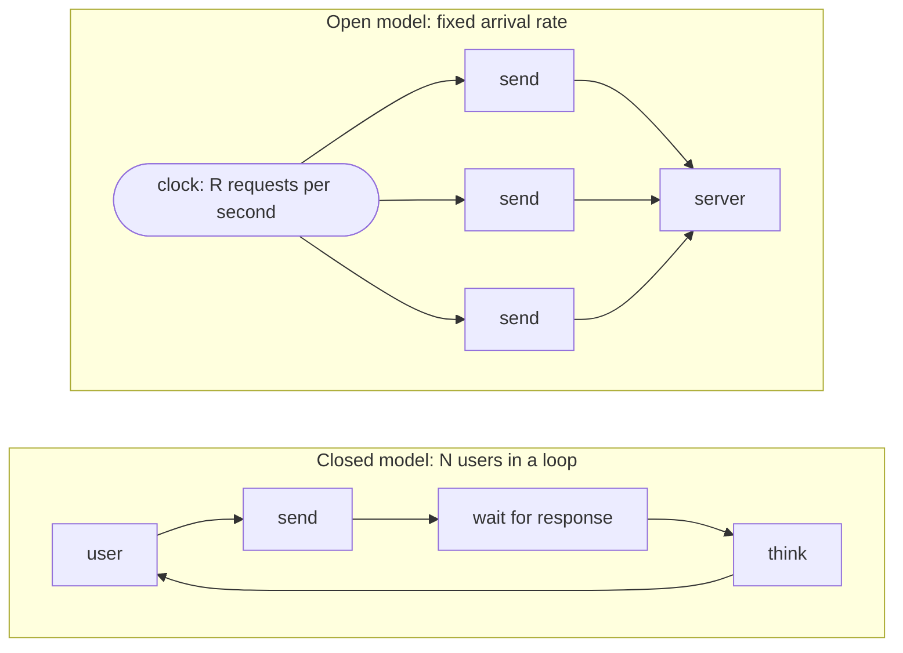

# Load testing

[← Index](index.md)

Load testers such as Locust, k6 and Gatling see an application from the outside. They can
tell you the p95 doubled at 150 requests per second. They cannot tell you **which query**
went from 3 ms to 410 ms. Redline's profiler sees the inside, one request at a time. The
load tester joins the two: it drives your app at a controlled rate, tags every request, and
then shows, per step of the test, **what got slower inside the server**.

```text
Bottlenecks                      10 rps     50 rps    100 rps   150 rps    growth
SELECT ... FROM shop_order ...    3.1 ms     4.0 ms    62 ms    410 ms     132x
GET /api/orders                    18 ms      24 ms    120 ms   690 ms      38x
```

It ships in `redline-core`. Install the `load` extra (it needs `httpx`):

```bash
pip install "redline-core[load] @ git+https://github.com/Pythondeveloper6/redline#subdirectory=packages/redline-core"
```

The command is `redline`.

## Concepts

You can skip this section and use the [quickstart](#quickstart), but the three ideas below
decide whether a load test tells you the truth.

### Open versus closed model



A **closed** model runs N virtual users in a loop: send a request, wait for the response,
think, send the next. When the server slows down, the users slow down too, so the offered
load *falls* exactly when you most need it to hold. The test politely stops hurting the
server it is meant to stress.

An **open** model sends requests at a fixed arrival **rate**, whether or not earlier ones
have finished, the way independent users on the internet behave. When the server slows
down, requests pile up, queues grow and latency climbs, which is what happens in
production. Redline uses the open model: you choose requests per second, not users.

### Coordinated omission

A load generator that waits for each response before sending the next one measures the
wrong thing: if one request stalls for two seconds, it silently *omits* the requests it
should have sent in that time, and the slow period is under-counted. This is **coordinated
omission**, and it makes latency charts look much better than reality.

Redline schedules each arrival on a timetable and measures latency from the **scheduled**
time, not from when the request was finally sent. If the generator was late, or the
connection pool was busy, that waiting counts. Arrivals that cannot even be started
because too many requests are already in flight are counted as **dropped** and shown in
the results, never hidden.

### The knee

Plot achieved throughput and p95 latency against offered load. For a while the server keeps
up: latency is flat, throughput follows the target. Then, at some load, it bends: latency
shoots up, errors appear, or throughput stops following the target. That bend is the
**knee**, and the load just before it is your **maximum healthy rate**.

Redline finds the knee for you in a ramp or step test. It is the first complete step where
any of these is true:

- p95 is more than **2x** the first step's p95;
- the error rate is above **1%**;
- the achieved rate is below **90%** of the target.

The p95 rule compares with the first step, so the first step can only be the knee through
errors or a missed target. A step cut short by a stop is reported but never decides the
knee.

## Quickstart

1. Start your app (with Redline mounted, so the run can be correlated; see below).
2. Generate a scenario from what Redline already knows:

   ```bash
   redline load init --from-traces -o scenario.toml
   ```

   or from an OpenAPI schema:

   ```bash
   redline load init --from-openapi http://localhost:8000/openapi.json -o scenario.toml
   ```

3. Open `scenario.toml`, check the `base_url` and the request list, and set weights.
4. Run a step test:

   ```bash
   redline load scenario.toml --steps 10:100:10 --step-duration 20s
   ```

   That is 10, 20, ... 100 requests per second, 20 seconds each.

5. Read the table, then open the run in the UI (the link is printed at the end as
   "Open the run in Redline: …") to see the chart and the bottlenecks. The link uses
   `--ui-url`, else the scenario's `ui_url`, else `mount_path` from your project's Redline config,
   else `/_redline`; with Django (mounted where your URLconf puts it, often `/redline/`) pass
   `--ui-url /redline` or set `ui_url` in the scenario.

```text
redline load: browse → http://127.0.0.1:8000
run 7c1e...: steps 10 to 100 rps by 10, 20s each
step   target  achieved    sent      ok    err   drop      p50      p95      p99      max   err%
   1     10.0      10.0     200     200      0      0     12ms     21ms     38ms     64ms   0.0%
   2     20.0      20.0     400     400      0      0     13ms     23ms     41ms     70ms   0.0%
   ...
   7     70.0      69.8    1396    1390      6      0     41ms    190ms    420ms    910ms   0.4%
   8     80.0      71.2    1424    1380     44      0    210ms    1.40s    2.10s    3.50s   3.1%

total: sent 6420  ok 6370  errors 50  dropped 0  p50 38ms  p95 410ms  p99 1.80s
knee: step 8 – error rate 3.1% > 1%
max ok rps: 69.8
verdict: saturated (knee at step 8 (80 rps): error rate 3.1% > 1%)
```

!!! warning "Test an environment you own"

    A load test is an attack on whatever it points at. Run it against your own local,
    staging or review environment. Never point it at a production system, a shared
    dependency or someone else's service. In a shared staging environment, tell the
    people who use it.

### Correlating with the app

Every request carries a header `X-Redline-Run: <run_id>;step=<n>`. A Redline-instrumented
app turns it into the trace tags `run_id` and `step`, as long as that run is in the app's
store and running (or ended less than a minute ago): a made-up header tags nothing, and a
run with `--no-store`, or written to another store, does not tag the app's traces. The
**bottleneck** analysis joins
those tags with the per-query summaries, so the app must be recording the load. Remember
[sampling](production.md#sampling): in a profile that keeps 5% of requests you still get
enough traces at high rps, but at 5 rps you may get none. Raise `sample_rate` on the
instance under test.

The run itself (its steps and latency histograms) is written to the same store the app
uses. The default is `.redline/redline.db` in the working directory, and `--store` points
elsewhere, so run the command from the app's directory or pass the path. The UI then lists
it under **Load**.

## Profiles

A profile says how the rate changes over time.

| Mode | Shape | Parameters |
|---|---|---|
| `constant` | one step at a fixed rate | `rps`, `duration_s` |
| `ramp` | the rate rises (or falls) linearly | `start_rps`, `end_rps`, `duration_s`, `step_duration_s` (default 5 s) |
| `steps` | a staircase | `start_rps`, `end_rps`, `step_rps`, `step_duration_s` (default 30 s) |

Results are reported **per step**. A ramp is reported in steps too (each at the ramp's
rate at the step's midpoint), so the knee finder works on it. Prefer `steps` when looking
for a knee: each step is long enough for a stable p95, and "the server held 70 rps and
broke at 80" is a sentence you can act on.

`stop_on` ends the run after the first step that breaches a limit, so a test does not keep
hammering a server that has already fallen over:

```toml
[profile]
mode = "steps"
start_rps = 10
end_rps = 200
step_rps = 10
step_duration_s = "20s"
stop_on = { error_rate = 0.05, p95_ms = 2000 }
```

Arrivals are evenly spaced by default. `poisson = true` (or `--poisson`) uses random
inter-arrival times with the same mean, which is closer to independent real users and
produces burstier queues.

## Scenario reference

A scenario is a **TOML** file (Python 3.11 or newer, or the `tomli` package), a **JSON**
file, or a **Python** file that defines `SCENARIO = {...}`.

```toml
name = "browse"
base_url = "http://127.0.0.1:8000"
headers = { Accept = "application/json" }
timeout_s = 10

[[requests]]
name = "orders"
path = "/api/orders/?page={random_int:1:20}"
weight = 3

[[requests]]
name = "order detail"
path = "/api/orders/{random_int:1:500}/"
weight = 5

[[requests]]
name = "add to cart"
method = "POST"
path = "/api/cart/"
json = { sku = "A-1", qty = 1 }
expect_status = [200, 201]

[profile]
mode = "steps"
start_rps = 10
end_rps = 100
step_rps = 10
step_duration_s = "20s"
stop_on = { error_rate = 0.05, p95_ms = 2000 }
```

### Top-level keys

| Key | Default | Meaning |
|---|---|---|
| `name` | file name | Shown in the UI |
| `description` | | Free text |
| `base_url` | required, here or with `--base-url` | `http://` or `https://` root of the app. Requests use paths only |
| `headers` | `{}` | Sent with every request |
| `timeout_s` | `10` | Per-request timeout. A timeout is an error |
| `requests` | required | A non-empty list. At least one needs `weight > 0` |
| `profile` | constant 10 rps for 30 s | See [Profiles](#profiles) |
| `workers` | min(CPUs, 8) | Worker **processes** |
| `connections` | `64` | Keep-alive connections per worker |
| `max_inflight` | `1000` | In-flight cap per worker; arrivals beyond it are counted `dropped` |
| `seed` | random | Integer seed for placeholders and request choice, for repeatable runs |
| `ui_url` | config `mount_path`, else `/_redline` | Where the Redline UI is mounted (path on `base_url`'s host, or a full URL); only used for the printed link |

Durations accept a number of seconds or strings such as `"20s"`, `"2m"`.

### Request keys

| Key | Default | Meaning |
|---|---|---|
| `name` | method and path | Label in results |
| `method` | `GET` | `GET`, `HEAD`, `OPTIONS`, `POST`, `PUT`, `PATCH`, `DELETE` |
| `path` | required | Must start with `/`. May contain placeholders |
| `weight` | `1` | Relative frequency. `0` keeps the request in the file but never sends it |
| `headers` | `{}` | Added to the top-level headers |
| `json` | none | A JSON body; sets `Content-Type: application/json` |
| `body` | none | A raw string body |
| `expect_status` | any status below 400 | A list of acceptable status codes. Anything else counts as an error |

### Placeholders

Rendered separately for every request:

| Placeholder | Result |
|---|---|
| `{random_int:A:B}` | a random integer from A to B, inclusive |
| `{random_choice:a\|b\|c}` | one of the listed values |
| `{uuid}` | a fresh random UUID (32 hex digits, no dashes) |

Any other `{...}` in a path is an **error**, so an OpenAPI path such as `/orders/{id}` can
never be sent by accident.

### Authentication

Put credentials in `headers`. Do not commit tokens: read them from the environment in a
Python scenario.

```python
# scenario.py
import os

SCENARIO = {
    "name": "authenticated browse",
    "base_url": "http://127.0.0.1:8000",
    "headers": {"Authorization": f"Bearer {os.environ['LOAD_TOKEN']}"},
    "requests": [{"path": "/api/orders/", "weight": 1}],
    "profile": {"mode": "constant", "rps": 50, "duration_s": 30},
}
```

## CLI reference

`redline load SCENARIO [options]`. Options override the scenario:

| Option | Meaning |
|---|---|
| `--rps N` | constant rate |
| `--ramp A:B` | ramp from A to B rps over `--duration` |
| `--steps A:B:STEP` | steps from A to B rps, STEP apart, each `--step-duration` |
| `--duration 60s` | total duration (default 30 s for constant and ramp) |
| `--step-duration 30s` | length of each step |
| `--poisson` | Poisson arrivals instead of evenly spaced |
| `--workers N` | worker processes |
| `--base-url URL` | override the scenario's `base_url` |
| `--ui-url PATH\|URL` | where the Redline UI is mounted, for the printed link (overrides the scenario's `ui_url`) |
| `--name TEXT` | run name |
| `--store PATH` | store to write the run to (default `.redline/redline.db`) |
| `--no-store` | do not write to a store |
| `--json OUT` | also write the results as JSON |
| `--fail-p95-ms X` | exit 1 if the run-wide p95 exceeds X ms |
| `--fail-error-rate Y` | exit 1 if the error rate exceeds Y (`0.01` or `1%`) |
| `--quiet`, `-q` | only print the final table |
| `--ui-url URL` | the Redline UI address printed in the "See bottlenecks in the Redline UI at ..." line after the run. Default: the scenario's host plus the `mount_path` setting (from `redline.toml` or `REDLINE_MOUNT_PATH`), else `/_redline` |

`--rps`, `--ramp` and `--steps` are mutually exclusive. `redline load init` writes
scenarios; see [Generating scenarios](#generating-scenarios).

Exit codes: `0` ok, `1` a `--fail-*` threshold was breached or the run failed, `2` usage or
scenario error, `130` interrupted with Ctrl-C (the partial results are still saved).

### Workers

The generator runs as several **processes** (asyncio and httpx in each), not threads, so
that the Python GIL in the generator does not cap the rate it can offer or distort the
latency it measures. Each worker sends per-second histograms to the parent. All workers
follow the same precomputed plan from a shared start time, so step boundaries line up
without any messaging. The number of workers never exceeds the target rate.

For a high rate, raise `--workers` up to your core count, leaving one for the app if it
runs on the same machine. A generator on the same machine competes with the app for CPU;
for numbers you trust, run it from another host.

## Reading the results

### The step table

| Column | Meaning |
|---|---|
| `target`, `achieved` | the offered rate, and what was actually completed per second |
| `sent`, `ok`, `err` | requests started, successful, failed |
| `drop` | arrivals that could not start because the in-flight cap was reached. Non-zero means the **generator** or the server's queue was saturated |
| `p50`, `p95`, `p99`, `max` | latency, from the *scheduled* time |
| `err%` | errors divided by completed requests |

An error is a status outside `expect_status`, a timeout, or a connection failure; the
final summary breaks them down (`timeout x12, 503 x31`).

The verdict is one word:

| Verdict | Meaning |
|---|---|
| `healthy` | no knee in the tested range. Raise the top of the range to find it |
| `saturated` | a knee after at least one good step. `max ok rps` is the last good step |
| `failing` | the very first step is already the knee. Lower the starting rate |
| `no data` | no complete step |

### Bottlenecks

The **Bottlenecks** table in the UI answers "what got slower". It joins the traces tagged
with the run, step by step, with their per-fingerprint and per-route summaries:

| Item kind | Compared |
|---|---|
| `sql` | mean time per execution of each query, by step |
| `route` | mean time per request of each endpoint, by step |

Each item shows its mean and p95 at every step and a **growth** factor: the last step's
mean divided by the first's (floored at 0.01 ms to avoid dividing by nothing). Items are
sorted by growth, so the top row is the thing that degraded most as load rose. Click one
to open a sample trace, with its callsite.

### What a bottleneck usually means

| Pattern | Usually |
|---|---|
| One SQL statement's time grows 100x | a missing index or a lock; run [EXPLAIN](explain.md) on a sample |
| Every statement grows together; routes grow | the database or its pool is saturated. Look for `pool_wait` spans ([Transactions and locks](transactions.md#pool-waits)) |
| SQL flat, routes grow | the app itself: CPU, GIL, [blocking in async](async-blocking.md), or a downstream call |
| `dropped` rises with flat server latency | the generator is the limit. More workers, or another machine |
| Errors with no matching traces | requests are rejected before the app records them (proxy, worker queue) |

## CI usage

`--fail-p95-ms` and `--fail-error-rate` turn a run into a gate. The exit code is `1` on a
breach, with the reason printed:

```yaml
# .github/workflows/perf.yml (excerpt)
- name: Start the app
  run: |
    python manage.py migrate
    python manage.py runserver 8000 &
    sleep 5
- name: Smoke load test
  run: |
    redline load scenario.toml --rps 30 --duration 30s \
      --fail-p95-ms 400 --fail-error-rate 1% \
      --json load-result.json --no-store
- uses: actions/upload-artifact@v4
  if: always()
  with:
    name: load-result
    path: load-result.json
```

Notes for stable CI numbers:

- Shared CI runners are noisy. Use **generous** thresholds, or compare against a stored
  baseline rather than an absolute number. Use `constant` at a rate comfortably below the
  knee: the goal is to catch a regression, not to find capacity.
- The gate checks the **whole run**, not each step.
- `--json` writes the full per-step results for archiving. `--no-store` skips the SQLite
  file when there is no UI to view it in.

## Starting a run from the UI

With `load_from_ui = True` the **Load** page has a form that starts a run against the app
that serves the UI. It is **off by default** (`403 load_disabled`) and needs
`redline-core[load]`, a file-backed SQLite store, and a store the background process can
write to. It is also blocked by `read_only` (`403 read_only`) and the `load` feature
switch (`404 feature_disabled`), and the `production` preset keeps it off. Turn it on only
in environments where load is welcome. See [Security](security.md#load-from-the-ui).

**Where the run goes.** The request list can contain only paths (a single leading `/`; no
scheme or host), so the form cannot aim the server at somebody else. The target is the
`base_url` setting when you set it. Otherwise it is `127.0.0.1` on the port the server is
**listening** on (ASGI `scope["server"]`, WSGI `SERVER_PORT`), plus the script root; the
`Host` header is never used, so a request cannot aim the run at another service on the
machine. When the port is unknown (the app listens on a unix socket), or the app is not
reachable on `127.0.0.1` (it listens on one specific interface, or behind a container
port mapping), `POST api/runs` answers `400 invalid_body` or the run fails to connect: set
`base_url`:

```toml
# redline.toml
base_url = "http://127.0.0.1:8000"      # the application's own address
```

A `base_url` or `workers` key in the request body is ignored.

**Limits.** Runs started from the UI are capped more tightly than the CLI: at most one
hour, 5 000 requests per second and 200 steps; the body needs a `name`, a non-empty
`requests` list, and a `profile` with a `mode` (`constant`, `ramp` or `steps`), a positive
`duration_s` and the rates that mode needs. A run goes through the same scenario
validation as a file. It runs in a detached `redline load` process, writes into the same
store, and is listed with status `running`, then `done`, `stopped` (you stopped it) or
`failed`. The run's stored config has secret-looking header values, body keys and URL secrets masked (the raw scenario lives in a mode 0600 file that is deleted when the run ends).

The same actions are in the API: `POST api/runs` (`202`), `POST api/runs/{id}/stop`,
`DELETE api/runs/{id}` (`409 run_active` while it runs) ([HTTP API](http-api.md#runs)).

## Generating scenarios

Writing a scenario by hand is fine for a handful of endpoints; for a real app, generate a
starting point and edit it.

| Source | Command | Notes |
|---|---|---|
| **OpenAPI** (FastAPI, Litestar, Django Ninja) | `redline load init --from-openapi URL_OR_FILE` | Path parameters get example values. Operations with required query or header parameters, and all non-GET operations, are written with `weight = 0` so you opt in after reviewing |
| **Captured traffic** | `redline load init --from-traces` | Takes the busiest endpoints from your store (`--top`, `--window`), picks a concrete sample path for each, weights GETs by their share of traffic. Bodies are never copied |
| **Django URLconf** | `python manage.py redline_scenario [-o FILE] [--base-url URL] [--force]` | Every GET route; routes without parameters get `weight = 1`. A parameterised route (`<int:pk>`) is filled with a concrete path from a recent trace of that route, and left out when there is none. The `admin` namespace and Redline's own URLs are skipped. Django Ninja and DRF routes are included. Prints to stdout without `-o` |
| **Flask `url_map`** | `flask redline scenario [-o FILE] [--base-url URL] [--force]` | The same rule over the `url_map` (static files and Redline's own routes skipped). Default base URL `http://127.0.0.1:5000` |

`redline load init` options:

| Option | Meaning |
|---|---|
| `--from-openapi URL\|FILE` | an OpenAPI 3 or Swagger 2 document |
| `--from-traces` | captured traffic in `--store` |
| `--store PATH` | for `--from-traces` (default `.redline/redline.db`) |
| `--window 24h` | how far back to look |
| `--top 10` | endpoints to keep |
| `--include-writes` | also include POST/PUT/PATCH/DELETE (written with `weight = 0`) |
| `--base-url URL` | set `base_url` |
| `-o, --out PATH` | output file; `.toml` or `.json`; `-` prints to stdout (default `scenario.toml`) |
| `--force` | overwrite an existing file |

The generator validates its own output, so a scenario it writes can be run. Write requests
are always disabled by default: a load test that POSTs and DELETEs against a real
database is something to choose deliberately.

## Limits

- It tests **HTTP endpoints over the network**. It does not model browsers, WebSockets or
  think time.
- Latency is as measured by the generator, including the network and the generator's own
  event loop. Distrust sub-millisecond numbers.
- Correlated bottlenecks need the app to record the load; with strong sampling, or a
  store the app is not writing to, the table is empty.
- Run records live in the Redline SQLite store and are subject to
  [history retention](history.md#retention).
