# Refactor check

[← Index](index.md)

You are about to change code that works. You want two answers afterwards: **did anything
break**, and **did it get faster** (or at least not slower)? The refactor check answers both
by replaying the same read-only requests against the old code and the new code and comparing
what came back and how long it took.

You pick a set of `GET` endpoints, record a **baseline** against the code as it is today,
change the code, and run the suite again. Redline gives you a report per endpoint:

- **Response:** the same, changed (with a diff of the fields that differ) or broken.
- **Performance:** faster, slower, same or too noisy to say, decided by a significance test
  and not by one lucky run.
- **Server side:** how many queries each endpoint ran, which SQL statements appeared or went
  away, and which N+1 issues are new or fixed.
- **Overall:** one number for how much faster or slower the suite got, and an exit code you
  can put in CI.

It works from the UI and from the command line (`redline check`).

!!! info "What it is not"

    It is not a load test (see [Load testing](load-testing.md); requests run one at a time),
    it does not send writes (`POST`, `PUT`, `PATCH` and `DELETE` are refused), it does not
    compare two live servers side by side, and it does not check out your code for you. You
    run the old code, then the new code.

## The workflow in three steps

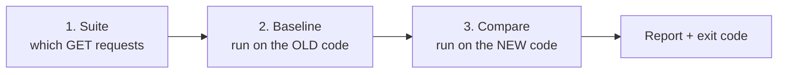

=== "In the UI"

    The UI is at **More → Checks** (`#/checks`).

    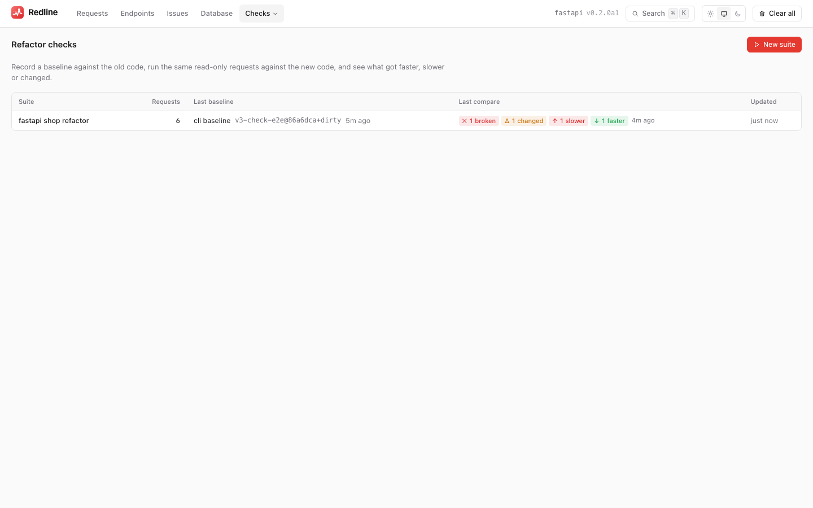{ .rl-shot .rl-only-light }
    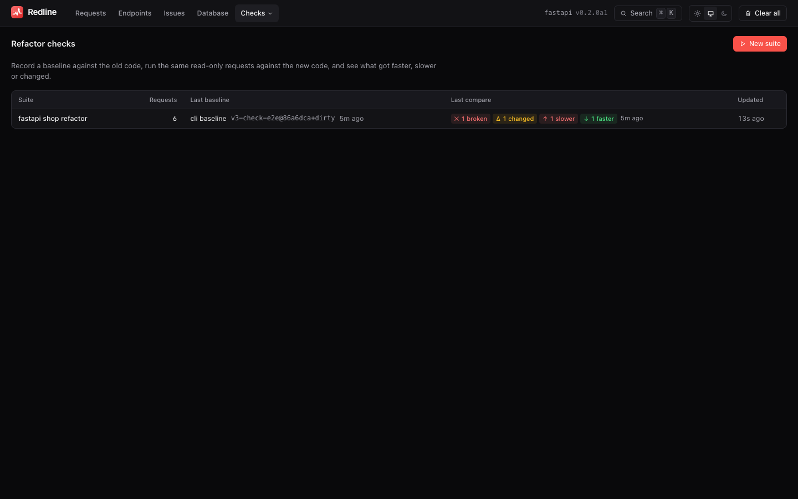{ .rl-shot .rl-only-dark }

    **1. Build a suite.** *New suite* opens the builder. It lists the read-only routes
    Redline has seen, with a sample path and the last p50 and query count of each. Tick the
    ones you want, or add a request by hand. For each request you can turn **Perf** and
    **Response** on or off, add ignore paths, headers and an expected status. Suite-level
    settings are the base URL, repeat, warmup and the thresholds. *Save suite* stores it in the
    Redline store; *Export TOML* gives you the same suite as a file you can commit.

    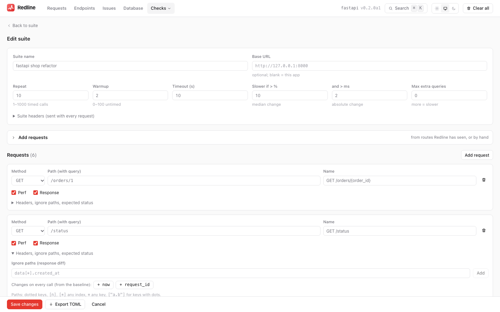{ .rl-shot .rl-only-light }
    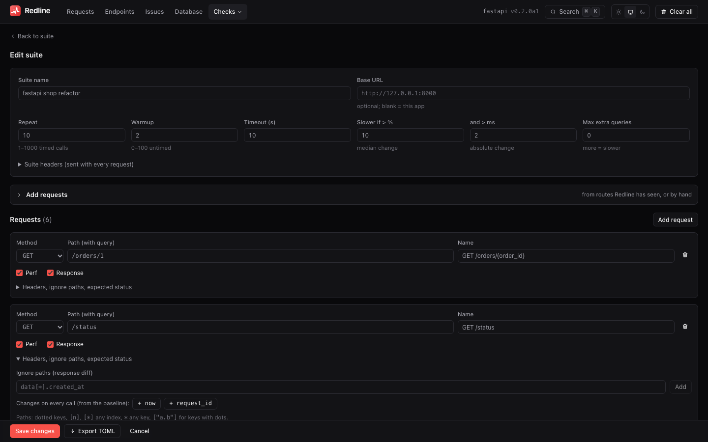{ .rl-shot .rl-only-dark }

    **2. Record a baseline.** On the suite page press *Record baseline*, ideally with a label
    ("before the eager-loading change"). Redline runs the suite in a background process and
    shows live progress.

    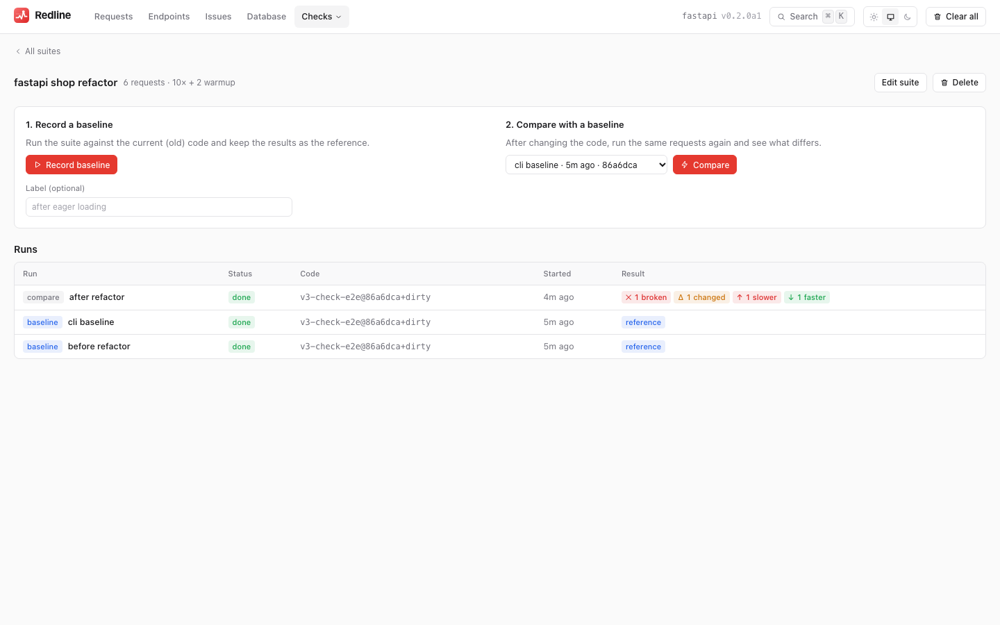{ .rl-shot .rl-only-light }
    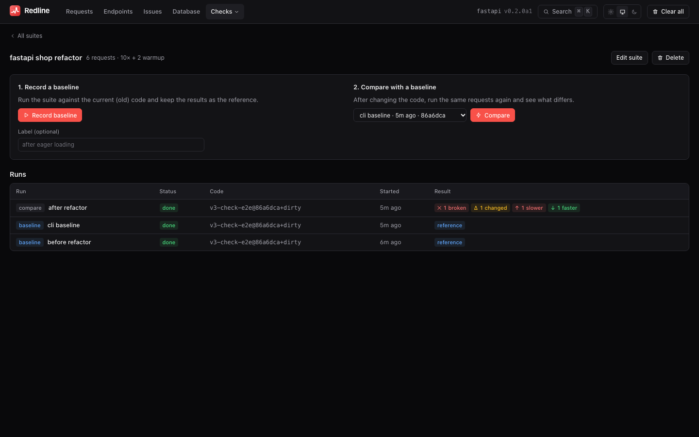{ .rl-shot .rl-only-dark }

    **3. Change the code, restart the app, press *Compare*.** The report opens when the run
    ends. See [Reading the report](#reading-the-report).

    !!! note "Starting runs from the UI is opt-in"

        The Compare and Baseline buttons need `checks_from_ui`, which by default is on only
        in debug mode, and off under the `production` preset. When it is off the buttons are
        disabled and say why; you can still look at runs made on the command line. See
        [Settings](#settings-and-access).

=== "On the command line"

    ```bash
    pip install "redline-core[load] @ git+https://github.com/Pythondeveloper6/redline#subdirectory=packages/redline-core"
    ```

    **1. Write a suite**, either from the traffic Redline has already recorded:

    ```bash
    redline check init --from-traces -o checks/orders.toml
    ```

    or by hand (see the [suite file](#the-suite-file)).

    **2. Record a baseline** with the old code running:

    ```bash
    redline check record checks/orders.toml --label before
    # wrote checks/orders.baseline.json
    ```

    **3. Change the code, restart the app, compare:**

    ```bash
    redline check compare checks/orders.toml --markdown report.md --junit report.xml
    echo $?    # 0 = nothing slower, changed or broken
    ```

    `redline check run SUITE` does step 2 when there is no baseline file yet and step 3 when
    there is one, which is handy for a quick loop. The exit code makes the compare a CI gate,
    see the [CI recipe](#ci-recipe).

!!! tip "Run both sides on the same machine, from a quiet state"

    Timings are only comparable when the machine, the database content and the load on both
    are the same. Close what you do not need, use the same data, and let the suite's warmup
    do its job. If a request shows as *noisy*, raise `repeat`.

## The suite file

A suite is TOML or JSON (`.toml` or `.json`). Python 3.10 needs the `tomli` package to read
TOML; JSON always works. Unknown keys are errors, and every error names the file and the
request, for example `checks/orders.toml: requests[1].method ('delete orders'): DELETE is
refused: ...`.

```toml
name = "orders refactor"
base_url = "http://127.0.0.1:8000"
headers = { Authorization = "Bearer ${env:API_TOKEN}" }
timeout_s = 10
repeat = 20
warmup = 3

[thresholds]
slower_pct = 10
slower_ms = 2
max_query_increase = 0

[[requests]]
name = "list orders"
path = "/orders?page=1"
ignore = ["data[*].created_at", "meta.request_id"]

[[requests]]
name = "order detail"
path = "/orders/1"
expect_status = 200

[[requests]]
name = "health"
path = "/healthz"
perf = false
```

### Top-level keys

| Key | Default | Meaning |
|---|---|---|
| `name` | the file name without its extension | A non-empty name; shown in reports and used for the exported file. `"refactor check"` for a suite given as an object |
| `base_url` | none | `http://` or `https://` URL of the app under test. The CLI's `--base-url` overrides it. Required unless you pass `--base-url` |
| `headers` | `{}` | Headers sent with every request. Values may contain [`${env:NAME}`](#environment-placeholders) |
| `timeout_s` | `10` | Per-call timeout in seconds. More than `0`, at most `600` |
| `repeat` | `20` | Timed calls per request. Whole number from `1` to `1000` |
| `warmup` | `3` | Untimed calls per request before timing starts. Whole number from `0` to `100` |
| `thresholds` | see below | When a change is big enough to matter |
| `requests` | required | A non-empty list of requests |

### `[thresholds]`

| Key | Default | Meaning |
|---|---|---|
| `slower_pct` | `10` | The median must change by more than this many percent (`0` or more) |
| `slower_ms` | `2` | ...and by more than this many milliseconds (`0` or more) |
| `max_query_increase` | `0` | More queries per call than the baseline by more than this number makes the request `slower`, whatever the clock says (whole number, `0` or more) |

`--slower-pct` and `--slower-ms` override the first two for one run. Both conditions must
hold, so a 50% change of 0.4 ms is not "slower" and a 1 ms change on a 5 s request is not
either.

### `[[requests]]`

| Key | Default | Meaning |
|---|---|---|
| `name` | `"<METHOD> <path>"` | Unique within the suite. This is what reports show and what a baseline is matched by |
| `method` | `"GET"` | `GET`, `HEAD` or `OPTIONS`. Anything else is an error |
| `path` | required | Path and query, starting with a single `/`, no whitespace. A full URL (`https://...`, `//host/...`) is refused: set `base_url` instead |
| `headers` | `{}` | Merged over the suite headers (same name wins). Same `${env:NAME}` rules |
| `perf` | `true` | Compare timing and queries |
| `response` | `true` | Compare status, headers and body. At least one of `perf` and `response` must be on |
| `ignore` | `[]` | JSON paths excluded from the body diff, see [Ignore paths](#ignore-paths) |
| `ignore_headers` | `[]` | Response headers to leave out of the comparison (names, case-insensitive). `content-type` is always compared |
| `expect_status` | none | A status code or a list of them (`100` to `599`). A response with any other status is `broken` |

A request with `perf = false` only makes two calls (the first and last timed round) because
that is enough to capture its response; it does not add `repeat` calls to the run.

### Environment placeholders

Put secrets in the environment, not in the file. `${env:NAME}` in a header value is replaced
when a run starts:

```toml
headers = { Authorization = "Bearer ${env:API_TOKEN}", Cookie = "${env:SESSION_COOKIE}" }
```

- `NAME` is letters, digits and underscores, not starting with a digit.
- If the variable is not set the run stops before sending anything: `environment variable
  API_TOKEN is not set`.
- The placeholder, never the value, is what is stored, exported and written to baselines
  (see [Security](security.md#refactor-checks)).

### Ignore paths

`ignore` removes fields from the response comparison. The syntax is the same one the diff
prints.

| Path | Matches |
|---|---|
| `meta.request_id` | the key `request_id` inside `meta` |
| `data[*].created_at` | `created_at` of every item of the list `data` |
| `data[0].price` | `price` of the first item only |
| `*.updated_at` | `updated_at` of any key directly under the top level |
| `["a.b"]` | a key that contains a dot (also use this form for brackets, quotes, spaces or a literal `*`) |
| `items[*]["a b"]` | a key with special characters inside a list |
| `$` | the whole body |

A rule also covers everything **below** the path it names, so `meta` ignores
`meta.request_id` and `meta.generated_at` together. A leading `$.` is allowed
(`$.data[*].id`). A rule that does not parse is an error naming the request and the rule.

!!! note "Text bodies"

    For a body that is not JSON (HTML, plain text) there are no paths. The diff is a unified
    diff of the lines, and lines that changed between two calls are ignored as volatile
    (below).

### Why only read-only methods

A check replays every request many times: a warmup, `repeat` timed calls, and then again for
the baseline. For a `GET` that is harmless. For a `POST /orders` it would create dozens of
orders in whichever database you pointed it at, and the second run would not even see the
same data as the first. Redline refuses `POST`, `PUT`, `PATCH`, `DELETE` and the rest with a
message that says so, in the file loader, in the builder and in the API, so a suite cannot be
saved with one in it. If an endpoint has side effects on `GET`, do not put it in a suite.

## How fields that change on every call are found

Many responses carry a timestamp, a request id or a random token. Compared byte for byte they
would be reported as changed on every run. Redline handles this in two ways.

1. **During `record`**, the full response is kept for two of the timed calls, the first and
   the last. Everything that differs between those two responses is **volatile** and is
   excluded from later comparisons. JSON bodies are compared path by path (`meta.request_id`),
   text bodies line by line (`line:7`), and a differing header is volatile too.
2. **During `compare`**, the same is done to the new run's own first and last responses, so a
   field that only started varying with the new code does not show up as a difference.

The report lists what was ignored ("changes on every call") next to what you ignored by rule,
so nothing is hidden: the UI shows them under *Ignored*, and the builder offers them as
`ignore` suggestions once a baseline exists.

A field that changes only now and then (a timestamp rounded to the minute) can slip past this
check. If you see it reported as `changed`, add it to `ignore`.

Secrets in responses are masked by the [redactor](security.md#redaction) on **both**
sides before comparing, so a masked token never shows as a difference.

## How verdicts are decided

For each request the report has two independent verdicts.

### Performance: `faster`, `slower`, `same`, `noisy`, `n/a`

The runner does the following, per request:

1. **Warmup.** `warmup` calls that are not measured, so connection set-up, import costs, caches
   and the database's own cache do not count against whichever side happened to run first.
2. **Interleaving.** The timed calls are made round-robin across the whole suite
   (request 1, 2, ..., N, then 1, 2, ..., N again) and not all 20 of one request in a row.
   Slow drift on the machine (thermal throttling, a background job, a cache filling up)
   spreads over every request instead of landing on one of them.
3. **Samples.** Each timed call records wall-clock time, response body read included.

Then the two sets of samples (before and after) are compared:

- **Change** is the after median against the before median, in milliseconds and percent.
- **Significance.** A two-sided **Mann–Whitney U test** on the samples. It asks whether one
  side's timings are systematically higher than the other's, without assuming a bell curve,
  which timings do not follow (they have a long tail of slow outliers). A change counts only
  when `p < 0.01`.
- **`slower`** needs the change to be significant **and** bigger than both `slower_pct` and
  `slower_ms`. **`faster`** is the mirror image. Anything else is **`same`**.
- **`noisy`** replaces all of that when either side's **coefficient of variation** (standard
  deviation over mean) is above `0.5`. The numbers are too scattered to trust a verdict;
  raise `repeat`, or quiet the machine.
- **`n/a`** when `perf` is off, the request is not in the baseline, there are no timed samples,
  or its response is `broken` (below). A broken request shows its numbers but is **not
  judged** ("perf not judged: response broken"): an error page is fast, and an error handler
  that skips the queries looks like an N+1 fix. Its fixed issues, gone SQL and query
  decrease are not counted as wins, and it is left out of the overall speed and the query
  totals.

**The query rule.** When server-side metrics are available (see [below](#server-side-metrics)),
a request whose median query count rose by more than `max_query_increase` is `slower` with
the reason `queries`, even if the clock says `same`. A refactor that adds a query per row is
a regression even on a fast development database with five rows. Newly appearing N+1 or
duplicate-query issues are listed as *new issues*, and issues that disappeared as *fixed
issues*.

### Response: `same`, `changed`, `broken`, `missing`, `n/a`

- **`broken`**: the status went from below 400 to 400 or above (`200 → 500`), or the
  request has `expect_status` and got another one, or at least half of its calls failed
  (connection error or timeout). That last rule applies even if `response` is off.
- **`changed`**: any other status change, a different content type, or a body difference
  outside the ignored and volatile fields. Compared headers are `content-type` plus
  `location`, `cache-control`, `content-encoding`, `content-language`,
  `content-disposition`, `vary`, `allow` and `access-control-allow-origin`, minus your
  `ignore_headers`.
- **`missing`**: the baseline has no request of that name (the suite grew since it was
  recorded). It fails by default; the report also carries a warning. If *none* of the suite's
  requests is in the baseline, the compare stops with exit code `2`: "baseline … has none of
  this suite's requests — was it recorded from a different suite?".
- **`same`**: none of the above.

JSON differences are a list of `added`, `removed`, `changed` and `type` entries with the path
and the before and after values (each cut at 200 characters, at most 50 entries per request,
with a count of the rest). Text differences are a unified diff of up to 200 lines.
**Arrays are compared index by index**, so inserting one item at the start of a list shows as
every later item changing. Bodies over 1 MiB, and binary bodies, are compared by SHA-256 and
size only.

### A worked example

The suite has three requests; `repeat` is 20, the defaults are in force, and both runs had
server-side metrics.

| Request | Median before → after | Δ | Queries | What happens |
|---|---|---|---|---|
| `list orders` | 48.0 ms → 30.5 ms | −36.5% | 31 → 3 | Significant (`p ≈ 1e-7`), −17.5 ms is past 2 ms and −36.5% is past 10%: **faster**. Queries fell by 28 and a `duplicate_query` issue is listed as **fixed** |
| `order detail` | 12.0 ms → 12.9 ms | +7.5% | 4 → 4 | Even if the test were significant, 7.5% is under `slower_pct`: **same** |
| `customer export` | 20.0 ms → 20.4 ms | +2.0% | 2 → 5 | Time is **same**, but the median went 2 → 5 queries and `max_query_increase` is 0: **slower (queries)** |

Say `order detail`'s response also lost the field `customer.email`. Its response verdict is
**changed**, with the diff entry `customer.email removed`. With the default `--fail-on
slower,changed,broken` the run fails on `customer export` (slower) and `order detail`
(changed), and the overall speed change is the geometric mean of the three time ratios
(0.635, 1.075 and 1.020), about **−11%**: ratios multiply, so a 2× speed-up and a 2× slow-down
cancel out, which an arithmetic mean of percentages would get wrong.

## Server-side metrics

The client side alone knows how long the response took. To also report queries, query time and
SQL, Redline needs the app's own traces of the check calls.

Every call of a check carries a header `X-Redline-Check: <run id>;req=<index>;n=<call number>`
(`n=0` for warmup calls). An app instrumented with Redline stores it as tags
(`check_run_id`, `check_req`, `check_n`) on that request's trace. After the run, the checker
reads those traces and gives each request:

- the median server duration, the median and maximum query count, and the query time;
- the SQL statements by fingerprint with their counts per call (so a statement that appeared
  or went away is listed as *new SQL* or *gone SQL*, with a link to a sample trace);
- the issues seen (so *new issues* and *fixed issues*).

What this needs:

- **The same store.** The checker reads the same SQLite file the app writes to. In the UI
  that is automatic, because the run is started by the Redline that serves the app. On the
  command line pass `--store PATH` (it defaults to the configured `storage_path` when that
  file exists). Against a remote app, or an app whose store you cannot read, use `--no-store`
  or let it find nothing: the report says *server-side metrics: unavailable* and the
  client-side verdicts still work.
- **An app that runs Redline**, with the check calls kept. Sampling does not drop them: a
  tagged call is kept even when `sample_rate` would have dropped it.
- **A real, running check.** The store only honours a `check_run_id` it knows: a check that is
  running, or ended less than a minute ago. The CLI writes the run into the store before it
  sends the first request.

**Why a made-up tag does nothing.** A header is controlled by whoever sends the request, so if
any tag were believed anyone could make Redline store requests, or fill its tables, just by
adding a header. Run ids are random 128-bit values that only users of Redline see. A request
with a tag for a run that does not exist keeps its normal sampling decision and loses the
`check_*` tags; a request that would only have been kept *because of* the tag is dropped. See
[Security](security.md#refactor-checks).

## Reading the report

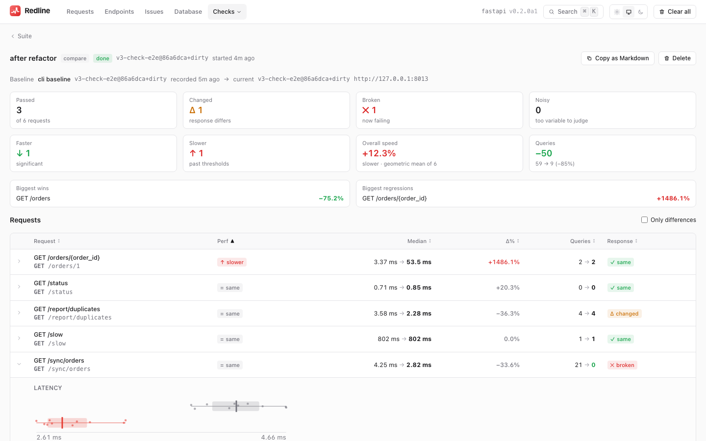{ .rl-shot .rl-only-light }
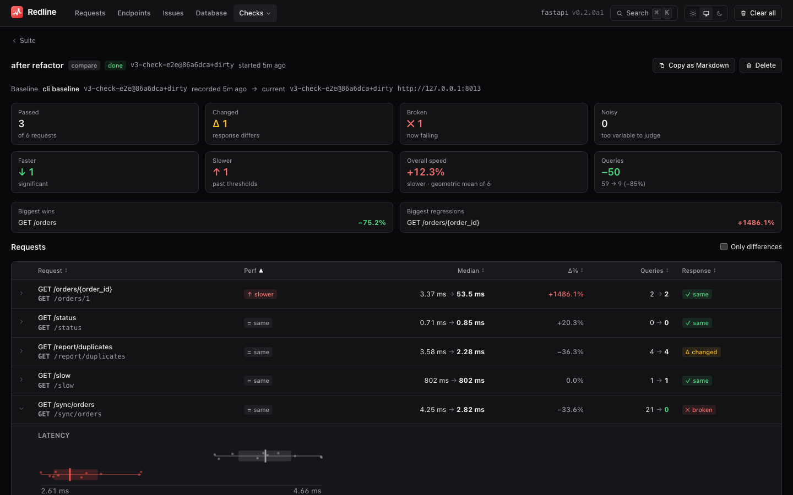{ .rl-shot .rl-only-dark }

**In the UI** (`#/checks/runs/{id}`) the top shows cards for passed, changed, broken, faster
and slower requests, the overall speed change and the total change in queries, plus the five
biggest wins and regressions. The table has a row per request: the performance verdict,
median before → after, the change in percent, queries before → after and the response
verdict. It is sortable. A row expands to show:

- the **latency** of both runs side by side;
- the **response diff** (paths with before and after values, or a unified text diff);
- **new and fixed issues** and **new and gone SQL**, with links to sample traces;
- the **ignored** fields, split into changes on every call and your own rules.

*Copy as Markdown* puts the PR-comment version on the clipboard. While a run is going the page
shows its live progress.

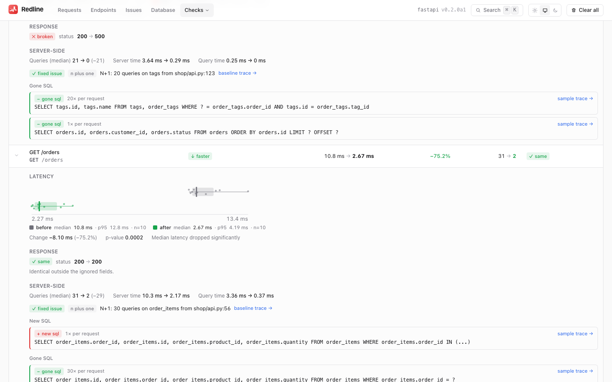{ .rl-shot .rl-only-light }
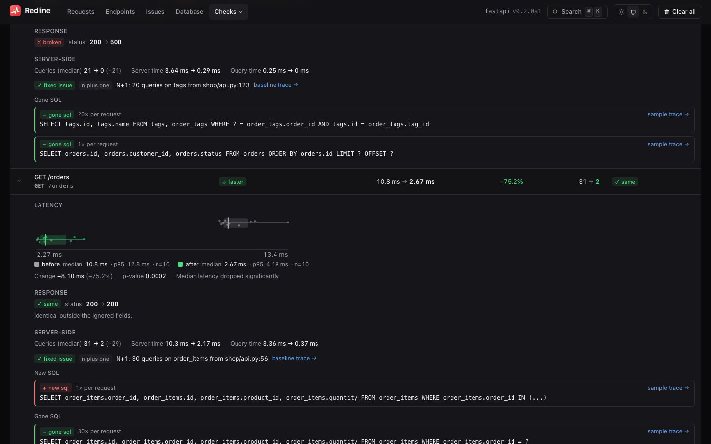{ .rl-shot .rl-only-dark }

**In the terminal**, `compare` prints a table and a verdict line (colour when it is a TTY,
`--no-color` to disable):

```text
redline check: orders refactor – compared with baseline 'before' 3f9a2c1e 2026-10-27 09:14

request          perf      median before → after     Δ  queries   response
list orders      faster    48.0 ms → 30.5 ms     -36.5%  31 → 3   same
order detail     same      12.0 ms → 12.9 ms      +7.5%  4 → 4    changed (1 difference)
customer export  slower (q) 20.0 ms → 20.4 ms     +2.0%  2 → 5    same

order detail:
  - customer.email: removed (was "ada@example.com")
list orders:
  fixed issue: duplicate_query – 28 identical queries

3 requests · perf: 1 faster, 1 slower, 1 same · response: 1 changed, 2 same · overall 11.4% faster · queries 37 → 12 (-25)
FAIL: 2 of 3 requests match --fail-on slower,changed,broken,missing: order detail, customer export
```

(Column spacing and wording are illustrative.) `redline check show report.json` prints a
saved JSON report again, and can write the Markdown and JUnit files from it.

## Outputs and exit codes

`compare` and `run` can write any of these in the same run:

| Flag | Output |
|---|---|
| `--json OUT` | the full report: suite, baseline, run, summary and every request's performance, server and response results |
| `--markdown OUT` | a PR comment: a PASS/FAIL line, a summary, a table, and a collapsible diff per changed request |
| `--junit OUT` | JUnit XML, one test case per request; a request whose verdict matches `--fail-on` is a failure with the diff as its text |
| `--ruff [PATH]` | include Ruff JSON (or run `ruff check --select F --output-format json`) as a table in Markdown and a `ruff` suite in JUnit; findings fail the command |

| Exit code | Meaning |
|---|---|
| `0` | Nothing matched `--fail-on` (or `record` finished) |
| `1` | At least one request matched `--fail-on` |
| `2` | Usage, suite or baseline error (bad file, unset `${env:NAME}`, missing baseline) |
| `3` | The app could not be reached at all: every call of the first round failed to connect |
| `130` | Interrupted with Ctrl-C or SIGTERM. A `record` writes no baseline; a `compare` prints the partial report |

`--fail-on` takes a comma-separated list of `slower`, `changed`, `broken`, `noisy`, `faster`,
`missing` and `none`. The default is `slower,changed,broken,missing`. Use `--fail-on broken,changed` to gate on
correctness only (for example when the baseline was recorded on other hardware), or add
`noisy` if you want an unstable measurement to fail the build.

## CI recipe

The most reliable setup records the baseline and runs the comparison **in the same job on the
same runner**, so both sides see the same hardware and the same data: check out the base
commit, record, check out the pull request, compare. The Markdown goes in as a PR comment and
a regression fails the job.

```yaml title=".github/workflows/refactor-check.yml"
name: refactor check
on: pull_request

permissions:
  contents: read
  pull-requests: write

jobs:
  check:
    runs-on: ubuntu-latest
    env:
      API_TOKEN: ${{ secrets.CHECK_API_TOKEN }}     # used by ${env:API_TOKEN} in the suite
    steps:
      - uses: actions/checkout@v4
        with:
          fetch-depth: 0
      - uses: actions/setup-python@v5
        with:
          python-version: "3.12"
      - run: |
          pip install -r requirements.txt
          pip install "redline-core[load] @ git+https://github.com/Pythondeveloper6/redline#subdirectory=packages/redline-core"

      - name: Keep the suite from this PR
        run: cp checks/orders.toml "$RUNNER_TEMP/orders.toml"

      - name: Record the baseline on the base commit
        run: |
          git checkout --detach ${{ github.event.pull_request.base.sha }}
          ./scripts/serve-for-check.sh start .redline/check.db      # migrate, load fixtures, start the app
          redline check record "$RUNNER_TEMP/orders.toml" \
            --store .redline/check.db --label "base ${GITHUB_BASE_REF}" \
            --out "$RUNNER_TEMP/baseline.json"
          ./scripts/serve-for-check.sh stop

      - name: Compare on the pull request
        run: |
          git checkout --detach ${{ github.event.pull_request.head.sha }}
          rm -f .redline/check.db*
          ./scripts/serve-for-check.sh start .redline/check.db
          redline check compare "$RUNNER_TEMP/orders.toml" \
            --baseline "$RUNNER_TEMP/baseline.json" --store .redline/check.db \
            --markdown check.md --junit check.xml --json check.json \
            --fail-on slower,changed,broken
          # a failing compare fails this step; the next two still run

      - name: Comment on the PR
        if: always() && hashFiles('check.md') != ''
        uses: marocchino/sticky-pull-request-comment@v2
        with:
          header: redline-refactor-check
          path: check.md

      - uses: actions/upload-artifact@v4
        if: always()
        with:
          name: refactor-check
          path: |
            check.md
            check.xml
            check.json
```

`scripts/serve-for-check.sh` is yours: it must bring the application up with the same database
content every time and with Redline's store at the given path (for example by exporting
`REDLINE_STORAGE_PATH=$2`), wait until it answers, and stop it again. Keep Redline's `access`
as it is for the app; the check only sends ordinary requests to your routes.

!!! warning "Baselines from another machine"

    If you would rather keep one baseline file, either as a CI artifact from a run on `main`
    or committed to the repository, remember that **timings are only comparable on the same
    hardware**. A baseline recorded on your laptop will make a CI runner look slower. Response
    comparison does not have that problem, so with a committed baseline gate on
    `--fail-on changed,broken`, and keep the `slower` gate for the same-runner setup above.
    Baselines are redacted, so committing one is safe to the same extent as committing a
    response fixture.

### The GitHub Action

For the common case the repository root is a composite action. It installs Redline, runs
`redline check run`, writes the Markdown report to the job summary and keeps **one** sticky
comment on the pull request up to date (found again through a hidden HTML marker, so reruns
edit it instead of adding another). Start the app in an earlier step.

```yaml
permissions:
  contents: read
  pull-requests: write

steps:
  - uses: actions/checkout@v4
  - run: ./scripts/serve-for-check.sh start        # your app, listening on :8000
  - uses: Pythondeveloper6/redline@main            # pin a tag or commit in real use
    with:
      suite: checks/orders.toml
      baseline: checks/orders.baseline.json        # compared when it exists, recorded otherwise
      base-url: http://127.0.0.1:8000
      fail-on: slower,changed,broken
```

| Input | Default | Meaning |
|---|---|---|
| `suite` | required | Suite file |
| `baseline` | `<suite>.baseline.json` | Compared with when present, recorded there when absent |
| `base-url` | the suite's `base_url` | The running app |
| `fail-on` | `slower,changed,broken` | Verdicts that fail the job, or `none` |
| `python-version` | `3.12` | Python used to run Redline |
| `package` | `redline-core[load]` | pip requirement; pin a version or use a git URL |
| `comment` | `true` | Post the sticky comment (pull request events only) |
| `github-token` | `github.token` | Needs `pull-requests: write`; without it the comment is skipped |
| `marker-id` | `redline-check` | Use one per suite when several suites comment on one PR |
| `extra-args` | | Extra `redline check run` arguments |

The step outputs `exit-code` and `report` (the JSON path). The comment is posted by
`redline check comment REPORT` (a `--json` report or a `--markdown` file; `--dry-run` prints
the body, `--no-comment` only writes the job summary). It does nothing outside
`pull_request` events, and a failed API call (for example the read-only token of a fork PR)
only prints a warning: the check's own verdict decides the job result.

A baseline produced in CI can be opened in the UI: `POST api/checks/baselines/import` takes
the JSON file (see [the HTTP API](http-api.md#checks)) and the run appears on the suite's
page.

## Settings and access

| Setting | Default | Meaning |
|---|---|---|
| `checks_from_ui` | `"auto"` | Allow starting baseline and compare runs from the UI. `"auto"` means only while the framework is in debug mode; `true` or `false` force it. The `production` preset sets it to `false`. Off whenever `read_only` is on or the `checks` feature is off |
| `features.checks` | `true` | The Checks page and everything under `api/checks`. Off: those routes answer `404 feature_disabled` and the UI hides the page |
| `base_url` | `None` | Where UI-started checks send their requests, the same setting load runs use. Unset: the server's own listening port on `127.0.0.1`, never the `Host` header |

Runs started from the UI are capped at 200 requests, 5 000 calls in total (each request's
warmup plus repeat, added up) and 15 minutes. See [Settings](settings.md#developer-experience),
[Access control](access-control.md) and [Security](security.md#refactor-checks).

## Try it on the demo shop

Each demo shop in `examples/` (Django, FastAPI, Flask and Litestar) ships a ready suite,
`examples/<fw>/check.toml`, and an environment toggle, `SHOP_REFACTOR=1`, that turns the shop
into "after a refactor". All four shops get the same changes, so one compare shows every kind
of verdict:

- **fixes the N+1** on the orders list (faster, and far fewer queries);
- **slows one endpoint** down on purpose (a `slower` verdict);
- **changes one field** in a response (a `changed` verdict with a diff);
- **breaks one endpoint** (a `broken` verdict).

The `/status` endpoint is in every suite too. The toggle does not change it, but some of its
fields differ on every call, so it shows how the check ignores fields that change on their own
and still reports `same`.

From the repository root, install the workspace once with `uv sync --all-packages`. Then pick a
framework.

### What `SHOP_REFACTOR=1` changes

=== "Django"

    | Endpoint | What `SHOP_REFACTOR=1` does | Expected verdict |
    |---|---|---|
    | `GET /orders/` | adds `prefetch_related("items")` | faster, queries 31 -> 2, fixed N+1 |
    | `GET /dashboard/` | adds a 50 ms sleep | slower |
    | `GET /api/products/` | `price` now has one decimal (`1528.00` -> `1528.0`) | changed (`products[n].price`) |
    | `GET /async/summary/` | raises an error | broken (200 -> 500) |
    | `GET /status/` | unchanged; `now` and `request_id` differ on every call | same (volatile fields ignored) |

=== "FastAPI"

    | Endpoint | What `SHOP_REFACTOR=1` does | Expected verdict |
    |---|---|---|
    | `GET /orders` | fixes the N+1 with `selectinload` | faster, queries 31 -> 2, fixed N+1 |
    | `GET /orders/1` | adds a 50 ms sleep | slower |
    | `GET /report/duplicates` | `products` becomes a string | changed (`products`, type) |
    | `GET /sync/orders` | raises an error | broken (200 -> 500) |
    | `GET /status` | unchanged; `now` and `request_id` differ on every call | same (volatile fields ignored) |

=== "Flask"

    | Endpoint | What `SHOP_REFACTOR=1` does | Expected verdict |
    |---|---|---|
    | `GET /orders` | fixes the N+1 with `selectinload` | faster, queries 31 -> 2, fixed N+1 |
    | `GET /orders/1` | adds a 50 ms sleep | slower |
    | `GET /report/duplicates` | `products` becomes a string | changed (`products`, type) |
    | `GET /orders/tags` | raises an error | broken (200 -> 500) |
    | `GET /status` | unchanged; `now` and `request_id` differ on every call | same (volatile fields ignored) |

=== "Litestar"

    | Endpoint | What `SHOP_REFACTOR=1` does | Expected verdict |
    |---|---|---|
    | `GET /orders` | fixes the N+1 with `selectinload` | faster, queries 31 -> 2, fixed N+1 |
    | `GET /orders/1` | adds a 50 ms sleep | slower |
    | `GET /report/duplicates` | `products` becomes a string | changed (`products`, type) |
    | `GET /sync/orders` | raises an error | broken (200 -> 500) |
    | `GET /status` | unchanged; `now` and `request_id` differ on every call | same (volatile fields ignored) |

Every other request in `check.toml` is unchanged, so it should come out `same`.

### Run the check

Use the same three steps for every framework: record a baseline on the code as it is, restart
the app with the toggle, then compare. The `redline` commands run from the repository root, and
the `--store` path points at the demo's own store (see the note in the example README).

=== "Django"

    ```bash
    # 1. old code: set up the demo and start the app (in its own terminal)
    uv run python examples/django/manage.py migrate
    uv run python examples/django/manage.py seed        # ~400k reviews, takes a few seconds
    uv run python examples/django/manage.py runserver 8000 --noreload
    ```

    Generate some traffic from another terminal, with the curl loop from the example README:

    ```bash
    for u in / /orders/ /items/ /orders/page/ /dashboard/ "/reviews/search/?q=battery" \
             /slow/ "/slow/?_redline=profile" /boom/ /async/summary/ /cached/ /cached/; do
      curl -s -o /dev/null -w "%{http_code} $u\n" "http://127.0.0.1:8000$u"
    done
    curl -s -o /dev/null -H "Authorization: Bearer sk-live-123" http://127.0.0.1:8000/api/products/
    ```

    Record the baseline, from the repository root in another terminal:

    ```bash
    uv run --package redline-core --extra load redline check record examples/django/check.toml \
        --base-url http://127.0.0.1:8000 --store examples/django/.redline/redline.db
    ```

    ```bash
    # 2. "refactored" code: stop the server (Ctrl-C), restart it with the toggle
    SHOP_REFACTOR=1 uv run python examples/django/manage.py runserver 8000 --noreload
    ```

    Compare, from the repository root:

    ```bash
    uv run --package redline-core --extra load redline check compare examples/django/check.toml \
        --base-url http://127.0.0.1:8000 --store examples/django/.redline/redline.db --markdown report.md --junit report.xml
    echo $?   # 1: the refactor made things slower, changed a response and broke an endpoint
    ```

    In the UI, the Checks page is at **http://127.0.0.1:8000/redline/#/checks** (log in as
    admin / admin first; `DEBUG = True` here, so `checks_from_ui` is on).

=== "FastAPI"

    ```bash
    # 1. old code: set up the demo and start the app (in its own terminal)
    cd examples/fastapi
    uv run --project ../.. python seed.py                      # creates shop.db (~2 s)
    uv run --project ../.. uvicorn shop.main:app --port 8000
    ```

    Generate some traffic by hitting the endpoints in the table in the example README
    (open http://127.0.0.1:8000/ or use curl). Then record the baseline, from the repository
    root in another terminal:

    ```bash
    uv run --package redline-core --extra load redline check record examples/fastapi/check.toml \
        --base-url http://127.0.0.1:8000 --store examples/fastapi/.redline/redline.db
    ```

    ```bash
    # 2. "refactored" code: stop the server (Ctrl-C), restart it with the toggle, still in examples/fastapi
    SHOP_REFACTOR=1 uv run --project ../.. uvicorn shop.main:app --port 8000
    ```

    Compare, from the repository root:

    ```bash
    uv run --package redline-core --extra load redline check compare examples/fastapi/check.toml \
        --base-url http://127.0.0.1:8000 --store examples/fastapi/.redline/redline.db --markdown report.md --junit report.xml
    echo $?   # 1: the refactor made things slower, changed a response and broke an endpoint
    ```

    In the UI, the Checks page is at **http://127.0.0.1:8000/_redline/#/checks** (local access
    only; the UI starts runs because `checks_from_ui` defaults to on in debug mode).

=== "Flask"

    ```bash
    # 1. old code: set up the demo and start the app (in its own terminal)
    cd examples/flask
    uv run --project ../.. python seed.py                                # creates shop.db (~2 s)
    uv run --project ../.. flask --app shop.main run --port 8000         # http://127.0.0.1:8000/
    ```

    Generate some traffic by hitting the endpoints in the table in the example README
    (open http://127.0.0.1:8000/ or use curl). Then record the baseline, from the repository
    root in another terminal:

    ```bash
    uv run --package redline-core --extra load redline check record examples/flask/check.toml \
        --base-url http://127.0.0.1:8000 --store examples/flask/.redline/redline.db
    ```

    ```bash
    # 2. "refactored" code: stop the server (Ctrl-C), restart it with the toggle, still in examples/flask
    SHOP_REFACTOR=1 uv run --project ../.. flask --app shop.main run --port 8000
    ```

    Compare, from the repository root:

    ```bash
    uv run --package redline-core --extra load redline check compare examples/flask/check.toml \
        --base-url http://127.0.0.1:8000 --store examples/flask/.redline/redline.db --markdown report.md --junit report.xml
    echo $?   # 1: the refactor made things slower, changed a response and broke an endpoint
    ```

    In the UI, the Checks page is at **http://127.0.0.1:8000/_redline/#/checks** (local access
    only; the UI starts runs because `checks_from_ui` defaults to on in debug mode).

=== "Litestar"

    ```bash
    # 1. old code: set up the demo and start the app (in its own terminal)
    cd examples/litestar
    uv run --project ../.. python seed.py                      # creates shop.db (~2 s)
    uv run --project ../.. uvicorn shop.main:app --port 8000   # http://127.0.0.1:8000/
    ```

    Generate some traffic by hitting the endpoints in the table in the example README
    (open http://127.0.0.1:8000/ or use curl). Then record the baseline, from the repository
    root in another terminal:

    ```bash
    uv run --package redline-core --extra load redline check record examples/litestar/check.toml \
        --base-url http://127.0.0.1:8000 --store examples/litestar/.redline/redline.db
    ```

    ```bash
    # 2. "refactored" code: stop the server (Ctrl-C), restart it with the toggle, still in examples/litestar
    SHOP_REFACTOR=1 uv run --project ../.. uvicorn shop.main:app --port 8000
    ```

    Compare, from the repository root:

    ```bash
    uv run --package redline-core --extra load redline check compare examples/litestar/check.toml \
        --base-url http://127.0.0.1:8000 --store examples/litestar/.redline/redline.db --markdown report.md --junit report.xml
    echo $?   # 1: the refactor made things slower, changed a response and broke an endpoint
    ```

    In the UI, the Checks page is at **http://127.0.0.1:8000/_redline/#/checks** (local access
    only; the UI starts runs because `checks_from_ui` defaults to on in debug mode).

### Read the compare report

This is the Django run, from the steps above. The other frameworks print the same table, with
their own rows (one per request in their `check.toml`):

```text
request                   perf        median before → after        Δ  queries    response
list orders (N+1)         faster      7.94ms → 3.02ms         -61.9%  31 → 2     same
dashboard                 slower      1.59ms → 57.1ms        +3485.5%  3 → 3      same
products API              same        1.50ms → 1.78ms         +18.7%  1 → 1      changed (20 differences)
async summary             slower      2.46ms → 9.11ms        +269.7%  3 → 0      broken (status 200 → 500)
slow view                 same        362ms → 364ms            +0.6%  0 → 0      same
cached top products       same        1.08ms → 1.03ms          -4.9%  0 → 0      same
status (volatile fields)  same        0.86ms → 0.85ms          -1.2%  0 → 0      same

list orders (N+1):  fixed issue: n_plus_one – N+1: 30 queries on shop_orderitem from shop/views.py:45
products API:  ~ products[0].price: 1528.00 → 1528.0 … 8 more
status (volatile fields):  ignored (changes on every call): now, request_id

7 requests · perf: 1 faster, 2 slower, 4 same · response: 5 same, 1 changed, 1 broken · overall 78.0% slower · queries 38 → 6 (-32)
FAIL: 3 of 7 requests match --fail-on slower,changed,broken: dashboard, products API, async summary
```

What each row says:

- **list orders (N+1)**: `faster`, and the queries drop from 31 to 2. The N+1 is reported as a
  fixed issue, with the line that caused it.
- **dashboard**: `slower` on the clock alone. The query count did not change; the 50 ms sleep did.
- **products API**: the speed is `same`, but the response is `changed`. The `price` field of the
  products now has one decimal place, so 20 values differ. Expand the row to see the paths.
- **async summary**: `broken`, because the status went from 200 to 500. The timings of the failing
  calls are still measured, which is why this row also reads `slower`; the response column is the
  verdict that matters here.
- **slow view** and **cached top products**: untouched by the toggle, so `same`. They are there to
  show that an unchanged endpoint stays quiet.
- **status (volatile fields)**: `same`. `now` and `request_id` change on every call, so the check
  lists them as ignored instead of reporting them as differences.

The last line is the exit code's reason. `compare` exits with 1 when any request matches
`--fail-on`, which defaults to `slower,changed,broken`. Here that is three requests, so the
command exits with 1.

### In the UI

The same run is on the Checks page, with the steps from
[the workflow above](#the-workflow-in-three-steps). Open the page for your framework (the URLs
are in the tabs above) and:

1. Build a suite from the routes Redline has seen: *New suite* lists them, and you tick the ones
   you want.

    { .rl-shot .rl-only-light }
    { .rl-shot .rl-only-dark }

    { .rl-shot .rl-only-light }
    { .rl-shot .rl-only-dark }

2. Press *Baseline* on the suite page while the app runs the old code.

    { .rl-shot .rl-only-light }
    { .rl-shot .rl-only-dark }

3. Restart the app with `SHOP_REFACTOR=1`, press *Compare*, and the report opens when the run ends.
   Its cards and table match the terminal output above.

    { .rl-shot .rl-only-light }
    { .rl-shot .rl-only-dark }

    Expand a row to see the latency of both runs, the response diff and the SQL that went away.

    { .rl-shot .rl-only-light }
    { .rl-shot .rl-only-dark }

See [Performance workflows](performance-workflows.md) for per-endpoint budgets, keyed arrays, numeric tolerances, environment warnings and UI verification.

## Limits and what's next

- **Read-only requests only.** `GET`, `HEAD` and `OPTIONS`. There is no way to replay a write
  safely, and the check does not try.
- **Arrays use index order by default.** Opt in to `array_keys` for paths where order is not part of the contract; invalid identities fail comparison.
- **No concurrency.** Requests run one at a time on one connection. That makes the numbers
  stable, and means it says nothing about behaviour under load: use
  [`redline load`](load-testing.md) for that.
- **One app at a time.** You record against the old code, then run again against the new code;
  it does not drive two live servers or check out commits for you (the CI recipe does the
  checkout).
- **Bodies are compared up to 1 MiB**; bigger ones by hash.
- **UI runs are capped** (200 requests, 5 000 calls, 15 minutes). The command line has no cap
  beyond the suite limits (`repeat` up to 1000).

`redline analyze` and its UI are documented in [Performance workflows](performance-workflows.md).
