# The UI

[← Index](index.md)

The web UI is a React single-page app, built ahead of time and shipped inside
`redline-core`. Your adapter serves it from your own application (`/redline/` for
Django, `/_redline/` for FastAPI), so there is nothing to host and no Node.js to install.

It is a client of the [HTTP API](http-api.md), using relative URLs (`./api/...`) and hash
routing (`#/requests`, `#/requests/<id>`, `#/endpoints`, `#/issues`, `#/database`, `#/cache`,
`#/external`, `#/history`, `#/load`, `#/compare/<a>/<b>`). That is why it works
under any mount prefix and needs no catch-all route. Because it follows the system
colour scheme and has a theme switch, every screenshot below is shown in the theme you are
reading these docs in.

## The top bar

{ .rl-shot .rl-only-light }
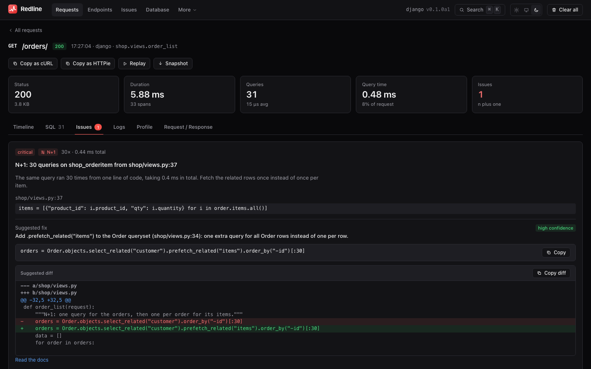{ .rl-shot .rl-only-dark }

| Control | What it does |
|---|---|
| **Requests**, **Endpoints**, **Issues** | The core pages |
| **Database**, **Cache**, **External**, **History**, **Load** | The aggregate pages added in 0.2 (see [below](#aggregate-pages)) |
| Search / command palette | Opens the [palette](#command-palette) (also `Ctrl-K` or `Cmd-K`) |
| Framework and version label | `django v0.2.0a1`, `fastapi v0.2.0a1`, ...; hover for the storage path |
| Theme switch | Light, system or dark. Remembered in the browser's `localStorage` (`redline-theme`) |
| **Clear all** | Deletes every stored request, query, profile and issue, after a confirmation dialog. It calls `DELETE api/traces` and cannot be undone |

## Requests

The live list of recorded requests, newest first.

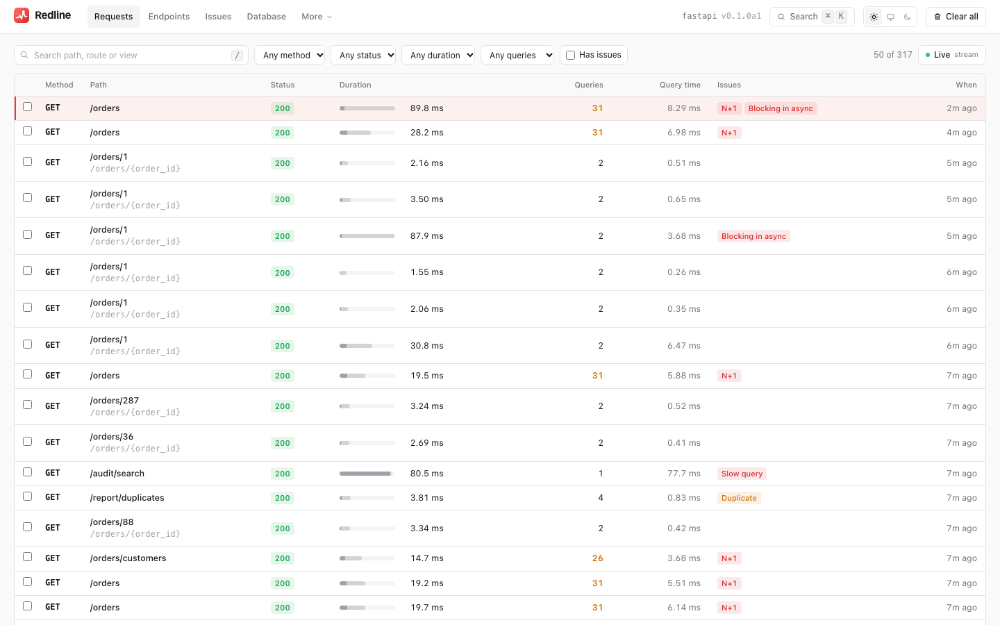{ .rl-shot .rl-only-light }
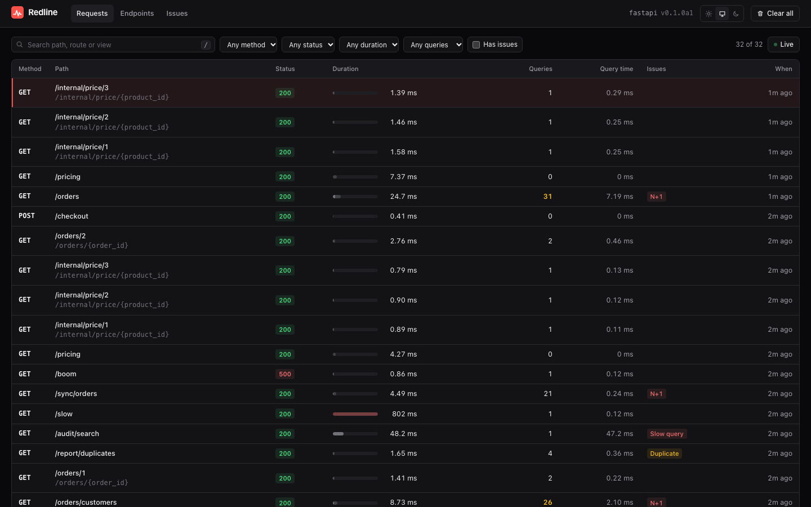{ .rl-shot .rl-only-dark }

Each row shows the method, the concrete path with the route template beneath it (when
they differ), the status, the duration with a bar, the query count, the time in queries,
badges for any issue kinds found, and how long ago it happened. The duration bar is shaded by how much of the request was spent in
queries, and turns amber at 100 ms and red at 500 ms.

### Filters

| Filter | Options | API parameter |
|---|---|---|
| Search | text matched against path, route or view | `q` |
| Method | any, GET, POST, PUT, PATCH, DELETE | `method` |
| Status | any, 2xx, 3xx, 4xx, 5xx | `status` |
| Duration | any, 50 ms, 100 ms, 500 ms, 1 s or more | `min_ms` |
| Queries | any, 5, 10, 25, 50 or more | `min_queries` |
| Has issues | checkbox | `has_issues=1` |

The API accepts more than the UI offers (an exact status code, `route`, `tag=key:value`):
see [The HTTP API](http-api.md#get-apitraces). **Reset** clears all filters.

### Live mode

New requests stream into the list as they happen. The page subscribes to `api/stream`
(Server-Sent Events: one event per new trace, a keep-alive comment every 15 seconds). The
server closes the stream periodically (every five minutes on ASGI servers, about every 25
seconds on WSGI servers) and the page reconnects, resuming after the last trace it saw by
its `seq`, so nothing is skipped or repeated. It falls back to polling every two seconds
when streaming is unavailable. With the `sse`
[feature switch](access-control.md#feature-switches) off, Live mode is hidden. The pulsing **Live** button
pauses (**Pause**, then **Resume**) while you read. The counter shows how many rows are
loaded of how many match. Older rows load with cursor pagination.

Two more filters arrived with 0.2: **SQL** (`sql=`: only requests that ran a statement
containing the text) and `replay_of=` (the replays of one request).

### Keyboard

Press `?` anywhere for the list.

| Key | Where | Action |
|---|---|---|
| `Ctrl-K` / `Cmd-K` | anywhere | Open the command palette |
| `/` | Requests | Focus the search box (elsewhere: open the palette) |
| `?` | anywhere | Show the shortcuts |
| `j` / `k` | Requests | Move the selection down / up |
| `Enter` | Requests | Open the selected request |
| `x` | Requests | Select the request for comparing (at most two) |
| `c` | Requests | [Compare](#compare-two-requests) the two selected |
| `Esc` | anywhere | Leave a field; close a drawer, dialog or the palette |

### Command palette

`Ctrl-K` (`Cmd-K` on a Mac) opens a fuzzy-search box over **pages**, recent **requests**,
**endpoints** and **issues**. Type `orders` to jump to the Orders endpoint, part of an issue
title to open that issue, `db` for the Database page. Arrow keys move, `Enter` opens, `Esc`
closes. It is the fastest way around the UI.

### The empty state

With nothing recorded yet the page shows a ready-to-copy installation snippet for your
framework, which is a reasonable thing to see on a fresh install.

## Request detail

Click a request. The header shows the method, path, status, start time, framework, route
and view. If the request raised, a red box shows the exception type, message and a
collapsible **traceback**. If it produced more than `max_spans_per_trace` spans, an amber
**Trace truncated** notice says how many spans were counted but not stored (query counts,
query time and the N+1 and slow-query issues still include them). Under it five cards:

| Card | Shows |
|---|---|
| Status | the status code and the response size |
| Duration | wall time and the number of spans |
| Queries | the query count (amber from 50) and the average per query |
| Query time | time in SQL and its share of the request |
| Issues | the number of issues and their kinds, or "clean" |

The header also has the request **actions**: [Copy as cURL](#copy-as-curl-and-httpie),
Copy as HTTPie, [Replay](#replay) and [Download snapshot](#snapshots).

Then the tabs. The selected tab is kept in the URL (`?tab=sql`). **Logs** and **Exception**
are the 0.2 additions.

### Timeline

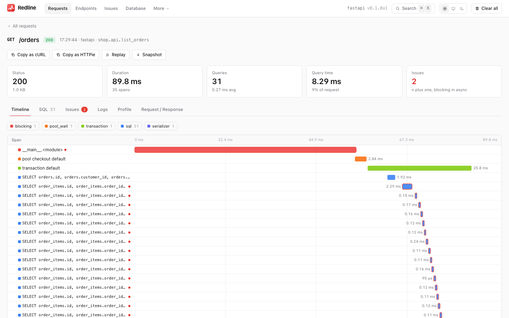{ .rl-shot .rl-only-light }
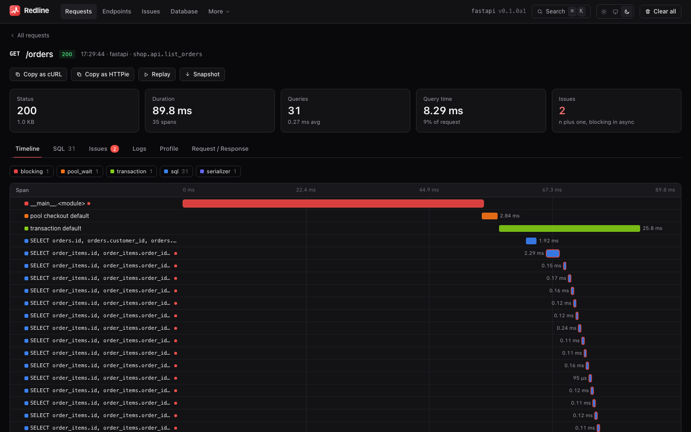{ .rl-shot .rl-only-dark }

A waterfall of the span tree: each row is a span, indented by depth, with a bar placed
on the request's time axis.

- Span kinds are colour-coded: `sql` blue, `cache` amber, `http_out` purple, `template`
  teal, `middleware` grey, `view` green, `custom` pink. The 0.2 kinds (`serializer`,
  `resolver`, `transaction`, `blocking`, `pool_wait`) have their own colours.
- The chips above the chart **toggle a kind** on and off and show its count. Hiding
  `middleware` and `view` is a quick way to see only the I/O.
- A triangle collapses a span's children.
- A red dot marks spans that belong to an issue.
- Hover for a tooltip with the kind, duration, start offset and callsite; click to open
  the span drawer.

### The span drawer

Clicking a span opens a drawer from the side. For SQL it shows the formatted statement,
**Copy SQL**, an **Explain** button (enabled only when the query is explainable), the
parameters, the database alias and vendor, the row count and the fingerprint. For other
kinds it shows their data: cache operation, key and hit; the outbound request and status;
the template name. Below, the **call site**: file, line, function and source line, and the
project stack, outermost first.

### SQL

Queries grouped by fingerprint, sorted by total time. Each group shows the normalised
statement, the callsite, an issue badge if it belongs to one, the total time, the number
of executions and the slowest. Expand a group to see the full statement and a table of
every execution (the first 50) with start, duration, parameters and rows, each with its
own **Explain** button.

### Issues

{ .rl-shot .rl-only-light }
{ .rl-shot .rl-only-dark }

One card per issue: severity, kind, the number of occurrences and total time, a title,
a plain-English detail, the offending source line, and the **suggested fix**: a summary,
a one-line code hint, a unified diff with **Copy diff**, a link to the relevant
documentation, and a confidence pill (`high`, `medium` or `low`).
See [N+1 detection](n-plus-one.md).

### Profile

The flamegraph, or an explanation of how to get one. See [Flamegraphs](flamegraphs.md).

### Logs

The log records the application emitted during the request, with time offset, level,
logger, message and the file and line of the call. See
[Logs and exceptions](logs-and-exceptions.md).

### Exception

For a request that raised: the type and message, and every **project frame** of the
traceback with its source line and **local variables**, expandable. Names that look secret
are masked. See [Logs and exceptions](logs-and-exceptions.md#exceptions-with-locals).

### Request / Response

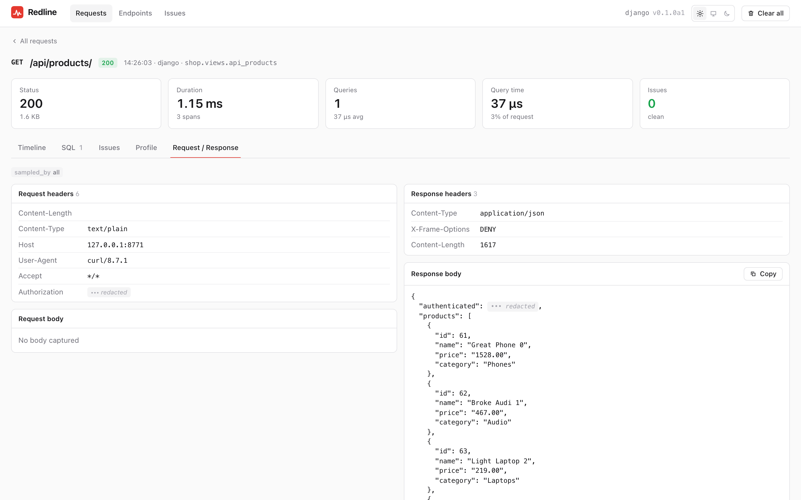{ .rl-shot .rl-only-light }
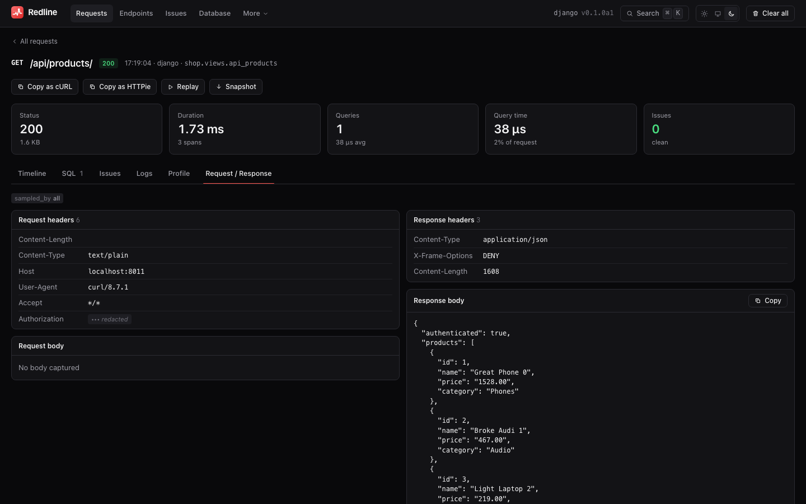{ .rl-shot .rl-only-dark }

Trace tags as pills, then request headers, query parameters, the request body, response
headers and the response body. Masked values are shown as a distinct **redacted**
marker, a **truncated** pill flags a body cut at `max_body_bytes`, and JSON bodies are
pretty-printed with a copy button. See [Security](security.md#redaction).

## The EXPLAIN drawer

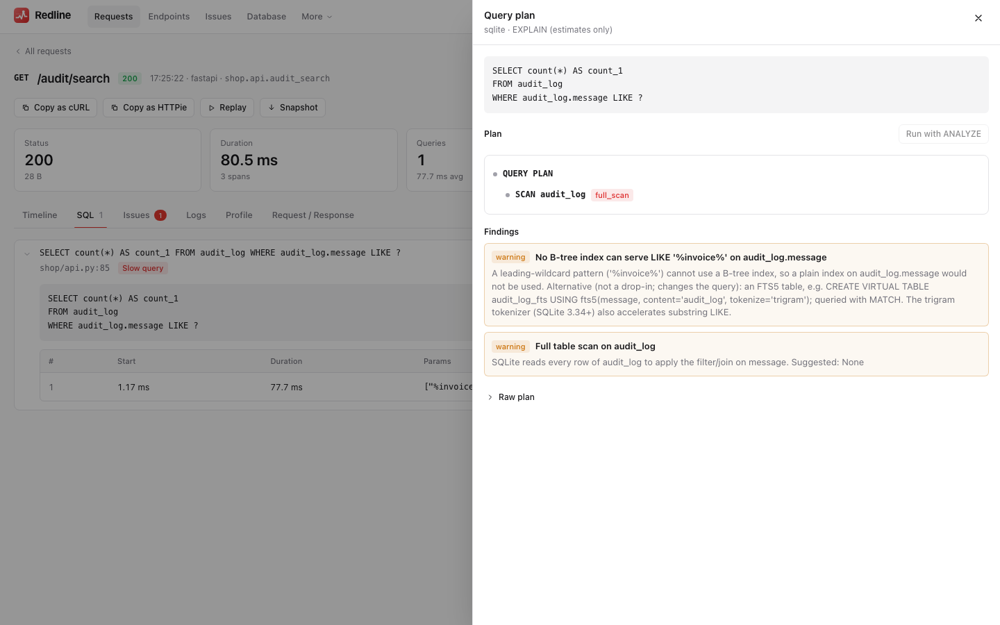{ .rl-shot .rl-only-light }
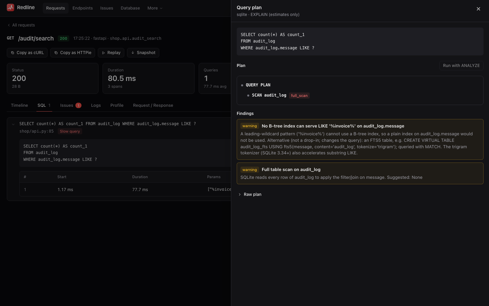{ .rl-shot .rl-only-dark }

Opens when you click **Explain**, and immediately runs an estimate-only `EXPLAIN`. It
shows the plan as a tree (with cost and row estimates and flag chips), the findings,
the suggested `CREATE INDEX` statements with **Copy SQL**, and a **Raw plan** toggle.
**Run with ANALYZE** is always visible; if `explain_analyze` is off, the drawer explains
that instead of running it. See [EXPLAIN](explain.md).

## Endpoints

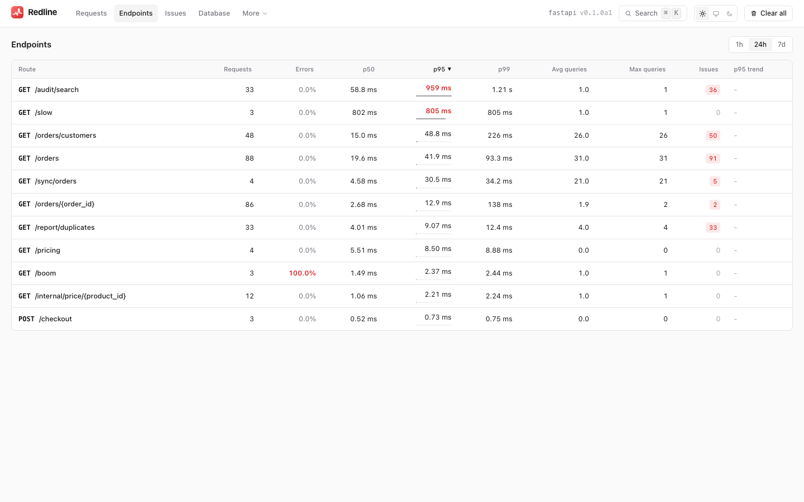{ .rl-shot .rl-only-light }
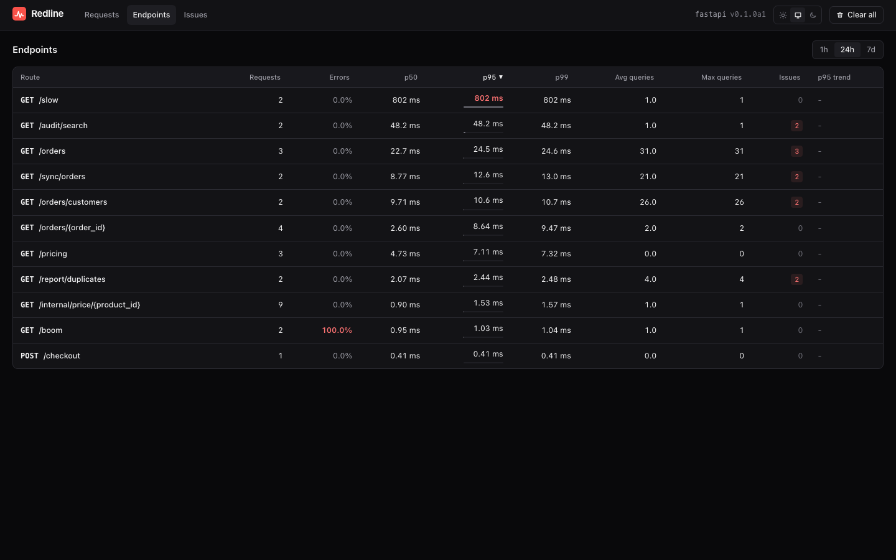{ .rl-shot .rl-only-dark }

A table of every route and method seen in the window (1 h, 24 h or 7 d): request count,
error rate, p50, p95, p99, average and maximum queries, issue count and a p95 trend
sparkline. Click a column header to sort. Percentiles and rates are defined in
[Issues and endpoints](issues-and-endpoints.md#endpoints).

## Issues

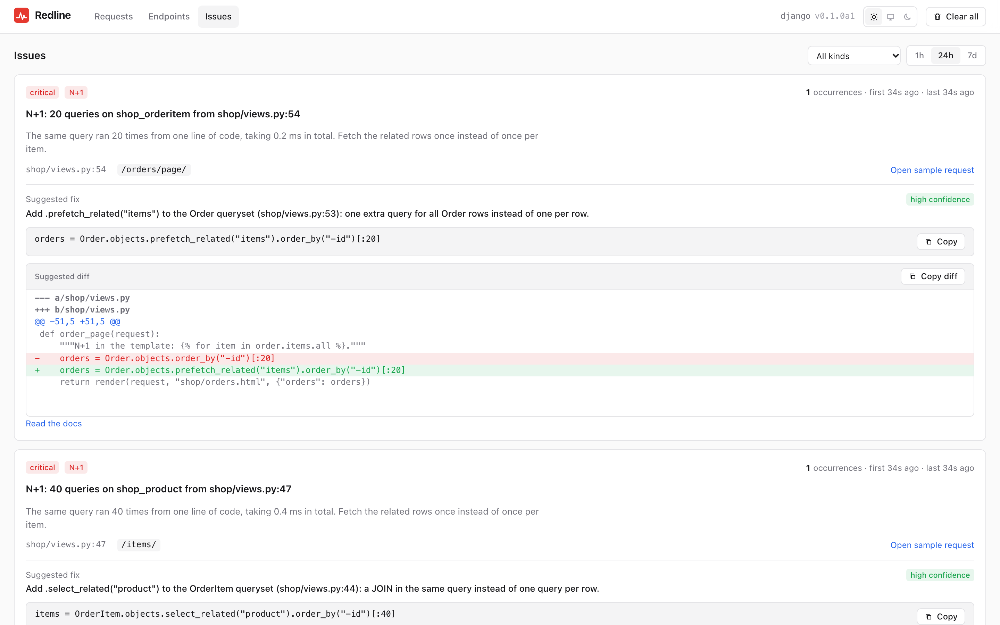{ .rl-shot .rl-only-light }
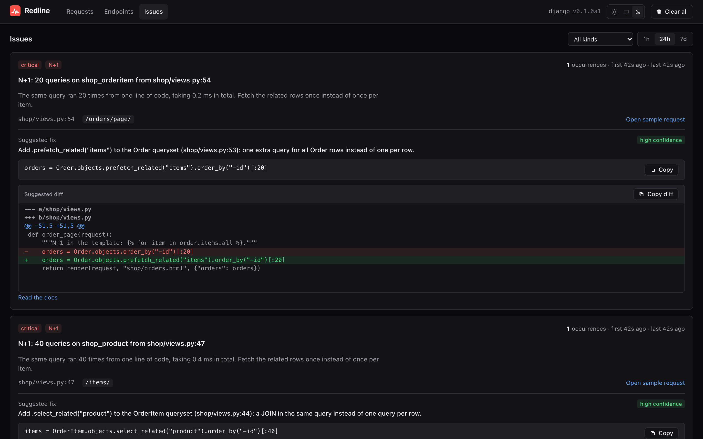{ .rl-shot .rl-only-dark }

Problems deduplicated across requests: severity, kind, occurrences, first and last seen,
the routes affected, the callsite and the suggested fix. **Open sample request** jumps
to the latest occurrence. Filter by kind and window.

## Open in editor

Every callsite in the UI (the span drawer, issue cards, exception frames, log rows) is a
link that opens the file **at that line in your editor**. Choose the editor with the
`editor` setting:

| `editor` | Opens in |
|---|---|
| `"vscode"` (default) | Visual Studio Code |
| `"cursor"` | Cursor |
| `"pycharm"` | PyCharm |
| `"idea"` | IntelliJ IDEA |
| `"sublime"` | Sublime Text |
| `"none"` | no links |
| a template | your own URL, containing `{file}` (an **absolute** path) and `{line}` |

```python
REDLINE = {"EDITOR": "cursor"}
REDLINE = {"EDITOR": "myeditor://open?path={file}&line={line}"}
```

The absolute path is built from `project_root`, which `GET api/meta` reports. If the server
runs in a container or on another machine, the paths on its disk are not your paths: set
`project_root` to what your editor sees, or use `"none"`.

## Copy as cURL and HTTPie

The request detail header has **Copy as cURL** and **Copy as HTTPie**. They build a command
from the recorded method, path, query, headers and body, aimed at the origin you are
viewing the UI from. Redacted headers and body values are replaced by shell variables with
a note saying which to fill in, so a secret is never invented and `[redacted]` is never
sent.

## Replay

**Replay** sends the request again, from your browser, so you can see whether a fix helped
or reproduce an error. A dialog shows the method, URL, headers and body; values that were
redacted must be **re-entered** by you. You can ask for a flamegraph of the replay.

- It uses `fetch` from the page, to the same origin, with **your** cookies: the server sees
  an ordinary request from you, with your permissions.
- The request carries `X-Redline-Replay-Of: <trace id>`. Redline turns it into the tag
  `replay_of`, so replays are findable (`GET api/traces?replay_of=<id>`) and compare cleanly
  with the original.
- Replaying a `POST`, `PUT` or `DELETE` **runs it again**. There is no undo.
- It can be turned off with the `replay` [feature switch](access-control.md#feature-switches).

## Compare two requests

Press `x` on two rows in the Requests list, then `c`. The page at `#/compare/<a>/<b>`
shows:

- the difference in duration, query count and query time;
- time by span kind, side by side;
- the SQL fingerprints that changed, sorted by the biggest time difference;
- issues only in A, only in B, and in both.

Typical use: replay a request after a fix and compare the replay with the original. The
data comes from `GET api/compare?a=&b=`. To compare whole releases rather than two requests,
see [History](history.md#before-and-after-comparing-periods).

## Snapshots

**Download snapshot** saves a trace as one standalone HTML file: the whole UI bundle inlined,
with the trace (and its profile) embedded. Open it in any browser, offline, with no Redline
running: attach it to a ticket, send it to a colleague, keep it as evidence. It is
read-only; actions that need a server (Explain, Replay) are not available in it. The
button is hidden when the `snapshot` feature is off, and the profile is left out when the
`profile` feature is off.

!!! warning "A snapshot contains the trace as stored"

    It holds the same data as the UI: SQL, parameters (redacted), bodies (redacted), source
    lines and exception locals. Treat the file with the care you would give the trace
    itself. See [Security](security.md).

## The floating badge

In development, HTML pages carry a small pill with the request's duration, query count and
issue count that links to the trace. See [Server-Timing and the badge](server-timing-badge.md).

## Aggregate pages

Pages that look across many requests rather than one:

| Page | Shows | Details |
|---|---|---|
| **Database** | SQL search by fingerprint, index advisor, unused indexes | [Database](database.md) |
| **Cache** | hit rate, unread writes and stampedes per key pattern | [Cache efficiency](cache-efficiency.md) |
| **External** | outbound HTTP by host and URL pattern: latency, duplicates, retries | [External calls](external-calls.md) |
| **History** | latency, errors and queries over time, release markers, before/after compare | [History](history.md) |
| **Load** | load-test runs, an RPS vs p95 vs errors chart with the knee, bottlenecks per step, a start form when enabled | [Load testing](load-testing.md) |

Each has a window picker like the one on Endpoints. A page whose data the current store
cannot provide (a custom store) says so instead of failing.

## Login and the Settings page

When the instance uses `access = "token"` or `"basic"` and you are not signed in, the API
answers `401 login_required` and the UI shows a **login screen**: a token field, or a
username and password for `basic`. It posts to `api/login` and reloads. **Log out** (in the
header and the command palette) appears when a login is in use. The page shell itself is
public; every `api/` call needs credentials, and the UI sends `X-Redline-UI: 1` so the
browser shows no native dialog.

The **Settings** page (`#/settings`, in the More menu and the palette) is a read-only view
of the effective configuration, grouped, with a chip showing where each value came from and
the warnings: `GET api/config`, including the settings you gave in code, which
`redline config` cannot see. Secrets show as `***`.

The UI hides what is switched off: `features` hide Explain, the Profile tab, Replay,
snapshot download, the Load page, the Logs tab, locals and Live mode, and `read_only` hides
Clear all, ANALYZE and the run controls. **Replay** only sends requests to the same origin
as the UI; a path that points at another origin is refused. See
[Access control](access-control.md) and [Configuration](configuration.md).

## On a phone

The layout is responsive: the navigation wraps under the logo, columns drop out of the
tables below breakpoints (p50, p99 and the query columns hide first).

## What the UI does not do

- It does not edit your application: the mutating actions are **Clear all**, **Replay**, running
  an EXPLAIN, and (when `load_from_ui` is on) starting or stopping a load run.
- It cannot delete a single request (the API can: `DELETE api/traces/<id>`).
- It has no saved filters and no sharing links to filtered views. Its login screen is a front
  for the [access control](access-control.md) policy, not an account system.
